# A Decision-Focused Learning Framework for Multistage Stochastic Programs, with Application to Power Network Operations under Stochastic Component Failures

[](#installation)
[](LICENSE)

This repository holds the code, the stored results and the SLURM job scripts of the paper with this title. A decision-focused learning (DFL) policy, a neural network trained on single-scenario MIP solutions, decides which failed generators and lines of a DC power network to repair at each of 14 stages after a severe-weather event, with and without a per-stage repair budget, on a synthetic 5-bus network and on the IEEE 14-bus network of PGLib-OPF (case14). The baselines (NoRepair, AlwaysRepair, Near-sighted MPC, multistage SAA, SDDiP, and an exact dynamic program for the 5-bus network) are included, and every reported number and figure can be recomputed in seconds from the stored results.

| [Verify the reported numbers](#quick-start) | [Understand the method](#the-problem) | [Rerun the experiments](#reproducing-the-experiments) | [Apply the code to another network](#applying-the-code-to-another-network) |
|:-:|:-:|:-:|:-:|
| 112 checks in about 3&nbsp;s, no solver | the problem, the DFL policy, the baselines | single runs on a laptop, or the full pipeline on a SLURM cluster | any PGLib-OPF case, with `--network` |

<p align="center">
  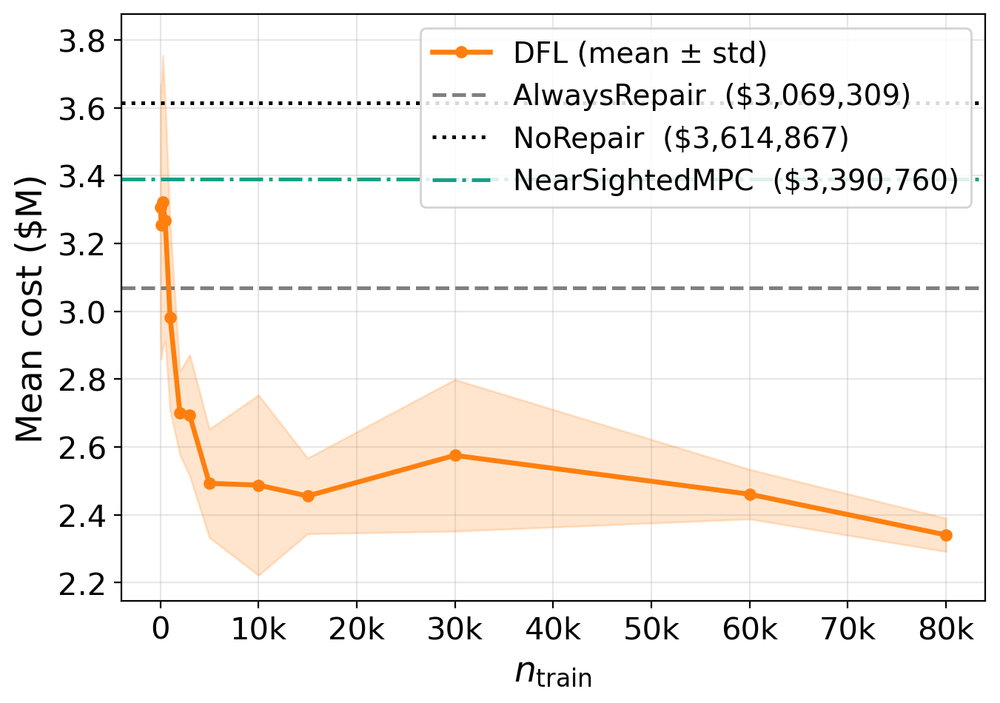
</p>
<p align="center"><em>Mean cost of DFL on the IEEE 14-bus network (case14) at repair-cost scale s = 55 with a per-stage repair budget (budget fraction 0.3), over 500 test scenarios, against the number of training scenarios. The band spans ± one standard deviation across five initializations. At 80,000 training scenarios DFL costs 23.3% less than AlwaysRepair.</em></p>

**Contents:** [The framework in brief](#the-framework-in-brief) · [Key results](#key-results) · [Quick start](#quick-start) · [The problem](#the-problem) · [The DFL policy](#the-dfl-policy) · [Baselines and the exact optimum](#baselines-and-the-exact-optimum) · [Results](#results) · [Installation](#installation) · [Reproducing the experiments](#reproducing-the-experiments) · [Applying the code to another network](#applying-the-code-to-another-network) · [Repository guide](#repository-guide) · [Computational details](#computational-details) · [Tests](#tests) · [License](#license) · [Citation](#citation)

## The framework in brief

A multistage stochastic program takes a decision $`\delta_t \in \mathcal{D}_t(x_t, \xi_t)`$ at each stage $`t = 1, \dots, T`$ after the random outcome $`\xi_t`$ is revealed, and moves to the state $`x_{t+1} = f_t(x_t, \delta_t, \xi_t)`$. Its value functions satisfy

```math
\mathcal{V}_t(x_t) = \mathbb{E}_{\xi_t}\Big[\min_{\delta_t \in \mathcal{D}_t(x_t, \xi_t)} \big\{ c_t(x_t, \delta_t, \xi_t) + \mathcal{V}_{t+1}\big(f_t(x_t, \delta_t, \xi_t)\big) \big\}\Big],
\qquad \mathcal{V}_{T+1} \equiv 0 .
```

The framework assumes that the decision splits as $`\delta_t = (\delta_t^0, u_t)`$, where only the sub-decision $`u_t`$ drives the state and enters the cost linearly:

```math
f_t(x_t, \delta_t, \xi_t) = f_t(x_t, u_t, \xi_t),
\qquad
c_t(x_t, \delta_t, \xi_t) = c_t^0(x_t, \delta_t^0, \xi_t) + \beta_t^\top u_t .
```

The continuation value is then replaced by a function linear in $`u_t`$, whose coefficients a neural network $`\pi_{\boldsymbol{\psi}}`$ predicts from the observed state, and each stage solves a surrogate problem in $`u_t`$, followed by the inner problem $`Q_t^0`$ for $`\delta_t^0`$:

```math
\begin{aligned}
\mathcal{V}_{t+1}\big(f_t(x_t, u_t, \xi_t)\big) &\approx h_t(x_t, \xi_t) - \boldsymbol{\mu}_t^\top u_t,
\qquad \boldsymbol{\mu}_t = \pi_{\boldsymbol{\psi}}(x_t, \xi_t),\\[4pt]
u_t &\in \arg\min_{u \in \mathcal{U}_t(x_t, \xi_t)} \big\{ Q_t^0(x_t, u, \xi_t) + (\beta_t - \boldsymbol{\mu}_t)^\top u \big\}.
\end{aligned}
```

The network is trained offline on perfect-information decisions $`u_s^{*,t}`$, the solutions of single-scenario MIPs, with the Fenchel-Young loss of the perturbed optimizer, whose gradient is the smoothed decision minus the label:

```math
\min_{\boldsymbol{\psi}}\ \sum_{s,t} L_\varepsilon\big(\pi_{\boldsymbol{\psi}}(x_s^t, \xi_s^t);\ u_s^{*,t}\big),
\qquad
\nabla_{\boldsymbol{\mu}} L_\varepsilon(\boldsymbol{\mu};\, u^*) = \hat u_\varepsilon(\boldsymbol{\mu}) - u^*,
\qquad
\hat u_\varepsilon(\boldsymbol{\mu}) = \mathbb{E}_{Z}\Big[\arg\max_{u \in \mathcal{Y}}\ (\boldsymbol{\mu} + \varepsilon Z)^\top u\Big].
```

In the application, $`x_t`$ is the availability of the generators and lines, $`\xi_t`$ the failures of the stage, $`u_t`$ the repair vector $`r^t`$ with cost $`\beta^\top r^t`$, and $`\delta_t^0`$ the DC-OPF dispatch with cost $`Q^0(a^t)`$. [The problem](#the-problem) and [The DFL policy](#the-dfl-policy) give the details.

## Key results

Three configurations are reported, each with and without the budget: the 5-bus network at repair-cost scale $`s = 100`$, and case14 at $`s = 45`$ and $`s = 55`$. The scale $`s`$ multiplies every repair cost, and the budget caps the repair spend of each stage at the fraction $`\varphi = 0.3`$ of the cost of repairing every component. Costs are means over 500 common test scenarios.

<p align="center">
  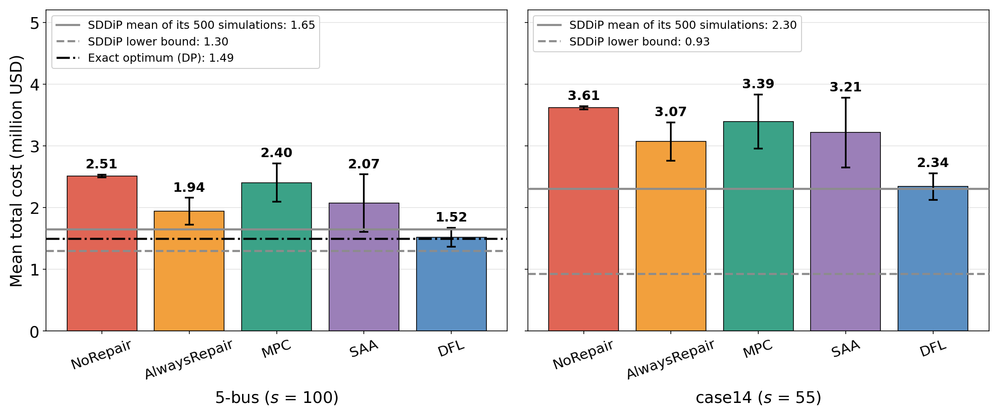
</p>
<p align="center"><em>Mean total cost with the repair budget (budget fraction 0.3) on the 5-bus network at s = 100 and on case14 at s = 55. The first five bars are scored on the 500 common test scenarios, DFL at the best training size of its sweep, and the whiskers span ± one across-scenario standard deviation (for DFL, averaged over its five initializations). The dash-dot line on the 5-bus network is the exact optimum from dynamic programming (<a href="#distance-to-the-exact-optimum">Distance to the exact optimum</a>).</em></p>

[Results](#results) gives the cost tables of all six configurations, the distance to the exact optimum, the sample complexity, the repair-cost sensitivity and the deployment times.

## Quick start

Run every command from the repository root. The commands need a Python 3.11 interpreter on the `PATH` as `python3.11` ([Installation](#installation) explains what to do if there is none).

```bash
python3.11 -m venv .venv
source .venv/bin/activate
# On Linux, first install the CPU build of PyTorch (avoids about 3 GB of CUDA wheels):
# pip install torch==2.14.1 --index-url https://download.pytorch.org/whl/cpu
pip install -r requirements-lock.txt
python paper/reproduce_paper_numbers.py      # 112 checks, about 3 s
```

The last command recomputes the reported numbers from the stored results in [`experiments/`](experiments) and ends with `All checks agree with the paper.` [Results](#results) names the values it does not cover. Its first run downloads the PGLib-OPF case14 file, which needs internet access once.

### Tasks at a glance

| Task | Command | Time |
|---|---|---|
| Check the installation | `python verify_installation.py` | about 1 s |
| Run all quick checks | `bash scripts/quick_check.sh` | about 1 min |
| Recompute the reported numbers (112 checks) | `python paper/reproduce_paper_numbers.py` | about 3 s |
| Redraw the figures | `python paper/make_paper_figures.py --out /tmp/figures` | about 3 s |
| Solve the exact DP (5-bus network, both variants) | `python exact_dp/exact_dp_toy.py` | about 2 s |
| Run the unit tests | `python -m pytest -q tests` | about 15 s |
| Train and evaluate a tiny DFL policy (smoke test: 10 training scenarios, $`s = 1`$) | `python Pseudo_DFL_main.py --test --output-dir /tmp/dfl_test` | about 40 s |
| Rerun the full experiments | job scripts in [`scripts/slurm/`](scripts/slurm), see [Level 3](#level-3-the-full-pipeline-on-a-slurm-cluster) | more than 4,000 hours of 64-core jobs |

All rows except the last need only the Python environment. The quick checks and the reproduction script read the PGLib-OPF case14 file, which is downloaded once, and the unit tests use GLPK when it is installed. The full experiments need a SLURM cluster, a Gurobi license for SAA, and Julia for SDDiP, which installs itself on first use. Single jobs run for up to 117 h 36 min (`--time=117:36:00`). The laptop times were measured on Apple Silicon with Python 3.11 and `requirements-lock.txt`.

## The problem

An operator runs a transmission network for 14 stages after the onset of a severe-weather event. At every stage, each generator and line in service fails with a probability that peaks at the first stage and then decays, and failures are independent across components and stages. The operator observes the failures, dispatches the network that remains, and decides which failed components to repair. Repairs are binary and change the network for all later stages, so minimizing the expected total cost of generation, load shedding and repairs is a multistage stochastic mixed-integer program.

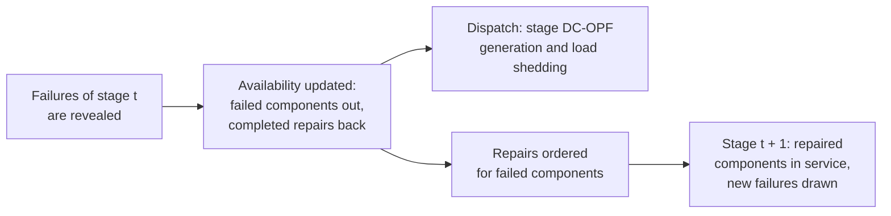

<p align="center"><em>One stage t. Only the repairs carry over to the next stage; the dispatch affects the cost of the current stage alone.</em></p>

A component whose repair completes at a stage is not exposed to the failures of that stage. Dispatch and repairs use only the failures observed so far, so every policy is non-anticipative.

Notation: stages are numbered $`t = 1, \dots, T`$ with $`T = 14`$. The index $`k`$ runs over the $`N_G`$ generators and then the $`N_E`$ lines, so the availability $`a^t = (a_g^t, a_e^t)`$, the failure events $`\xi^t`$ and the repairs $`r^t`$ are vectors in $`\{0,1\}^{N_G+N_E}`$, with $`a^t[k] = 1`$ when component $`k`$ is in service. $`\odot`$ is the element-wise product, inequalities between vectors hold element-wise, and $`\mathbf{1}`$ and $`\mathbf{0}`$ are the all-ones and all-zeros vectors.

### Failures

Failure events are independent across components and stages, with $`\xi^t[k] \sim \mathrm{Bernoulli}(\lambda^t[k])`$. An event fails component $`k`$ only if it is in service, so $`\lambda^t[k]`$ is the failure probability of an operational component. Its logit is a log-linear function of the stage, scaled so that the curve peaks at stage $`t^*`$ with value $`p_{\max}[k]`$:

```math
\mathrm{logit}\,\lambda^t[k] \;=\; \mathrm{logit}\bigl(p_{\max}[k]\bigr)\,
\frac{(t^* + K)\ln(t + K) - t}{(t^* + K)\ln(t^* + K) - t^*},
\qquad
\mathrm{logit}\,p = \ln\frac{p}{1 - p}
```

The fraction equals 1 at $`t = t^*`$, has zero slope there and decreases afterwards, so for $`p_{\max}[k] > 1/2`$ the probability peaks at stage $`t^*`$ with value $`p_{\max}[k]`$ and then decays towards zero. The experiments use $`K = 1.5`$ and $`t^* = 1`$. With $`t^* = 1`$, the denominator is $`(1 + K)\ln(1 + K) - 1`$, which is positive for $`K`$ above about 0.763 and equals 1.29 at $`K = 1.5`$. Each component is *standard*, with $`p_{\max}[k] \sim \mathcal{U}[0.55, 0.70]`$, or *elevated*, with $`p_{\max}[k] \sim \mathcal{U}[0.80, 0.90]`$, with probability 1/2 each. The class and $`p_{\max}[k]`$ of a component are drawn once with the model seed, 42 in all experiments. The curve is a synthetic choice and is not calibrated to weather data. `ModelParameters` in [`model_parameters.py`](model_parameters.py) computes it, with the constants in [`config.py`](config.py).

<p align="center">
  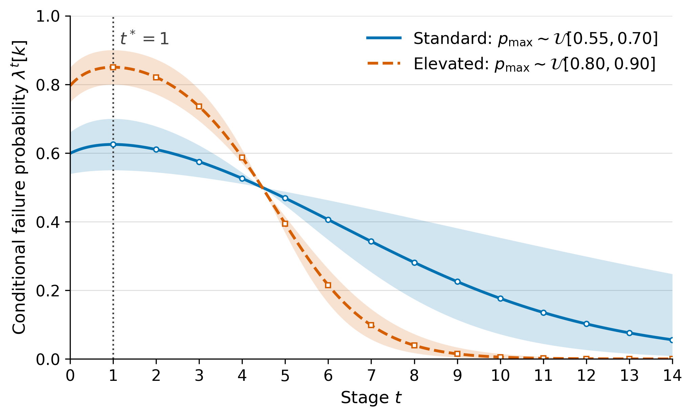
</p>
<p align="center"><em>Failure probability of an in-service component over the 14 stages, for the two vulnerability classes (K = 1.5, t<sup>*</sup> = 1). Each curve uses the midpoint of its class's p<sub>max</sub> range, and the band spans the range.</em></p>

### Availability and repairs

A failure takes an operational component out of service, and a repair ordered at stage $`t`$ brings it back at stage $`t + \tau`$:

```math
a^t[k] =
\left\{
\begin{array}{lll}
0 & \text{if } a^{t-1}[k] = 1 \text{ and } \xi^t[k] = 1 & \text{(new failure)},\\[2pt]
1 & \text{if } a^{t-1}[k] = 0 \text{ and } r^{t-\tau}[k] = 1 & \text{(repair completes)},\\[2pt]
a^{t-1}[k] & \text{otherwise}
\end{array}
\right.
```

Every component is in service before the event, $`a^0 = \mathbf{1}`$, and no repair is ordered before the first stage, so $`a^1 = \mathbf{1} - \xi^1`$. The rollouts in [`Pseudo_DFL_solver.py`](Pseudo_DFL_solver.py) apply the rule in vector form, $`a^t = a^{t-1} \odot (\mathbf{1} - \xi^t) + (\mathbf{1} - a^{t-1}) \odot r^{t-\tau}`$. All experiments use $`\tau = 1`$. The MIPs of the DFL labels, SAA and SDDiP also handle $`\tau > 1`$, but the inputs of the DFL network contain no repair pipeline, so the learned policy assumes $`\tau = 1`$.

### Dispatch at each stage

Given the availability $`a^t`$, the operator dispatches the network with a DC optimal power flow (DC-OPF) with explicit line flows and load shedding. Its optimal value $`Q^0(a^t)`$ is the dispatch cost of the stage:

```math
\begin{aligned}
Q^0(a^t) \;=\; \min_{p_g^t,\,\theta^t,\,f^t,\,d^t}\quad
& c^\top p_g^t + \alpha\,\mathbf{1}^\top\big(p_l - d^t\big)\\
\text{s.t.}\quad
& C f^t = S_g\,p_g^t - S_l\,d^t,\\
& {-(\mathbf{1} - a_e^t)\odot M} \le f^t - \mathrm{diag}(b)\,C^\top\theta^t \le (\mathbf{1} - a_e^t)\odot M,\\
& a_e^t \odot \underline{f} \le f^t \le a_e^t \odot \overline{f},\\
& \mathbf{0} \le p_g^t \le a_g^t \odot \overline{p}_g,
\qquad \mathbf{0} \le d^t \le p_l,\\
& {-\theta^{\max}\mathbf{1}} \le \theta^t \le \theta^{\max}\mathbf{1},
\qquad \theta^t[\mathrm{ref}] = 0,\\[4pt]
\text{where}\quad
& M_j = 2\,\theta^{\max} b_j \ \text{ for every line } j,
\qquad \theta^{\max} = \pi
\end{aligned}
```

The availability of a line decides its flow:

```math
f^t[j] =
\begin{cases}
b_j\big(\theta^t[\mathrm{from}(j)] - \theta^t[\mathrm{to}(j)]\big) & \text{if line } j \text{ is available},\\[2pt]
0 & \text{if line } j \text{ has failed (its end angles are then free)}
\end{cases}
```

Here $`p_g^t`$, $`\theta^t`$ and $`f^t`$ are the generator outputs, the voltage angles of the buses and the line flows, and $`d^t`$ is the served demand. $`c`$ is the generation cost, $`\overline{p}_g`$ the generator capacity, $`\underline{f} = -\overline{f}`$ and $`\overline{f}`$ the flow limits of the lines, $`\alpha`$ the value of lost load, $`p_l`$ the demand and $`\mathrm{ref}`$ the reference bus. $`C`$ is the bus-line incidence matrix (+1 where a line leaves a bus, −1 where it enters), $`S_g`$ and $`S_l`$ place generators and loads at buses, and $`\mathrm{diag}(b)`$ holds the line susceptances (the paper calls this matrix $`B`$, a letter kept here for the repair budget). The vector $`M`$ holds the big-M constant of each line, unrelated to the number $`M`$ of perturbations under [Training](#training).

For a failed line, the flow bounds force zero flow, and the big-M rows only require $`\lvert b_j(\theta^t[\mathrm{from}(j)] - \theta^t[\mathrm{to}(j)])\rvert \le 2\theta^{\max} b_j`$, which the angle bounds already imply. A failed line therefore does not couple its end angles, and for a given availability the stage problem is the DC-OPF of the energized subnetwork. A failed generator produces nothing, and since minimum outputs are zero, every availability pattern has a feasible dispatch.

The demand is the same at every stage, so $`Q^0`$ depends on the availability only, which the exact DP and Near-sighted MPC exploit. `StagewiseOPF` in [`Pseudo_DFL_stage_opf.py`](Pseudo_DFL_stage_opf.py) solves this LP in every rollout, and the tests of [`test_bigM_validity.py`](tests/README.md#test_bigm_validitypy-2-tests) check the big-M model against a DC-OPF on the surviving subnetwork.

### Objective, repair costs and budget

The operator minimizes the expected total cost over all non-anticipative policies, in which the decisions of stage $`t`$ depend on the failures up to stage $`t`$ only:

```math
\begin{aligned}
\min_{\text{non-anticipative policies}}\quad
& \mathbb{E}\Bigg[\sum_{t=1}^{T}\Big(c^\top p_g^t + \alpha\,\mathbf{1}^\top\big(p_l - d^t\big) + \beta^\top r^t\Big)\Bigg]\\
\text{s.t.}\quad
& a^t \text{ follows the availability transition from } a^0 = \mathbf{1},\\
& \big(p_g^t, \theta^t, f^t, d^t\big) \text{ is feasible for the stage DC-OPF at } a^t,\\
& r^t \in \{0,1\}^{N_G+N_E},\quad r^t \le \mathbf{1} - a^t,\qquad t = 1,\dots,T
\end{aligned}
```

The expectation runs over the failure process, and only failed components can be repaired. The dispatch does not influence later stages, so each stage contributes its dispatch cost $`Q^0(a^t)`$ plus its repair cost $`\beta^\top r^t`$, and this is how every rollout adds up the cost. The value of lost load is $`\alpha = 1{,}000`$ USD per MWh. Each stage is priced as one hour of operation, so the load shed of a scenario, summed over its 14 stages, is in MWh. Repair costs are proportional to capacity, the maximum output $`\overline{p}_g`$ of a generator and the thermal limit $`\overline{f}`$ of a line. In the budgeted variant, the repair spend of every stage may not exceed $`B`$, the fraction $`\varphi`$ of the cost of repairing all components at once:

```math
\begin{aligned}
\beta_g[i] &= 550\,s\,\frac{\overline{p}_g[i]}{\mathrm{mean}(\overline{p}_g)},
\qquad
\beta_e[j] = 350\,s\,\frac{\overline{f}[j]}{\mathrm{mean}(\overline{f})},\\[6pt]
B &= \varphi\,\mathbf{1}^\top\beta = \varphi\,s\,\big(550\,N_G + 350\,N_E\big),
\qquad \beta^\top r^t \le B \ \text{ at every stage}
\end{aligned}
```

The repair-cost scale $`s`$ sets how expensive repairs are relative to load shedding: a generator repair costs $`550\,s`$ USD and a line repair $`350\,s`$ USD on average, and a generator with zero capacity, such as a synchronous condenser of case14, is repaired for free. The experiments use $`s = 100`$ on the 5-bus network and $`s = 45`$ and $`s = 55`$ on case14, chosen with the [repair-cost sweep](#repair-cost-sensitivity), and $`\varphi = 0.3`$, which gives budgets of 85,500, 131,625 and 160,875 USD per stage. Unspent budget is not carried over, so the budget adds no state variable, but it couples the repair decisions of a stage. [`model_parameters.py`](model_parameters.py) sets the costs and the budget.

### Test networks

<p align="center">
  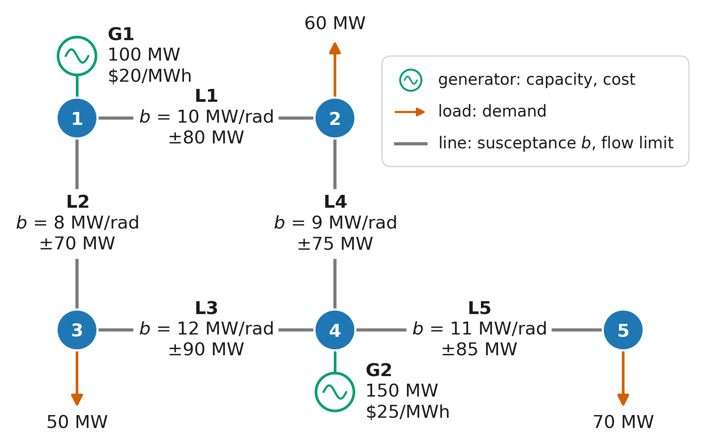
</p>
<p align="center"><em>The synthetic 5-bus network (<code>toy</code> in the code): generators with capacity and generation cost, loads with demand, and lines with susceptance b and flow limit. Bus 1 is the reference bus, and all seven generators and lines can fail.</em></p>

| Name in code | Network | Buses | Generators | Lines | Loads | Load / capacity | Notes |
|---|---|--:|--:|--:|--:|---|---|
| `toy` | synthetic 5-bus | 5 | 2 | 5 | 3 | 180 MW / 250 MW | built in |
| `case14` | IEEE 14-bus from PGLib-OPF | 14 | 5 | 20 | 11 | 259 MW / 399 MW | downloaded on first use. Three of its five generators are synchronous condensers with zero active-power capacity, and all 20 branches, transformers included, can fail |

The generator, line and load data of the 5-bus network, its repair costs at $`s = 100`$ and the peak failure probabilities drawn with seed 42 are listed in [exact_dp/README.md](exact_dp/README.md#the-model).

## The DFL policy

DFL replaces the expected cost of the future, which cannot be computed for this problem, by a function that is linear in the repair vector. A neural network maps the availability after the failures and the normalized stage $`t/T`$ to one coefficient per component, the net benefit of repairing it: the expected reduction of the future cost minus the repair cost. The construction applies to any multistage stochastic program in which one sub-decision alone drives the state transition and enters the stage cost linearly. Here that sub-decision is the repair vector, since the dispatch does not change the availability of later stages.

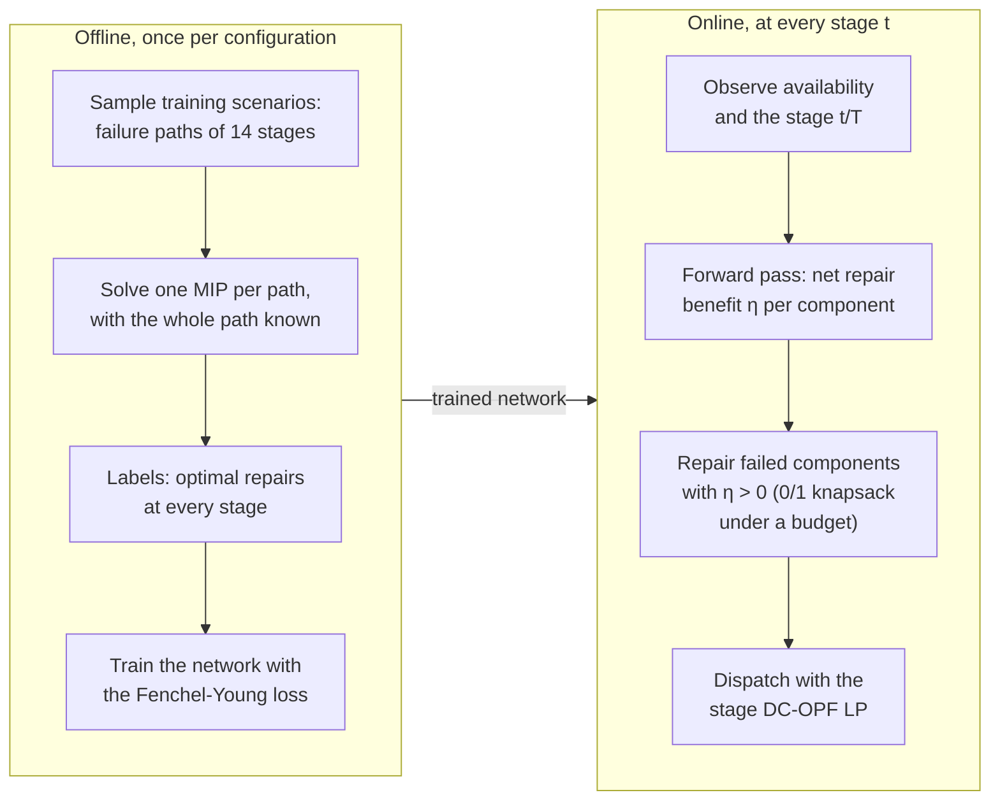

<p align="center"><em>Training happens once per network, repair-cost scale and variant; a deployed decision needs one forward pass, one LP and, under a budget, a small knapsack.</em></p>

### Decision rule

The expected future cost after the repairs of stage $`t`$ is approximated by a function that is linear in the repair vector:

```math
\mathbb{E}\Big[\,\mathcal{V}_{t+1}\big(a^{t+1}\big) \;\Big|\; \xi^1,\dots,\xi^t,\ r^t\Big]
\;\approx\; h_t(a^t) - (\boldsymbol{\mu}^t)^\top r^t
```

$`\mathcal{V}_{t+1}`$ is the optimal expected cost from stage $`t + 1`$ on, $`\boldsymbol{\mu}^t[k]`$ is the expected reduction of that cost from starting the repair of component $`k`$ at stage $`t`$, and $`h_t(a^t)`$ collects the part that does not depend on the repairs. The dispatch cost $`Q^0(a^t)`$ does not depend on $`r^t`$ either, so the stage problem keeps only the repair cost and the linear term:

```math
\begin{aligned}
r^t &\in \arg\max_{r \in \{0,1\}^{N_G+N_E}}\ \big(\boldsymbol{\mu}^t - \beta\big)^\top r
\quad\text{s.t.}\quad r \le \mathbf{1} - a^t,\\[4pt]
\eta^t &= \boldsymbol{\mu}^t - \beta = \pi_{\boldsymbol{\psi}}\big(a_g^t,\ a_e^t,\ t/T\big)
\end{aligned}
```

The network $`\pi_{\boldsymbol{\psi}}`$, with weights $`\boldsymbol{\psi}`$, predicts the net repair benefit $`\eta^t`$ directly. The code calls this output `theta` (`RepairNetwork` in [`Pseudo_DFL_model.py`](Pseudo_DFL_model.py)); this README writes $`\eta`$, because $`\theta`$ denotes the voltage angles. Without a budget, the stage problem separates by component, and a failed component is repaired exactly when its net benefit is positive:

```math
r^t[k] =
\begin{cases}
1 & \text{if } a^t[k] = 0 \text{ and } \eta^t[k] > 0,\\
0 & \text{otherwise}
\end{cases}
```

With the budget, the stage problem is a 0/1 knapsack with values $`\eta^t[k]`$, weights $`\beta[k]`$ and capacity $`B`$, over the feasible set $`\mathcal{Y}_t`$:

```math
r^t \in \arg\max_{r \in \mathcal{Y}_t}\ (\eta^t)^\top r,
\qquad
\mathcal{Y}_t = \big\{ r \in \{0,1\}^{N_G+N_E} : r \le \mathbf{1} - a^t,\ \beta^\top r \le B \big\}
```

`budgeted_argmax` in [`knapsack.py`](knapsack.py) solves it exactly by depth-first branch and bound, and only failed components with $`\eta^t[k] > 0`$ can enter.

### Training

Each training scenario is a sampled 14-stage failure path. Its single-scenario MIP, with the budget constraint in the budgeted variant, sees the whole path in advance and gives the optimal repairs $`r_i^{*,t}`$ at every stage of scenario $`i`$, solved to a relative gap of $`10^{-6}`$. These perfect-information decisions are the labels. Every stage of every solved scenario gives one training row, whose input is the availability $`a_i^{*,t}`$ along the MIP's own optimal trajectory, together with $`t/T`$ ([`Pseudo_DFL_data.py`](Pseudo_DFL_data.py)). Scenario $`i`$ is drawn with NumPy seed [42, i], so a smaller training set is a prefix of a larger one.

A label is a hard 0/1 decision, so the network is fitted through a smoothed decision, the expected decision when $`\eta`$ is perturbed by random noise of temperature $`\varepsilon`$:

```math
\begin{aligned}
\hat r_\varepsilon(\eta)[k] &= \sigma\big(\eta[k]/\varepsilon\big)\,\big(1 - a^t[k]\big)
  && \text{without a budget},\\[4pt]
\hat r_\varepsilon(\eta) &\approx \frac{1}{M}\sum_{m=1}^{M}\ \arg\max_{r \in \mathcal{Y}_t}\ \big(\eta + \varepsilon Z_m\big)^\top r,
  \quad Z_m \sim \mathcal{N}(0, I)
  && \text{with a budget}
\end{aligned}
```

Without a budget, the noise is logistic and the expectation has the closed form above, with the sigmoid $`\sigma(z) = 1/(1 + e^{-z})`$. With a budget, it is estimated from $`M`$ Gaussian perturbations, with one exact knapsack per draw, and the code uses this estimate. Only the values are perturbed, while the weights $`\beta`$ and the capacity $`B`$ stay fixed. The experiments use $`\varepsilon = 0.1`$ and $`M = 5`$. The code averages the loss over mini-batches $`\mathcal{I}`$ of 64 (scenario, stage) rows:

```math
\begin{aligned}
\mathcal{L}(\boldsymbol{\psi}) &= \frac{1}{\lvert\mathcal{I}\rvert}\sum_{(i,t) \in \mathcal{I}}
\Big(\mathrm{sg}\bigl[\hat r_\varepsilon(\eta_i^t)\bigr] - r_i^{*,t}\Big)^{\!\top} \eta_i^t,
\qquad \eta_i^t = \pi_{\boldsymbol{\psi}}\big(a_i^{*,t},\ t/T\big),\\[4pt]
\frac{\partial \mathcal{L}}{\partial \eta_i^t} &= \frac{1}{\lvert\mathcal{I}\rvert}\Big(\hat r_\varepsilon(\eta_i^t) - r_i^{*,t}\Big)
\end{aligned}
```

Here $`\hat r_\varepsilon`$ uses the availability $`a^t = a_i^{*,t}`$ of the row. The stop-gradient $`\mathrm{sg}[\cdot]`$ holds the smoothed decision constant (it is computed under `torch.no_grad()`), so back-propagation passes the Fenchel-Young gradient, smoothed decision minus label, to the network. The loss value itself is not the Fenchel-Young loss and can be negative; it is the value shown in the training logs. Under the budget, the Gaussian draws come from NumPy's unseeded global state, which is why budgeted reruns differ slightly ([Seeds and reproducibility](#seeds-and-reproducibility)). `FenchelYoungLoss` in [`Pseudo_DFL_model.py`](Pseudo_DFL_model.py) implements the loss, and [`Pseudo_DFL_training.py`](Pseudo_DFL_training.py) the training loop.

<details>
<summary>Why the gradient is the smoothed decision minus the label</summary>

For a linear objective over a finite feasible set $`\mathcal{Y}`$, perturbation defines a smooth convex function $`F_\varepsilon`$, its gradient $`\hat u_\varepsilon`$ and the Fenchel-Young loss $`L_\varepsilon`$:

```math
\begin{aligned}
F_\varepsilon(\eta) &= \mathbb{E}_{Z}\Big[\max_{u \in \mathcal{Y}}\ (\eta + \varepsilon Z)^\top u\Big],\\
\hat u_\varepsilon(\eta) &= \nabla F_\varepsilon(\eta) = \mathbb{E}_{Z}\Big[\arg\max_{u \in \mathcal{Y}}\ (\eta + \varepsilon Z)^\top u\Big],\\
L_\varepsilon(\eta;\, u^*) &= F_\varepsilon(\eta) + \varepsilon\,\Omega(u^*) - \eta^\top u^* \;\ge\; 0,\\
\nabla_\eta L_\varepsilon(\eta;\, u^*) &= \hat u_\varepsilon(\eta) - u^*
\end{aligned}
```

The regularizer $`\Omega`$, the convex conjugate of $`F_1`$, is fixed by the noise distribution and never has to be computed. For the repair problem, $`u`$ is the repair vector, $`u^*`$ the label and $`\mathcal{Y}`$ the feasible set of the stage problem, with or without the budget. Logistic noise gives the sigmoid of the unbudgeted closed form. Gaussian noise would give the normal distribution function instead, $`\Phi(\eta[k]/\varepsilon)\,(1 - a^t[k])`$, which is also the limit of the budgeted estimate as $`M`$ grows when the budget never binds. The paper develops this theory and its guarantees.

</details>

The reported runs use the settings below. In experiments/README.md, [Settings shared by all runs](experiments/README.md#settings-shared-by-all-runs) lists the settings common to all stored runs, [Run configuration](experiments/README.md#run-configuration) the full configuration snapshot, and [Trained models](experiments/README.md#trained-models) the initialization, the epoch budget and the epochs trained.

- Network: hidden layers of 128, 256 and 128 units with ReLU and dropout 0.3; 8 inputs and 7 outputs on the 5-bus network, 26 and 25 on case14.
- Optimizer: Adam (learning rate 1e-3, weight decay 1e-5), batch 64, gradient clipping at 1.0, a random 80/20 split of the rows, ReduceLROnPlateau on the validation loss (patience 200, factor 0.5) and early stopping (patience 330) with the best weights restored.
- Sweep: 15 training sizes from 25 to 120,000 scenarios, each trained from the init seeds 1, 2, 3, 4 and 42.

## Baselines and the exact optimum

DFL, NoRepair, AlwaysRepair, Near-sighted MPC and SAA are scored on the same 500 held-out test scenarios (seed 1000, drawn independently of the training scenarios). SDDiP is scored on its own policy simulations, and the exact DP gives the optimal expected cost of the 5-bus network.

| Method | Decision at each stage | Run with | Result key or folder |
|---|---|---|---|
| DFL | learned net benefit: threshold rule, or knapsack under the budget | [`Pseudo_DFL_main.py`](Pseudo_DFL_main.py) | `Pseudo_DFL` |
| NoRepair | never repairs | the DFL run | `NoRepair` |
| AlwaysRepair | repairs every failed component except at the last stage, cheapest first under the budget | the DFL run | `AlwaysRepair` |
| Near-sighted MPC | certainty-equivalent lookahead over a window of three stages | `--with-mpc` in the DFL run | `NearSightedMPC` |
| SAA | extensive-form MILP on a sampled scenario tree, nearest-child rollout | [`main.py`](main.py) | `SAA/` |
| SDDiP | SDDP.jl with Lagrangian cuts | [`SDDiP_main.py`](SDDiP_main.py) | `SDDiP/` |
| Exact DP | backward recursion over all states of the 5-bus network | [`exact_dp/exact_dp_toy.py`](exact_dp/exact_dp_toy.py) | `experiments/exact_dp_toy/` |

### NoRepair and AlwaysRepair

NoRepair never repairs. AlwaysRepair repairs every failed component at every stage except the last, where a repair could not complete within the horizon. With a budget, AlwaysRepair repairs the cheapest failed components first, as many as the budget allows, also except at the last stage.

### Near-sighted MPC

Near-sighted MPC is a certainty-equivalent receding-horizon controller (model predictive control, MPC) without learning, implemented as `NearSightedMPCRollout` in [`Pseudo_DFL_solver.py`](Pseudo_DFL_solver.py). At each stage it assigns every failed component either to one of the stages of a window of $`W = 3`$ stages at which its repair can still take effect, or to "never". It scores each such schedule by rolling the availability forward at the mean failure rates and pricing every window stage with a DC-OPF on the derated network. The score adds the repair costs and assigns zero value after the window. The controller then executes only the repairs of the current stage and replans at the next stage. Under a budget, schedules that overspend at any stage of the window are skipped.

All schedules are scored when there are at most $`3^7 = 2{,}187`$ of them, which with $`W = 3`$ holds at every stage with at most seven failed components, and therefore at every stage on the 5-bus network. Otherwise, the all-never schedule and 2,186 schedules sampled with a fixed seed are scored.

<details>
<summary>Near-sighted MPC in formulas: schedule count, rollout and schedule cost</summary>

With $`L_t = \min(W, T - t + 1)`$ stages in the window and $`F^t`$ the set of failed components, a repair can be ordered at one of $`L_t - \tau`$ window stages or never, which gives $`(L_t - \tau + 1)^{\lvert F^t \rvert}`$ schedules (the code counts stages from 0 and writes the window as `min(W, T - t)`). On case14 the schedules are sampled when 8 or more components are failed in a window of three stages, or 12 or more in a window of two, since $`3^8 > 2{,}187`$ and $`2^{12} > 2{,}187`$.

A schedule $`S`$ lists the components whose repair it orders at each window step $`j = 0, \dots, L_t - 1`$, with $`S_j`$ empty outside the actionable steps and $`\mathbf{1}[S_j]`$ the indicator vector of $`S_j`$. The scored schedules form the set $`\mathcal{S}_t`$: all schedules, or the all-never schedule and the sampled ones, in both cases without those that overspend the budget. The rollout replaces the failures by their means, and the schedule cost adds the dispatch cost and the repair cost of every window step:

```math
\begin{aligned}
\bar a^{(0)} &= a^t,
\qquad
\bar a^{(j+1)} = \bar a^{(j)} \odot \big(\mathbf{1} - \lambda^{t+j+1}\big) + \big(\mathbf{1} - \bar a^{(j)}\big) \odot \mathbf{1}[S_{j+1-\tau}],
\quad j = 0, \dots, L_t - 2,\\[4pt]
\widehat{J}_t(S) &= \sum_{j=0}^{L_t - 1} \Big[\,Q^0\big(\bar a^{(j)}\big) + \beta^\top \mathbf{1}[S_j]\Big],
\qquad
r^t = \mathbf{1}[S_0^\star],\quad S^\star \in \arg\min_{S \in \mathcal{S}_t}\ \widehat{J}_t(S)
\end{aligned}
```

At fractional availability, $`Q^0`$ is evaluated on the derated network, in which availability scales line susceptances, line limits and generator capacities (`StagewiseOPF.solve_derated` in [`Pseudo_DFL_stage_opf.py`](Pseudo_DFL_stage_opf.py)). Only the step-0 repairs are executed, and nothing after the window is valued. The sampled schedules are drawn uniformly with replacement, with sampling seed 0.

</details>

The docstrings of `NearSightedMPCRollout`, its method `_sample_assignments` and `evaluate_mpc_cached` in [`Pseudo_DFL_solver.py`](Pseudo_DFL_solver.py) document the schedule search, the sampling (one NumPy generator per MPC object, seeded with `MPC_SAMPLE_SEED` and shared across stages and scenarios) and the result cache, and [`config.py`](config.py) holds the constants.

### Multistage SAA

Multistage sample average approximation (SAA; `main.py`, folder `SAA`) solves one extensive-form MILP over a sampled scenario tree with 2 children per node, which gives $`2^T = 16{,}384`$ sample paths and $`2^{T+1} - 2 = 32{,}766`$ decision nodes at $`T = 14`$; a node of stage $`t`$ has probability $`2^{-t}`$. Decisions are indexed by tree node, which makes them non-anticipative, and in the budgeted variant the budget applies at every node. The MILP is solved by Gurobi to a 10% relative gap or a time limit of 419,760 s. Out of sample, the node policy runs in closed loop. At every stage, the realized failure vector is matched to the nearest child of the current node in Hamming distance, and the repairs of that child are applied to the components that are actually failed.

<details>
<summary>Multistage SAA in formulas: tree objective and nearest-child rollout</summary>

With $`\mathcal{N}_t`$ the $`2^t`$ nodes of stage $`t`$, the MILP minimizes the probability-weighted cost of all nodes, subject to the stage constraints at every node and the availability transition from parent to child:

```math
\min\ \sum_{t=1}^{T}\ \sum_{n \in \mathcal{N}_t} 2^{-t}\Big(c^\top p_g^n + \alpha\,\mathbf{1}^\top\big(p_l - d^n\big) + \beta^\top r^n\Big)
```

Out of sample, the policy moves at every stage to the child whose sampled failure vector $`\hat\xi^{\,m}`$ is closest to the realized one, taking the first child on ties, and applies that child's repairs to the components that are actually failed:

```math
n^t = \arg\min_{m\,\in\,\mathrm{children}(n^{t-1})}\ \big\lVert \hat\xi^{\,m} - \xi^t \big\rVert_1,
\qquad
r^t = r^{n^t} \odot \big(\mathbf{1} - a^t\big),
\qquad
n^0 = \text{root}
```

The tree is built by `ScenarioGenerator.generate_scenario_tree` in [`scenario_generator.py`](scenario_generator.py), and the rollout by `SAASolver.evaluate_solution` in [`saa_solver.py`](saa_solver.py).

</details>

### SDDiP

`SDDiP_main.py` (folder `SDDiP`) runs stochastic dual dynamic integer programming with SDDP.jl, called from Python through juliacall. The model uses Lagrangian cuts and binary state variables for availability and the repair pipeline, and HiGHS solves the subproblems. Failures are stagewise independent, with all $`2^7 = 128`$ outcomes per stage on the 5-bus network and 256 sampled outcomes per stage on case14. Training stops at a time limit, after which the final policy is simulated 500 times on its own stagewise distribution. The reported values are the final lower bound and the mean cost of these 500 simulations.

### Exact dynamic program

On the 5-bus network (`exact_dp/exact_dp_toy.py`), each component is operational, failed, or failed with a repair pending, so a stage has at most $`3^7 = 2{,}187`$ states and $`2^7 = 128`$ failure outcomes. Backward recursion over all repair subsets, or only the affordable ones under the budget, gives the exact optimal expected cost, and a forward pass recomputes it as a check. [exact_dp/README.md](exact_dp/README.md#why-the-recursion-is-exact) states the recursion, explains why it is exact and documents the output files.

## Results

`python paper/reproduce_paper_numbers.py` recomputes the numbers in this section from the files in `experiments/` (112 checks, ending with `All checks agree with the paper.`), and `python paper/make_paper_figures.py` draws the figures. The script checks or prints every number of this section except the following, which are read directly from the result files:

- the unbudgeted DFL across-seed std
- the unbudgeted case14 row at $`s = 55`$ of the savings table
- the comparisons with Near-sighted MPC and the budgeted comparisons under [Sample complexity](#sample-complexity)
- the DFL time ranges under [Deployment time](#deployment-time)

[`experiments/README.md`](experiments/README.md#from-files-to-reported-numbers) names the file and key behind each number. In the result files, `toy` is the 5-bus network, `case14_scale55` is case14 at $`s = 55`$, and `Pseudo_DFL` is DFL ([Names](experiments/README.md#names)).

Costs are in USD. The cost of a method is its mean total cost over the 14 stages and the 500 test scenarios, where $`(a_i^t, r_i^t)`$ is its trajectory on test scenario $`i`$:

```math
\bar c = \frac{1}{500}\sum_{i=1}^{500}\ \sum_{t=1}^{T}\Big(Q^0\big(a_i^t\big) + \beta^\top r_i^t\Big)
```

The tables compare costs through these ratios, all in percent, with $`\mathcal{V}^\star`$ the exact optimum of the 5-bus network and LB the final SDDiP lower bound:

```math
\begin{aligned}
\text{DFL vs AR} &= \frac{\bar c_{\mathrm{AR}} - \bar c_{\mathrm{DFL}}}{\bar c_{\mathrm{AR}}},
&
\text{estimated gap} &= \frac{\bar c_{\mathrm{SDDiP}} - \mathrm{LB}}{\bar c_{\mathrm{SDDiP}}},\\[8pt]
\text{above the optimum} &= \frac{\bar c - \mathcal{V}^\star}{\mathcal{V}^\star},
&
\text{below the optimum} &= \frac{\mathcal{V}^\star - \mathrm{LB}}{\mathcal{V}^\star}
\end{aligned}
```

DFL vs AR, the saving relative to AlwaysRepair, is positive when DFL is cheaper. DFL is the mean of five independently initialized models at the best training size of the sweep, the one with the lowest five-seed mean cost. The across-seed std is the population standard deviation of the five per-seed means. For SDDiP, the policy mean is taken over its own 500 simulations. Bold marks the cheapest policy of a row.

### Mean cost without a budget

| Network | $`s`$ | n_train | NoRepair | AlwaysRepair | Near-sighted MPC | SAA | DFL | DFL across-seed std | DFL vs AR |
|---|--:|--:|--:|--:|--:|--:|--:|--:|--:|
| 5-bus | 100 | 15,000 | 2,511,488 | 1,506,639 | 1,445,096 | 2,028,014 | **1,406,419** | 3,167 | +6.7% |
| case14 | 45 | 30,000 | 3,614,867 | 2,098,438 | **1,949,190** | 3,193,445 | 2,271,956 | 87,283 | -8.3% |
| case14 | 55 | 100,000 | 3,614,867 | 2,369,039 | **2,107,215** | 3,255,115 | 2,318,269 | 61,313 | +2.1% |

### Mean cost with a budget

| Network | $`s`$ | n_train | NoRepair | AlwaysRepair | Near-sighted MPC | SAA | DFL | DFL across-seed std | DFL vs AR |
|---|--:|--:|--:|--:|--:|--:|--:|--:|--:|
| 5-bus | 100 | 60,000 | 2,511,488 | 1,937,457 | 2,403,624 | 2,069,534 | **1,520,472** | 2,011 | +21.5% |
| case14 | 45 | 15,000 | 3,614,867 | 2,842,476 | 2,600,141 | 3,240,817 | **2,235,973** | 68,890 | +21.3% |
| case14 | 55 | 80,000 | 3,614,867 | 3,052,613 | 3,390,760 | 3,214,677 | **2,340,615** | 49,014 | +23.3% |

The budget is $`\varphi = 0.3`$. Under the budget, AlwaysRepair repairs as many failed components as the budget allows, cheapest first (none at the last stage), and Near-sighted MPC skips schedules that exceed the budget. NoRepair spends nothing on repairs, so its cost is the same in both variants and at both case14 scales. The budgeted case14 sweep at $`s = 55`$ ends at 80,000 training scenarios (see [What did not finish](#what-did-not-finish)). SDDiP is not in these tables because it was not evaluated on the common test set (see [SAA and SDDiP within the time limit](#saa-and-sddip-within-the-time-limit)).

### Where the savings come from

Mean repair spend and load shed per test scenario:

| Configuration | DFL repair spend (USD) | DFL load shed (MWh) | AR repair spend (USD) | AR load shed (MWh) |
|---|--:|--:|--:|--:|
| 5-bus, unbudgeted | 381,209 | 988 | 737,884 | 726 |
| case14 ($`s = 45`$), unbudgeted | 540,798 | 1,714 | 1,217,706 | 857 |
| case14 ($`s = 55`$), unbudgeted | 517,535 | 1,784 | 1,488,307 | 857 |
| 5-bus, budgeted | 342,405 | 1,144 | 553,488 | 1,356 |
| case14 ($`s = 45`$), budgeted | 379,670 | 1,840 | 945,617 | 1,878 |
| case14 ($`s = 55`$), budgeted | 434,735 | 1,889 | 1,155,754 | 1,878 |

Without a budget, DFL spends a third to a half of what AlwaysRepair spends on repairs and accepts more load shedding. Under the budget, it spends less on repairs in every configuration and sheds about as much load or less.

<details>
<summary>Across-scenario standard deviation of the total cost</summary>

For DFL, the table gives the per-seed standard deviation over the 500 test scenarios, averaged over the five seeds.

| Configuration | DFL | AlwaysRepair | Near-sighted MPC |
|---|--:|--:|--:|
| 5-bus, unbudgeted | 147,204 | 181,324 | 147,566 |
| case14 ($`s = 45`$), unbudgeted | 258,241 | 259,749 | 242,020 |
| case14 ($`s = 55`$), unbudgeted | 228,029 | 281,378 | 253,062 |
| 5-bus, budgeted | 153,482 | 216,198 | 311,935 |
| case14 ($`s = 45`$), budgeted | 247,306 | 298,073 | 568,840 |
| case14 ($`s = 55`$), budgeted | 215,595 | 306,815 | 438,293 |

</details>

### Distance to the exact optimum

On the 5-bus network, the exact DP gives the optimal expected cost of both variants. The optimum is an exact expectation, whereas the DFL and SDDiP values are means over 500 simulated scenarios.

| Variant | Exact optimum (USD) | DFL (USD) | DFL above the optimum | SDDiP policy mean above the optimum | SDDiP lower bound below the optimum |
|---|--:|--:|--:|--:|--:|
| unbudgeted | 1,382,625 | 1,406,419 | 1.7% | 14.6% | 25.9% |
| budgeted | 1,493,319 | 1,520,472 | 1.8% | 10.6% | 13.2% |

### Sample complexity

The figures show the DFL mean cost (± across-seed std) against the number of training scenarios. The horizontal lines mark AlwaysRepair (dashed), NoRepair (dotted) and Near-sighted MPC (dash-dotted).

<p align="center">
  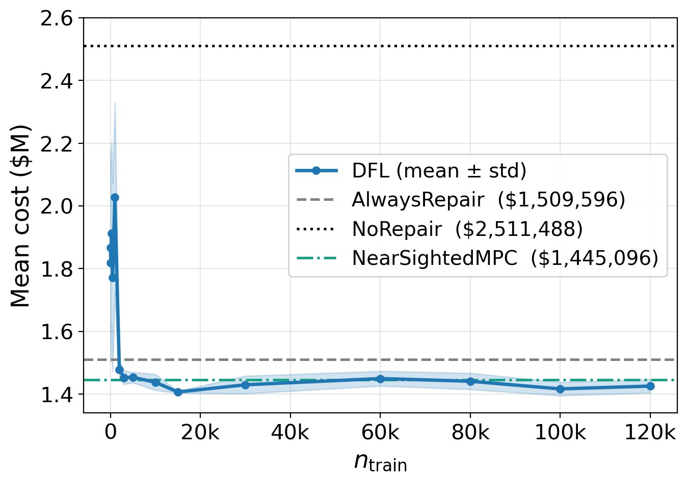
  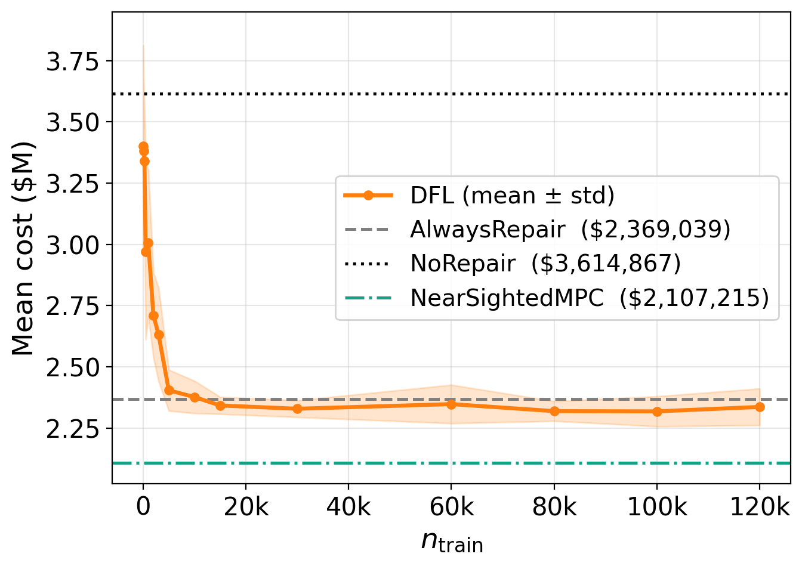
</p>
<p align="center"><em>Unbudgeted: 5-bus network at s = 100 (left) and case14 at s = 55 (right).</em></p>

<p align="center">
  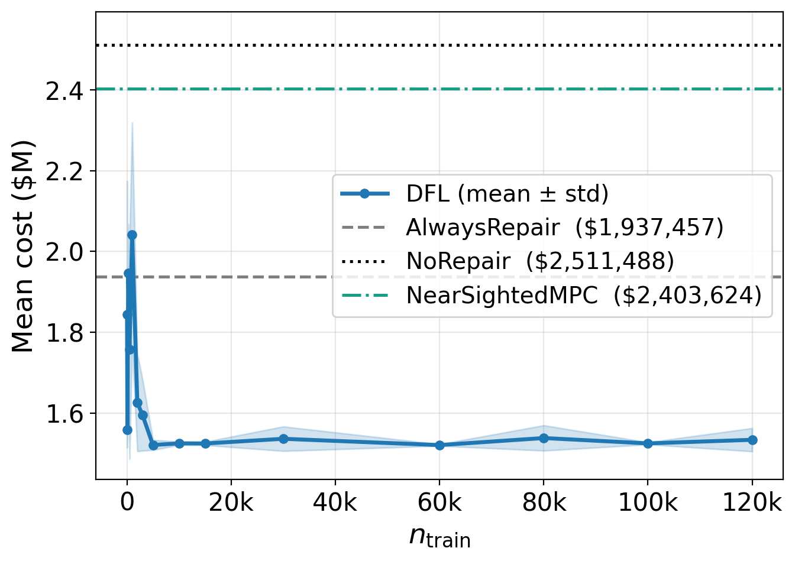
  
</p>
<p align="center"><em>Budgeted (budget fraction 0.3): 5-bus network at s = 100 (left) and case14 at s = 55 (right).</em></p>

- Without a budget, DFL is cheaper than AlwaysRepair on the 5-bus network at every size from 2,000 training scenarios on, and from 15,000 on its across-seed std stays at or below 28,052 USD. On case14 at $`s = 55`$, the lowest DFL mean, 2,318,269 USD, is reached at 100,000 training scenarios, and Near-sighted MPC stays below DFL at every size.
- With the budget, DFL is below Near-sighted MPC at every training size on both plotted networks, and below AlwaysRepair at every size from 2,000 training scenarios on (from 1,000 on case14 at $`s = 55`$).

These statements compare the plotted values of the aggregated files ([From files to figures](experiments/README.md#from-files-to-figures)). The curves of case14 at $`s = 45`$, reported in the tables only, are [figures/paper/case14/convergence_multiseed.png](figures/paper/case14/convergence_multiseed.png) and [convergence_multiseed_budget.png](figures/paper/case14/convergence_multiseed_budget.png).

### Repair-cost sensitivity

The repair-cost scale $`s`$ decides whether repair selection matters. For each $`s`$, a single DFL model (init seed 42, 120,000 training scenarios, no budget) was compared with AlwaysRepair on the test set through the ratio below, which is positive when DFL is cheaper:

```math
\text{sensitivity} = \frac{\bar c_{\mathrm{AR}} - \bar c_{\mathrm{DFL}}}{\bar c_{\mathrm{DFL}}}
```

Here $`\bar c_{\mathrm{DFL}}`$ is the cost of this single model. Unlike the DFL vs AR column of the cost tables, which divides by the AlwaysRepair cost, this ratio divides by the DFL cost.

DFL is ahead of AlwaysRepair at every scale on the 5-bus network, by +0.36% to +8.02%. On case14, the difference changes sign between $`s = 50`$ (-7.80%) and $`s = 70`$ (+19.31%), and linear interpolation between these two points puts the crossing at $`s = 55.8`$. The scales of the main experiments come from this sweep: $`s = 100`$ on the 5-bus network, and $`s = 45`$ and $`s = 55`$ on case14, near the crossing. With the five-seed models of the sweeps, AlwaysRepair is cheaper than DFL at $`s = 45`$ and DFL is slightly cheaper at $`s = 55`$ (see the cost tables). The values of both networks at all 12 scales are in [experiments/sensitivity/sensitivity_curve.txt](experiments/sensitivity/sensitivity_curve.txt).

<p align="center">
  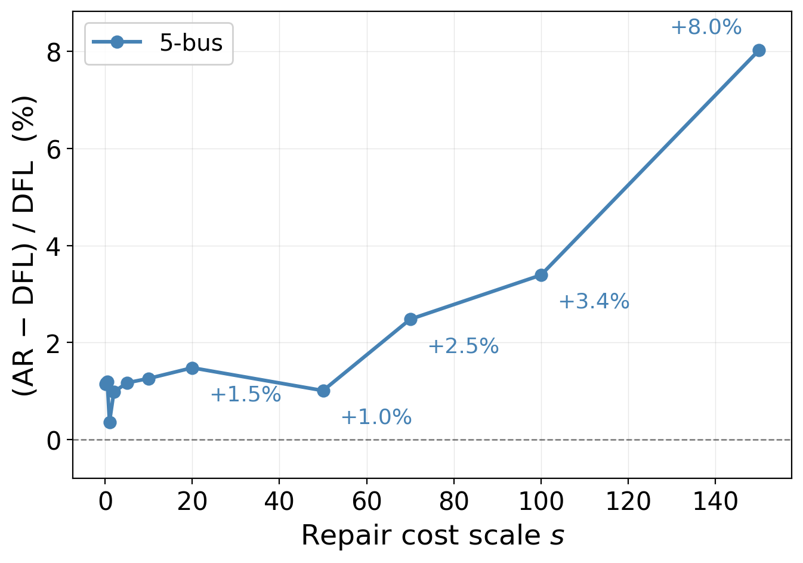
  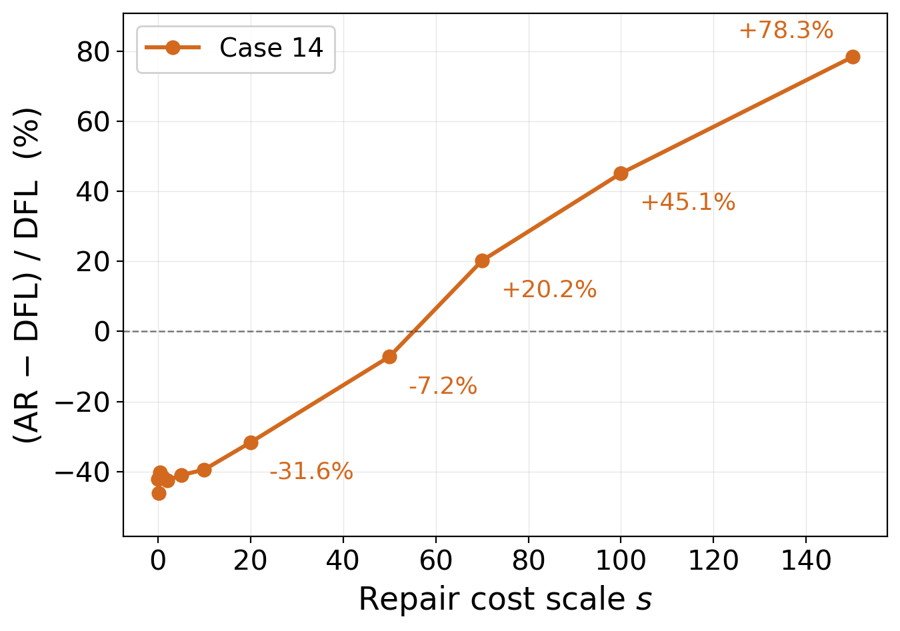
</p>
<p align="center"><em>(AR − DFL)/DFL against the repair-cost scale s: 5-bus network (left) and case14 (right).</em></p>

### SAA and SDDiP within the time limit

SAA runs, with the out-of-sample mean on the common test set:

| Configuration | MIP gap reached | In-sample objective (USD) | Solve time | Termination | Out-of-sample mean (USD) |
|---|--:|--:|--:|---|--:|
| 5-bus, unbudgeted | 9.7% | 1,405,197 | 0.9 h | optimal (gap target reached) | 2,028,014 |
| case14 ($`s = 45`$), unbudgeted | 60.1% | 2,757,664 | 116.7 h | time limit | 3,193,445 |
| case14 ($`s = 55`$), unbudgeted | 59.2% | 2,866,700 | 116.7 h | time limit | 3,255,115 |
| 5-bus, budgeted | 10.0% | 1,515,653 | 2.3 h | optimal (gap target reached) | 2,069,534 |
| case14 ($`s = 45`$), budgeted | 53.0% | 2,814,539 | 116.8 h | time limit | 3,240,817 |
| case14 ($`s = 55`$), budgeted | 42.5% | 2,465,177 | 116.8 h | time limit | 3,214,677 |

All six SAA runs used Gurobi 10.0.1. The in-sample objective is the incumbent of the tree MILP over its 16,384 sample paths, and the out-of-sample mean is the cost of the nearest-child rollout on the test set, as in the cost tables.

SDDiP runs, with the policy mean over SDDiP's own 500 simulations:

| Configuration | Iterations | Cuts | Lower bound (USD) | Policy mean (USD) | Estimated gap | Run time |
|---|--:|--:|--:|--:|--:|--:|
| 5-bus, unbudgeted | 782 | 10,166 | 1,024,482 | 1,584,476 | 35.3% | 116.8 h |
| case14 ($`s = 45`$), unbudgeted | 158 | 2,054 | 671,289 | 2,110,204 | 68.2% | 110.7 h |
| case14 ($`s = 55`$), unbudgeted | 150 | 1,950 | 740,410 | 2,283,357 | 67.6% | 110.1 h |
| 5-bus, budgeted | 755 | 9,815 | 1,296,240 | 1,651,543 | 21.5% | 116.7 h |
| case14 ($`s = 45`$), budgeted | 150 | 1,950 | 831,741 | 2,208,569 | 62.3% | 109.9 h |
| case14 ($`s = 55`$), budgeted | 147 | 1,911 | 927,540 | 2,304,480 | 59.8% | 109.9 h |

The simulations draw from SDDiP's own stagewise distribution (exact on the 5-bus network, 256 sampled outcomes per stage on case14), not from the common test set. Their individual costs were not kept, so `reconstruct_saved_sddip_mean` in `exact_dp/exact_dp_toy.py` rebuilds the policy mean from the saved stagewise averages, exactly, because the stage cost is affine. The `upper_bound` and `gap` fields of `sddip_solution.json` come from the single forward pass of the last training iteration, not from a statistical bound ([experiments/README.md](experiments/README.md#sddip)). [figures/paper/toy/sddip_convergence.png](figures/paper/toy/sddip_convergence.png) traces this forward-pass cost and the lower bound over the training of the unbudgeted 5-bus run ([The figures](paper/README.md#the-figures) describes it).

### Deployment time

Mean time to run one complete 14-stage test scenario on the cluster, unbudgeted:

| Network | $`s`$ | NoRepair | AlwaysRepair | DFL | SAA policy | Near-sighted MPC | MPC / DFL |
|---|--:|--:|--:|--:|--:|--:|--:|
| 5-bus | 100 | 24.7 ms | 27.5 ms | 30.0 ms | 77.3 ms | 5.9 s | 196 |
| case14 | 45 | 29.4 ms | 36.1 ms | 35.2 ms | 79.2 ms | 95.3 s | 2,707 |

A DFL decision costs one forward pass and one LP per stage, about as much as the trivial heuristics. Over all 440 models of the training-size sweeps, with and without the budget, DFL took 28.6 to 30.8 ms per test scenario on the 5-bus network and 33.0 to 38.2 ms on case14 (`mean_time_per_scenario_s` of the per-seed files). The SAA rollouts solved their stage LPs with gurobipy, and the other methods with SciPy's HiGHS. Training is the offline cost of DFL ([Run times](#run-times)).

## Installation

Everything runs in the Python environment below. Julia is needed only for SDDiP and installs itself on first use, and Gurobi only to repeat the SAA runs as reported.

### Python environment

The code runs in place and needs no build step. Python 3.11 is the validated version, and the first three commands under [Quick start](#quick-start) create the environment. If `python3.11 --version` fails, install Python 3.11 first (for example from python.org, or with `brew install python@3.11`, pyenv, uv or conda), or replace `python3.11` with the full path of a Python 3.11 interpreter.

`requirements-lock.txt` pins the exact versions of an environment in which the tests pass, `scripts/quick_check.sh` succeeds and `paper/reproduce_paper_numbers.py` passes all 112 checks. `requirements.txt` gives only lower bounds, apart from `pandapower==3.2.1` and `pandas<3`. Use it when the lock file does not install on your platform.

- On Linux, pip installs the CUDA build of PyTorch by default, about 3 GB of extra wheels. The code runs on the CPU only, so install the CPU wheel first:

  ```bash
  pip install torch==2.14.1 --index-url https://download.pytorch.org/whl/cpu
  pip install -r requirements-lock.txt
  ```

- The lock file requires Python 3.11 or newer. Its PyTorch version has wheels for Apple Silicon (macOS 14 or newer), for Linux with glibc 2.28 or newer and for 64-bit Windows, but not for Intel Macs, where `requirements.txt` is the untested fallback.
- On Windows, the shell scripts need bash, and the default output folder names contain a colon, so always pass `--output-dir`. SDDiP has not been run on Windows, and WSL2 avoids these issues. All reported runs used Linux and macOS.

### Julia, Gurobi, solvers and the case14 file

- SDDiP calls SDDP.jl through juliacall, and nothing has to be installed by hand. The first SDDiP run, or any first `import juliacall`, installs a Julia 1.x release (1.10 or newer) and the packages listed in `juliapkg.json` (SDDP.jl, JuMP, HiGHS.jl and JSON.jl), which needs internet access and takes several minutes. To install ahead of time, run from the repository root, where juliapkg finds `juliapkg.json`:

  ```bash
  python -c "from juliacall import Main as jl; print('Julia ready')"
  ```

  In a virtual environment, the Julia project is created in `.venv/julia_env`, and registries, packages and compiled code go to the Julia depot (`~/.julia` by default). The package versions are not pinned (there is no `Manifest.toml`), so they depend on the install date. On a machine without internet access, set `PYTHON_JULIAPKG_OFFLINE=yes` once the install is complete. If Julia is installed with juliaup, juliacall can pick up the juliaup launcher and stop with `could not load library ".../.juliaup/bin/../lib/julia/sys.dylib"` (macOS). Pointing `PYTHON_JULIAPKG_EXE` at the Julia binary itself avoids this, for example with `export PYTHON_JULIAPKG_EXE="$(julia -e 'print(joinpath(Sys.BINDIR, "julia"))')"`, which gives a path such as `~/.julia/juliaup/julia-1.12.3+0.aarch64.apple.darwin14/bin/julia`.
- HiGHS is the default solver throughout the code, and the reported SAA runs used Gurobi 10.0.1. For the Pyomo MIPs and the stage LPs, install `gurobipy` in the version of your Gurobi installation (the cluster runs used `pip install gurobipy==10.0.1` with the `Gurobi/10.0.1` module). The pip package comes only with a size-limited license, and full-size models need a full license. SDDiP on Gurobi also needs Gurobi.jl, which `juliapkg.json` leaves out. Add it once, from the repository root:

  ```bash
  python -c "import juliapkg; juliapkg.add('Gurobi', \
      '2e9cd046-0924-5485-92f1-d5272153d98b'); juliapkg.resolve()"
  ```

  By default, Gurobi.jl uses the Gurobi library of its Gurobi_jll dependency. [Adding Gurobi.jl](scripts/slurm/smoke/README.md#adding-gurobijl) shows the module setup on the cluster and names the two variables for building Gurobi.jl against a local Gurobi installation instead. The reported SDDiP runs used HiGHS.
- `solver_config.py` selects the solver of three layers from `ED_OPF_*` environment variables, which it reads at import: layer A for the Pyomo MIPs of the DFL labels and SAA, layer B for the SDDP.jl subproblems and layer C for the stage LPs of every rollout. All three use HiGHS by default, and `ED_OPF_SOLVER=gurobi` moves all three to Gurobi. [Solver selection](scripts/README.md#solver-selection) lists the per-layer variables, the command-line flags `--solver` and `--lp-method`, and the solvers of the reported runs. Variables left set in the shell also change the solver of the unit tests.
- Every case14 run, and `paper/reproduce_paper_numbers.py`, loads `pglib_opf_case14_ieee.m`, downloaded on first use from the master branch of [PGLib-OPF](https://github.com/power-grid-lib/pglib-opf) into `~/.cache/pglib_opf/`. The download is not checksummed, so delete a truncated file and run again. The experiments used the file of PGLib-OPF v23.07, which is identical to the master-branch file at the time of writing, and [The case14 network file](paper/README.md#the-case14-network-file) shows how to pin that version, prepare a machine without internet access and check the SHA-256. Loading a PGLib case needs pandapower and matpowercaseframes (both in the requirements), and for case14 pandapower prints a harmless note that "3 branches ... are considered as trafos".

## Reproducing the experiments

The experiments can be reproduced at three levels. The stored results give every reported number and figure in seconds. Single DFL runs work on a workstation, as do short test runs of SAA and SDDiP, and the full experiments need a SLURM cluster. The cluster scripts organize the runs in three lanes, each one network at one repair-cost scale: lanes 0, 1 and 2 are `toy` at $`s = 100`$, `case14` at $`s = 45`$ and `case14` at $`s = 55`$ ([Lanes](scripts/README.md#lanes)).

| Level | What it reproduces | Needs |
|---|---|---|
| [1. Stored results](#level-1-from-the-stored-results) | every reported number and figure, the aggregated result files and the costs of a stored model | Python environment (seconds to about 30&nbsp;s) |
| [2. Single runs](#level-2-single-runs-on-a-workstation) | one DFL run at a time, with NoRepair, AlwaysRepair and Near-sighted MPC, and short test runs of SAA and SDDiP | Python environment with HiGHS, and Julia for SDDiP |
| [3. Full pipeline](#level-3-the-full-pipeline-on-a-slurm-cluster) | all stored results | SLURM cluster, more than 4,000 hours of 64-core jobs, Gurobi for SAA |

### Level 1: from the stored results

These commands need no solver:

```bash
python paper/reproduce_paper_numbers.py                    # 112 checks, about 3 s
python paper/make_paper_figures.py --out /tmp/figures      # 10 figures, about 3 s
```

`reproduce_paper_numbers.py` prints each reported value next to the value recomputed from `experiments/`, exits with status 1 on any mismatch and writes nothing apart from the PGLib download cache. `make_paper_figures.py` overwrites `figures/` when `--out` is omitted. [paper/README.md](paper/README.md) lists the files each script reads and explains the pixel differences that another build of matplotlib produces. The aggregated `dfl_train<N>/evaluation.json` files and the sensitivity table `sensitivity_curve.txt` can be rebuilt byte for byte from the stored per-run files, with the commands under [DFL results aggregated over seeds](experiments/README.md#dfl-results-aggregated-over-seeds) and [Repair-cost sensitivity sweep](experiments/README.md#repair-cost-sensitivity-sweep).

A stored DFL model can also be evaluated again on the test set:

```bash
python Pseudo_DFL_main.py --mode evaluate --network toy --repair-base-scale 100 \
    --n-train 15000 --n-eval 500 --eval-seed 1000 --seed 42 --load-model \
    experiments/paper_unbudgeted/dfl_scaling_multiseed/toy/dfl_train15000/seed_42/model.pt \
    --output-dir runs/check_toy_15000_seed42
```

This needs only the stage LPs, takes about 30 s and reproduces the stored per-scenario costs of DFL, AlwaysRepair and NoRepair exactly. [Loading the files in Python](experiments/README.md#loading-the-files-in-python) gives the comparison with the stored file, which prints `True`. For a budgeted model, add `--repair-budget-fraction 0.3` and point `--load-model` to, for example, `experiments/paper_budget0.3/dfl_scaling_multiseed/toy/dfl_train60000/seed_42/model.pt` with `--n-train 60000`. Models are stored only at the reported size of each lane. `--mode train`, `evaluate` and `compare` rebuild the network, parameters and test set from the command line and read nothing from `config_snapshot.json`, so repeat the network, scale, seeds, test-set size, budget and `--hidden-dims` exactly.

### Level 2: single runs on a workstation

Each method can be run on its own with the commands the cluster scripts use. Outside SLURM, label generation starts one worker per CPU and the HiGHS solves of SAA and SDDiP use every CPU. To use fewer, set `SLURM_CPUS_PER_TASK=<n>`, which the code also reads outside SLURM.

The DFL command of `dfl_multiseed.sh`, for one lane, size and init seed:

```bash
python Pseudo_DFL_main.py --network toy --repair-base-scale 100 --n-train 2000 \
    --n-eval 500 --eval-seed 1000 --seed 42 --init-seeds 42 --with-mpc \
    --output-dir runs/paper_unbudgeted/toy/dfl_train2000/seed_42
```

- For case14, use `--network case14 --repair-base-scale 45`, or `55` for the second case14 lane, and replace `toy` in `--output-dir` by `case14` or `case14_scale55`, so that each lane keeps its own folder. For the budgeted variant, add `--repair-budget-fraction 0.3` and write to `runs/paper_budget0.3/` instead.
- Run the sizes in increasing order from the same working directory, so that the label cache grows instead of being rebuilt.
- If a run is interrupted while it solves the labels, delete its cache file (`data_cache_scale100/toy/seed42/training_data.pkl` for the command above) before running again: the partial cache already has its full size, so later runs would train on the solved scenarios only.
- `--with-mpc` evaluates Near-sighted MPC once and caches it. On case14 this alone takes about 13 hours for 500 test scenarios, and the repair heatmaps of every run simulate MPC again on 50 test scenarios. Leave it out, or add MPC afterwards with `python inject_mpc_baseline.py --network toy --window 3 runs/paper_unbudgeted/toy/dfl_train*/seed_*` and aggregate again. The module docstring of [`inject_mpc_baseline.py`](inject_mpc_baseline.py) lists the checks it makes.
- Repeat with `--init-seeds 1`, `2`, `3` and `4` into the matching `seed_<seed>/` folders, then aggregate with `python aggregate_multiseed.py --root runs/paper_unbudgeted`.

SAA and SDDiP solves at the reported sizes belong on the cluster, and [SAA](scripts/README.md#saa) and [SDDiP](scripts/README.md#sddip) in scripts/README.md give their commands with the settings of the stored runs. On a workstation, two short runs check that both methods work: a wait-and-see SAA solve over 4 scenarios (a perfect-information MIP, not the tree policy) and a 5-iteration SDDiP run with a 120 s training limit, which installs Julia on first use:

```bash
python main.py --mode ws --n-scenarios 4 --evaluate --n-test 4 --no-plots \
    --output-dir /tmp/saa_ws
python SDDiP_main.py --test --output-dir /tmp/sddip_test
```

The comparison plots of one DFL run with SAA and SDDiP are described under [Comparison folders](scripts/README.md#comparison-folders).

### Level 3: the full pipeline on a SLURM cluster

The job scripts in [`scripts/slurm/`](scripts/slurm), documented under [Cluster pipelines](scripts/README.md#cluster-pipelines), are those that produced the stored results, with the settings that were used. They were written for the Snellius cluster, with the resources listed under [Computational details](#computational-details). Submit every job from the repository root: the scripts treat the submission directory as the project directory, activate `.venv` there and write their logs to `logs/`, which must exist (`logs/.gitkeep` keeps it, see [Common conventions](scripts/README.md#common-conventions)). Each experiment script skips a run whose result file already exists, and the repository ships these files for all scripts except `dfl_scaling.sh`, so before a rerun move the stored results of the part to be rerun out of `experiments/`, for example with `mkdir -p experiments_stored && mv experiments/paper_unbudgeted experiments_stored/`.

The one-time setup creates the environment, downloads the pinned case14 file and optionally runs the smoke tests. [Environment setup](scripts/README.md#environment-setup) lists the steps of `install_env.sh` and its modules, and the [smoke tests](scripts/slurm/smoke/README.md) have their own README.

```bash
# creates .venv; wait for "Installation complete!" in logs/install_<jobid>.out
sbatch scripts/slurm/install_env.sh
mkdir -p ~/.cache/pglib_opf && curl -L -o ~/.cache/pglib_opf/pglib_opf_case14_ieee.m \
  https://raw.githubusercontent.com/power-grid-lib/pglib-opf/v23.07/pglib_opf_case14_ieee.m
# optional: nine short setup checks, three of which load case14
bash scripts/slurm/smoke/submit_all.sh
```

The scripts in `unbudgeted/` and `budgeted/` default to `SOLVER=gurobi`, which they export as `ED_OPF_SOLVER`. The commands below therefore pass `--export=ALL,SOLVER=appsi_highs` to the DFL and SDDiP jobs, as in the reported runs, and to the optional comparison job, which then needs no Gurobi license, while SAA keeps its Gurobi default. Pass overrides as `sbatch --export=ALL,SOLVER=...`, because on Snellius a `SOLVER=... sbatch ...` prefix did not reach the job, which then ran on Gurobi. `--export=ALL` also forwards any `ED_OPF_*` variable set in the submitting shell ([Solver selection](scripts/README.md#solver-selection) lists the solver of every job).

The unbudgeted variant writes its results to `experiments/paper_unbudgeted/`:

```bash
V=unbudgeted; R=experiments/paper_unbudgeted

# 1. Single-seed DFL sweep, one task per lane: fills the label and MPC caches
sbatch --export=ALL,SOLVER=appsi_highs scripts/slurm/$V/dfl_scaling.sh

# 2. Once step 1 has finished for every lane: five init seeds per lane, then the aggregation
MS=$(sbatch --parsable --export=ALL,SOLVER=appsi_highs scripts/slurm/$V/dfl_multiseed.sh)
AGG=$(sbatch --parsable --dependency=afterok:$MS scripts/slurm/$V/dfl_aggregate.sh)

# 3. SAA and SDDiP, independent of the DFL jobs
SAA=$(sbatch --parsable scripts/slurm/$V/saa.sh)
SDDIP=$(sbatch --parsable --export=ALL,SOLVER=appsi_highs scripts/slurm/$V/sddip.sh)

# 4. Optional comparison plots; the reported numbers do not use them. The 8 h limit of
#    compare.sh is too short for most lanes: submit each lane with its own --array and
#    --time ("Comparison folders" in scripts/README.md gives the hours per lane)
sbatch --dependency=afterok:$AGG,afterany:$SAA:$SDDIP \
    --export=ALL,SOLVER=appsi_highs,SAA_ROOT=$R,SDDIP_ROOT=$R scripts/slurm/$V/compare.sh
```

For the budgeted variant (results in `experiments/paper_budget0.3/`), use the same commands after `V=budgeted; R=experiments/paper_budget0.3`. The budgeted scripts add `--repair-budget-fraction 0.3` to every run. The two variants use separate cache files and can run at the same time.

<details>
<summary>Notes on order, resubmission and failures (details in scripts/README.md)</summary>

- `dfl_scaling.sh` comes first because it solves the label MIPs and computes Near-sighted MPC once per lane, so that the five seed tasks of `dfl_multiseed.sh` read finished caches instead of solving the same MIPs and writing to one cache file concurrently. Its own outputs are not used for the reported results and are not included ([DFL training sweep](scripts/README.md#dfl-training-sweep)).
- Without `--array`, the per-lane scripts `dfl_scaling.sh`, `saa.sh`, `sddip.sh` and `compare.sh` run lanes 0 to 2, and `dfl_multiseed.sh` runs tasks 0-14. Its task number is 5 × lane + seed index, with the init seeds 1, 2, 3, 4 and 42 as seed indices 0 to 4, so tasks 0-4 train `toy`, 5-9 `case14` at $`s = 45`$ and 10-14 `case14` at $`s = 55`$. To run a subset, pass `--array`, for example `--array=1` to a per-lane script or `--array=5-9` to `dfl_multiseed.sh` for `case14` at $`s = 45`$ ([Lanes](scripts/README.md#lanes)). A network outside the study runs as a further lane ([Adding a lane](scripts/README.md#adding-a-lane)).
- A size or lane whose result file exists is skipped, so submitting the same command again resumes it. A task that ends in TIMEOUT never satisfies `afterok`, which is why step 2 is submitted by hand once step 1 has finished, and why `dfl_aggregate.sh` must be submitted by hand after the last resubmission. The DFL scripts exit 0 even when a size fails, so check the `Completed | Skipped | Failed` line at the end of each log. Before resubmitting, delete a `SAA/solution.json` without out-of-sample costs, an `SDDiP/sddip_solution.json` that still has its `note` key, and the label cache `.pkl` of a job killed while generating labels, which looks complete but holds scenarios that are never solved later ([Skip guards, failures and resubmission](scripts/README.md#skip-guards-failures-and-resubmission)).
- Summed over all sizes, a budgeted seed task took 101 to 122 hours on the 5-bus network and 146 to 205 hours on case14 at $`s = 45`$, so it can need more than one 117:36:00 window ([Recorded run times](scripts/README.md#recorded-run-times)). The budgeted case14 lane at $`s = 55`$ stops after 80,000 training scenarios, and resubmitting tasks 10-14 would start the sizes 100,000 and 120,000 ([What did not finish](#what-did-not-finish)).
- `sddip.sh` sets a training limit of 394,560 s, the job limit minus 8 h, on every lane, as in the stored case14 runs. The stored 5-bus runs used 419,760 s, the limit minus 1 h. To repeat them exactly, run toy from a copy of `sddip.sh` as described under [SDDiP](scripts/README.md#sddip), and add `--array=1-2` to the `sddip.sh` command of step 3, because its default array also runs toy.
- With the new results in place, run `python paper/reproduce_paper_numbers.py` and `python paper/make_paper_figures.py --out <folder>`. The first script compares the recomputed values with the reported ones, and exact agreement is expected only where the computation is deterministic ([Seeds and reproducibility](#seeds-and-reproducibility)).

</details>

On another cluster, adapt the partition (and add `--account` or `--qos` if required), the modules, the node size, the wall clock together with the constant `SLURM_LIMIT` in `saa.sh` and `sddip.sh`, and the Gurobi version and license, or use HiGHS throughout with `SOLVER=appsi_highs` (the SAA results then differ from the reported ones). [Running on another cluster](scripts/README.md#running-on-another-cluster) lists every place to change.

### Sensitivity sweep and exact DP

```bash
bash scripts/slurm/sensitivity/submit_sensitivity.sh
```

This submits `sensitivity_sweep.sh`, 12 array tasks with 64 CPUs, 112 GB and 72:00:00 each, one per scale $`s`$ in {0.1, 0.2, 0.5, 1, 2, 5, 10, 20, 50, 70, 100, 150}, and then the plot job. Each task trains and evaluates one DFL model per network (init seed 42, 120,000 training scenarios, 500 test scenarios, no MPC, no budget), first toy and then case14, and writes to `experiments/sensitivity/scale_<s>/<net>/`. The plot job writes `experiments/sensitivity/sensitivity_curve.txt`. The $`s = 100`$ toy cell uses the same label cache as lane 0 of the unbudgeted DFL sweep (`data_cache_scale100/toy/seed42/training_data.pkl`), so do not run the two while either one is still generating labels. [Sensitivity sweep](scripts/README.md#sensitivity-sweep) has the details.

```bash
python exact_dp/exact_dp_toy.py
```

The defaults are the reported settings: both variants, seed 42, $`T = 14`$, $`s = 100`$, $`\varphi = 0.3`$, and SciPy's HiGHS for the 128 stage LPs. It takes about 2 s, writes `exact_dp/results/{unbudgeted,budgeted}/exact_dp_solution.json` (ignored by git) and prints a comparison with the stored 5-bus SDDiP solutions. `sbatch scripts/slurm/exact_dp.sh` writes to `experiments/exact_dp_toy/run_<jobid>/` on the cluster, and [Running it](exact_dp/README.md#running-it) lists the options. `paper/reproduce_paper_numbers.py` reads `experiments/exact_dp_toy/{unbudgeted,budgeted}/exact_dp_solution.json`, so copy a new solution there to use it ([Stored results](exact_dp/README.md#stored-results)).

## Applying the code to another network

The experiment entry points (`Pseudo_DFL_main.py`, `main.py`, `SDDiP_main.py`, `compare_methods.py` and `inject_mpc_baseline.py`) take `--network`. `toy` (case-sensitive) is the built-in 5-bus network, the only one that `exact_dp/exact_dp_toy.py` solves, and any other name selects a PGLib-OPF case, downloaded on first use into `~/.cache/pglib_opf/`. A bus count without a PGLib case falls back to the closest one with only a printed note (`case25` gives `case24_ieee_rts`). `create_network` and `_resolve_pglib_case` in [`network_data.py`](network_data.py) document the matching rules. Result folder names are not network names: `--network case14_scale55` loads case14 at the default scale $`s = 1`$. To use a network outside PGLib-OPF, build it from a MATPOWER or PyPower case dictionary with `NetworkData.from_ppc` and return it from `create_network` under a name of its own, which the entry points then accept as `--network`.

### PGLib cases

The table lists the PGLib-OPF cases from 14 to 118 buses as the code reads them. The components are the generators and lines that can fail. The label MIPs, the SDDiP state and the number of repair schedules that Near-sighted MPC scores all grow with them.

| `--network` | PGLib case | Buses | Generators | Lines | Components |
|---|---|---|---|---|---|
| `case14` | `case14_ieee` | 14 | 5 | 20 | 25 |
| `case24` | `case24_ieee_rts` | 24 | 33 | 38 | 71 |
| `case30` | `case30_ieee` | 30 | 6 | 41 | 47 |
| `case30_as` | `case30_as` | 30 | 6 | 41 | 47 |
| `case39` | `case39_epri` | 39 | 10 | 46 | 56 |
| `case57` | `case57_ieee` | 57 | 7 | 80 | 87 |
| `case60` | `case60_c` | 60 | 23 | 88 | 111 |
| `case73` | `case73_ieee_rts` | 73 | 99 | 120 | 219 |
| `case89` | `case89_pegase` | 89 | 12 | 210 | 222 |
| `case118` | `case118_ieee` | 118 | 54 | 186 | 240 |

case14 is the PGLib network of the study, and case30 is the example of the steps below. Of the two 30-bus cases, the bus count selects the IEEE one, so `case30_as` has to be given by its full name. `_PGLIB_CASES` in [`network_data.py`](network_data.py) lists every case, from 3 to 78,484 buses.

When a PGLib case is loaded, minimum generator outputs are set to 0 and only the linear generation-cost coefficient is kept, line susceptances are baseMVA/x (tap ratios, phase shifts and resistance are ignored), and the base power is 100 MVA. A branch without a thermal rating gets the limit max(total in-service generation capacity, 1,000 MW). Line repair costs are proportional to the limit, so such a branch is also expensive to repair. Every in-service generator and branch can fail, including units with zero active-power capacity.

### Step by step, with case30 as the example

The steps use the IEEE 30-bus case with the settings of our trial runs. case30 is not part of the study, and no script runs it by default.

1. Check that the case loads and that the intact network serves its load. From the repository root, the command below prints the stage cost and the load shed with every component available, `7,506.48 USD per stage, 0.0 MW shed` for case30:

   ```bash
   python -c "
   from network_data import create_network
   from model_parameters import create_model_parameters
   from Pseudo_DFL_stage_opf import create_stagewise_opf
   net = create_network('case30')
   opf = create_stagewise_opf(net, create_model_parameters(net))
   cost, _, d_load, _ = opf.solve([1] * net.n_generators, [1] * net.n_lines)
   print(f'{cost:,.2f} USD per stage, {net.load_nominal.sum() - d_load.sum():.1f} MW shed')"
   ```

   The unit tests can run on the new network as well: [Extending the tests](tests/README.md#extending-the-tests) names the fixture to change and the parts of the suite that assume the size of the 5-bus network.

2. Choose the repair-cost scale $`s`$ (`--repair-base-scale`). It decides whether repair selection matters at all: with cheap repairs AlwaysRepair is close to optimal, and with very expensive ones NoRepair is. Single runs at a few scales, or the sensitivity sweep, find the range in between ([Repair-cost sensitivity](#repair-cost-sensitivity)). For case30 we used $`s = 25`$. The repair-cost bases 550 and 350 are also written as literals in the files listed next to `GEN_REPAIR_BASE` in [`config.py`](config.py), so changing them in `config.py` alone is not enough.

3. Time a few label MIPs before a long run. With `--mode data`, the run only solves the labels, prints `Data generation time` and caches the labels in `data_cache_scale25/case30/seed42/` of the working directory, where the later runs find them:

   ```bash
   python Pseudo_DFL_main.py --network case30 --repair-base-scale 25 --mode data --n-train 10 \
       --output-dir /tmp/dfl_case30_labels
   ```

   If the run is stopped before it finishes, delete `data_cache_scale25/case30/` before the next run: an interrupted cache already has its full size, and its unsolved labels are never solved later. Label MIPs grow quickly with the network. 120,000 labels took 1.5 to 1.8 h for `toy` and 5.8 to 18.6 h for case14 on 64 cores, and the cluster jobs reserve up to 117:36:00, about 4.9 days, each.

4. Train and evaluate DFL. The command below trains on 1,000 scenarios and compares DFL with AlwaysRepair and NoRepair on 500 test scenarios. On the lanes of the study, the best training size lay between 15,000 and 100,000 scenarios ([Results](#results)). For a larger network, revisit `--n-epochs`, `--early-stop-patience` and `--hidden-dims` ([Training](#training) gives the settings of the study), since the input and output sizes of the DFL network follow the power network. For the budgeted variant, add `--repair-budget-fraction 0.3` and check that the budget binds, as it does on both networks of the study.

   ```bash
   python Pseudo_DFL_main.py --network case30 --repair-base-scale 25 --n-train 1000 \
       --n-eval 500 --eval-seed 1000 --output-dir /tmp/dfl_case30_n1000
   ```

5. Size the baselines:

   - `--with-mpc` adds Near-sighted MPC, which scores at most 2,187 repair schedules per stage and samples when there are more ([Near-sighted MPC](#near-sighted-mpc)). Its time per test scenario grows with the number of failed components until this cap binds: on case14 it took 95 s, about 13 h for the 500 test scenarios. The cap is `MPC_SCHEDULE_CAP_RATIO` (default 1) times $`(W - \tau + 1)^{7}`$, rounded up, with the exponent 7 set by `MPC_CAP_REFERENCE_COMPONENTS`, both in [`config.py`](config.py). MPC can also be added later with `inject_mpc_baseline.py` ([Level 2](#level-2-single-runs-on-a-workstation)).
   - SAA and SDDiP belong on the cluster. The SAA tree has $`2^T`$ paths at any network size, but the MILP grows with the network, so the time limit binds sooner.
   - SDDiP samples `--n-samples` failure outcomes per stage on networks with 10 or more components (64 for case30). Its binary state has 2 × (generators + lines) variables at $`\tau = 1`$ (50 on case14, 94 on case30), and convergence slows down quickly as it grows.

6. On the cluster, run the network as a further lane of the job scripts. [Adding a lane](scripts/README.md#adding-a-lane) lists the arrays to extend and the submission commands, again with case30 as the example.

Further settings:

- The load-shedding cost, the failure model, $`T`$ and $`\tau`$ have flags only in `Pseudo_DFL_main.py` (`--load-shedding-cost`, `--failure-*`, `--n-stages` and `--tau`). `main.py`, `SDDiP_main.py`, `compare_methods.py` and `inject_mpc_baseline.py` read them from `config.py`, so change them there to compare the methods under other values. A non-default load-shedding cost disables the automatic label cache. The label cache does not record the failure model, $`T`$ or $`\tau`$, and the MPC cache records none of these settings, so delete the caches of the lane after changing them.
- The MIP models, SAA and SDDiP handle $`\tau > 1`$, but the DFL features contain no repair pipeline, so the learned policy assumes $`\tau = 1`$.
- Label generation runs one process per CPU, capped by `SLURM_CPUS_PER_TASK`. The cluster jobs requested 112 GB for 64 workers.

## Repository guide

### Folder READMEs

- [`experiments/README.md`](experiments/README.md): layout and file formats of the stored results, and the file and key behind each reported number.
- [`paper/README.md`](paper/README.md): the two scripts that recompute the reported numbers and figures, and how to pin and verify the case14 file.
- [`scripts/README.md`](scripts/README.md): helper and cluster scripts, lanes and how to add one, submission order, resubmission, recorded run times and other clusters.
- [`scripts/slurm/smoke/README.md`](scripts/slurm/smoke/README.md): short jobs that check the cluster setup before the long runs.
- [`exact_dp/README.md`](exact_dp/README.md): the data of the 5-bus network, its exact DP, why the DP is exact and what its output files hold.
- [`tests/README.md`](tests/README.md): what each test file checks, and how to run the tests on another network.

### Parameters and names

The parameters of this page are documented constants in [`config.py`](config.py), and `Pseudo_DFL_main.py` overrides most of them with a flag: `--n-stages` and `--tau` ($`T`$, $`\tau`$), `--load-shedding-cost` ($`\alpha`$), `--repair-base-scale` ($`s`$), `--repair-budget-fraction` ($`\varphi`$), `--failure-k`, `--failure-t-star` and `--failure-p-max-*` ($`K`$, $`t^*`$, $`p_{\max}`$), `--epsilon` ($`\varepsilon`$) and `--mpc-window` ($`W`$). The number $`M`$ of perturbations is `FY_MC_SAMPLES`, and $`\eta`$ is `theta` in the code. In the code and the result folders, the 5-bus network is `toy`, case14 at $`s = 55`$ is the folder `case14_scale55` (run as `--network case14 --repair-base-scale 55`), DFL is `Pseudo_DFL`, and the two variants are `paper_unbudgeted` and `paper_budget0.3`. [Names](experiments/README.md#names) in experiments/README.md lists every name of the result files, and [Lanes](scripts/README.md#lanes) in scripts/README.md the array indices of the lanes.

### Layout

<details>
<summary>All files and folders, one line each</summary>

```text
.
├── Pseudo_DFL_main.py           DFL entry point: labels, training, evaluation, plots
├── Pseudo_DFL_data.py           single-scenario label MIPs, solved in parallel, label cache
├── Pseudo_DFL_model.py          RepairNetwork and the Fenchel-Young loss
├── Pseudo_DFL_training.py       training loop
├── Pseudo_DFL_solver.py         rollouts of DFL, AlwaysRepair, NoRepair and Near-sighted MPC
├── Pseudo_DFL_stage_opf.py      stage DC-OPF LP used by every rollout
├── Pseudo_DFL_visualization.py  plots of a DFL run
├── knapsack.py                  exact 0/1 knapsack for budgeted repair decisions
├── main.py                      SAA entry point (scenario tree or wait-and-see)
├── saa_solver.py                SAA solve and out-of-sample rollout
├── problem_formulation.py       Pyomo MIP models over a scenario set or a scenario tree
├── utils.py, visualization.py   SAA helpers and plots
├── SDDiP_main.py                SDDiP entry point
├── SDDiP_solver.py              wrapper around SDDP.jl
├── SDDiP_julia_bridge.py        builds and solves the SDDP.jl model through juliacall
├── SDDiP_visualization.py       SDDiP plots
├── network_data.py              5-bus network and PGLib-OPF loader
├── model_parameters.py          horizon, costs, failure probabilities, budget
├── scenario_generator.py        failure scenarios and scenario trees
├── state_dynamics.py            availability transitions
├── config.py                    default parameters
├── solver_config.py             solver choice for the three solver layers
├── compare_methods.py           cross-method comparison folder for one DFL run
├── compare_visualization.py     comparison plots
├── aggregate_multiseed.py       averages seed_<seed>/ into dfl_train<N>/evaluation.json
├── inject_mpc_baseline.py       adds Near-sighted MPC to existing evaluation.json files
├── verify_installation.py       installation check
├── requirements.txt             Python dependencies (lower bounds)
├── requirements-lock.txt        exact versions of the validated Python 3.11 environment
├── juliapkg.json                Julia packages for SDDiP
├── LICENSE                      MIT License
├── experiments/                 stored results of all reported experiments (69 MB)
│   ├── paper_unbudgeted/        DFL sweeps, SAA and SDDiP without a budget
│   ├── paper_budget0.3/         the same with φ = 0.3
│   ├── sensitivity/             repair-cost sensitivity sweep
│   └── exact_dp_toy/            exact DP solutions of the 5-bus network
├── figures/                     the figures, as drawn by paper/make_paper_figures.py
├── docs/images/                 README figures that the paper does not have (toy_network.png, budget_cost_bars.png)
├── paper/                       reproduce_paper_numbers.py, make_paper_figures.py
├── exact_dp/                    exact DP of the 5-bus network (exact_dp_toy.py, run_local.sh)
├── scripts/
│   ├── quick_check.sh           end-to-end check of a checkout
│   ├── sensitivity_plot.py      sensitivity table and diagnostic plots
│   ├── make_readme_figures.py   draws the two README figures in docs/images/
│   └── slurm/                   cluster jobs: unbudgeted/, budgeted/, sensitivity/, smoke/,
│                                exact_dp.sh, install_env.sh, install_deps.sh
├── tests/                       pytest suite (118 tests)
└── logs/                        SLURM job logs (kept empty; sbatch needs the folder)
```

</details>

## Computational details

All cluster jobs ran on the Snellius cluster, partition `rome` (AMD EPYC 7H12 nodes), with 1 node and 1 task. The experiment jobs requested 64 CPUs, 112 GB and 117:36:00, and the sensitivity tasks 72:00:00. [Resources and logs](scripts/README.md#resources-and-logs) lists the requests of every job. No GPU was used, and the code has no GPU path: DFL training runs in one CPU process, and the code does not set PyTorch's thread count. The two stored exact-DP solutions were computed on macOS, as their `run_environment` key records, and rerunning the DP reproduces the same optima.

### Solvers and settings

| Computation | Solver | Settings |
|---|---|---|
| DFL label MIPs | HiGHS through Pyomo appsi (`appsi_highs`) | 64 worker processes with 1 thread each, relative MIP gap 1e-6, presolve on, no time limit |
| Stage LPs of DFL, AlwaysRepair, NoRepair and Near-sighted MPC | SciPy `linprog(method='highs')` | later window stages of Near-sighted MPC use the derated LP, also on SciPy's HiGHS |
| SAA extensive form | Gurobi 10.0.1 | MIPGap 0.10, TimeLimit 419,760 s, one uninterrupted solve started from the NoRepair solution, up to 32 threads (Gurobi's default cap) on 64 CPUs |
| SAA out-of-sample rollout LPs | gurobipy, since `SOLVER=gurobi` also switches the LP layer | LP optimal values do not depend on the solver |
| SDDiP subproblems | HiGHS through SDDP.jl | 64 threads (`SLURM_CPUS_PER_TASK`), feasibility and interior-point optimality tolerances 1e-6 |
| Exact DP | SciPy's HiGHS | 128 stage LPs per variant |
| Sensitivity sweep | as for DFL | `appsi_highs`, the script default |

### Seeds and reproducibility

| Seed | Value | Set by | Controls |
|---|---|---|---|
| model and data seed | 42 | `--seed` | $`p_{\max}`$ and class of every component<br>the training scenarios (scenario i uses NumPy seed [42, i])<br>the train/validation split, batch order and dropout<br>the SAA tree<br>Julia's random number generator in SDDiP |
| init seeds | 1, 2, 3, 4, 42 | `--init-seeds` | the initial network weights only |
| evaluation seed | 1000 | `--eval-seed` | the 500 test scenarios (scenario i uses [1000, i]) |
| MPC sampling seed | 0 | `MPC_SAMPLE_SEED` in `config.py` | the sampled schedules when the cap binds |
| budgeted perturbations | not seeded | NumPy's global random state | the Gaussian perturbations of the budgeted Fenchel-Young loss |

The failure probabilities depend only on the network and the model seed, so the test scenarios of a network are the same at every scale and in both variants.

- Evaluating a stored model reproduces the stored per-scenario costs exactly. Rebuilding the aggregated results and the sensitivity table from the stored per-run files gives identical files.
- Unbudgeted DFL training is deterministic on a given machine and software stack. On other hardware, ties between optimal label solutions and floating-point differences can lead to a different model, so a retrained model is not expected to reproduce the stored costs exactly.
- Budgeted DFL training draws its Gaussian perturbations from NumPy's global random state, which the code does not seed, so budgeted reruns give slightly different models and costs even on the same machine.
- Runs stopped by a time limit (SAA on case14, SDDiP) depend on the speed of the hardware.
- `config_snapshot.json` records `config.py` after the repair-cost scale, the seeds and the budget fraction have been applied, but not most other command-line values. [Reading the files correctly](experiments/README.md#reading-the-files-correctly) and [Run configuration](experiments/README.md#run-configuration) list what the snapshots show for the SAA runs, the init seeds and `FY_MC_SAMPLES`.

### Run times

The run times recorded in `experiments/` add up to more than 4,000 hours of 64-core jobs, and [Recorded run times](scripts/README.md#recorded-run-times) breaks them down by method and lane. The longest training of a single model of the training-size sweeps took 17.0 h without the budget (case14, $`s = 55`$, 120,000 scenarios, seed 42) and 62.8 h with it (case14, $`s = 45`$, 120,000 scenarios, seed 4), and a budgeted seed task can need more than one 117:36:00 job. The mean training time per model at every size is `timing.training_s` of the aggregated `dfl_train<N>/evaluation.json` files, tabulated in hours for the sizes from 5,000 on under [Not included, and how to regenerate it](experiments/README.md#not-included-and-how-to-regenerate-it).

### What did not finish

- The budgeted case14 lane at $`s = 55`$ has 13 of the 15 sizes (65 models), because the sizes 100,000 and 120,000 did not finish within the wall-clock limit. The other lanes have all 15 sizes for each of the 5 init seeds.
- All four SAA runs on case14 stopped at the time limit, with MIP gaps of 42.5% to 60.1%. The 5-bus runs reached the 10% target.
- All six SDDiP runs stopped at the time limit, after 147 to 782 of the allowed 10,000 iterations, with estimated gaps of 21.5% to 68.2%.

### Further details

- DFL initialization, epoch budget and epochs trained: [Trained models](experiments/README.md#trained-models). The label and MPC caches: [DFL training sweep](scripts/README.md#dfl-training-sweep), and after an interrupted label run, [Skip guards, failures and resubmission](scripts/README.md#skip-guards-failures-and-resubmission).
- Near-sighted MPC computation time on each lane: `NearSightedMPC.eval_time_s` of the result files, in hours under [Recorded run times](scripts/README.md#recorded-run-times).
- SAA tree, solve and rollout: [SAA](scripts/README.md#saa) in scripts/README.md and the [stored SAA files](experiments/README.md#saa). The tree comes from one NumPy generator seeded with [42, 2, 14] (`ScenarioGenerator.generate_scenario_tree` in [`scenario_generator.py`](scenario_generator.py)).
- SDDiP model, sampling, cuts and stopping: [SDDiP](scripts/README.md#sddip) in scripts/README.md and the [stored SDDiP files](experiments/README.md#sddip).
- Exact DP work and checks: [Why the recursion is exact](exact_dp/README.md#why-the-recursion-is-exact) and [Stored results](exact_dp/README.md#stored-results) in exact_dp/README.md.
- Files that are not in the repository, and how to regenerate them: [Not included, and how to regenerate it](experiments/README.md#not-included-and-how-to-regenerate-it).

## Tests

```bash
python -m pytest -q tests                  # 118 tests, about 15 s
python -m pytest -q -m "not slow" tests    # the 112 fast tests
```

Apart from one test on a hand-built 3-bus network, the suite uses only the 5-bus network, so it needs no internet access, case14 or Julia. It checks the failure model, the scenario sampling, the availability dynamics, the stage DC-OPF and its outage model, the derated LP of Near-sighted MPC, and the SAA scenario tree with small SAA solves. It does not test the DFL pipeline (labels, loss, training, knapsack and rollouts), repair budgets, the MPC schedule search, SDDiP or the exact DP ([What a pass guarantees, and what it does not](tests/README.md#what-a-pass-guarantees-and-what-it-does-not)). One slow test uses GLPK and is skipped when `glpsol` is not on `PATH` (117 passed, 1 skipped). Unset any `ED_OPF_*` variable before running the tests, because these variables also change the solver of the tests. [What each file checks](tests/README.md#what-each-file-checks) in tests/README.md lists the coverage of every test file.

## License

The code is released under the MIT License; see [LICENSE](LICENSE). The PGLib-OPF case files are not part of this repository. The code downloads them from PGLib-OPF, whose own license applies.

## Citation

Citation information will be added after publication.
