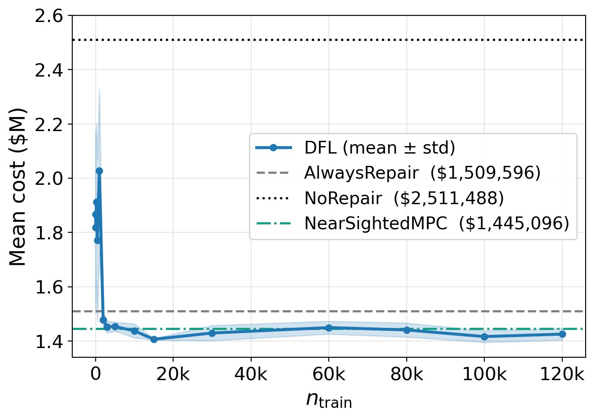
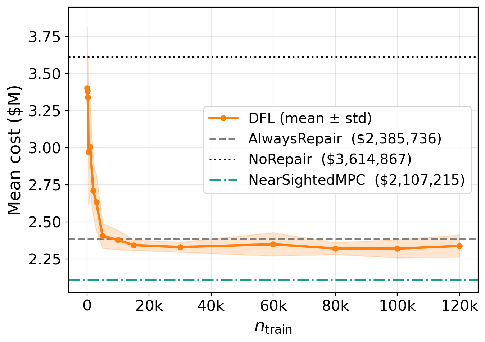
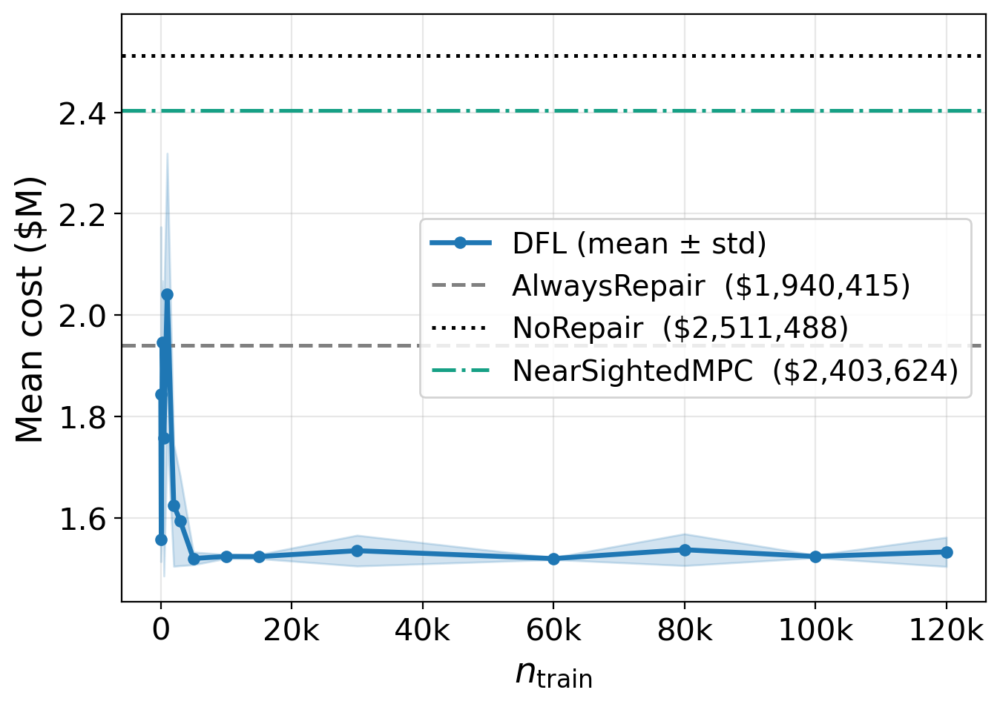
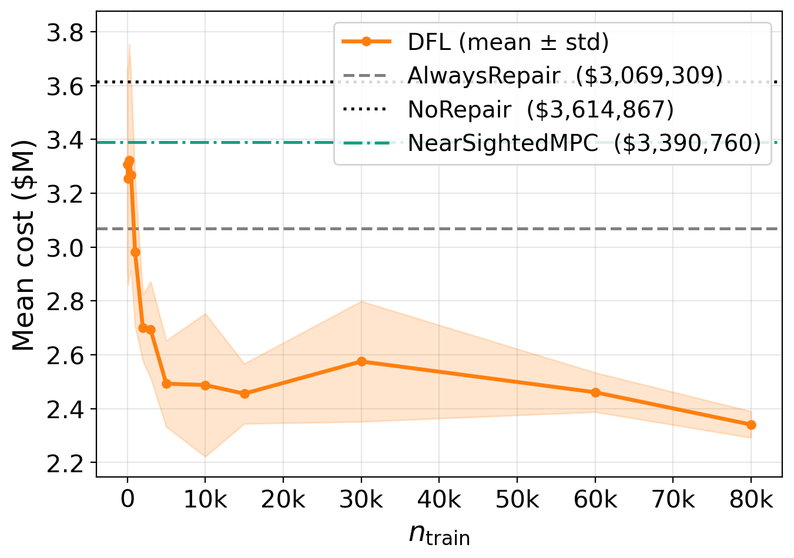
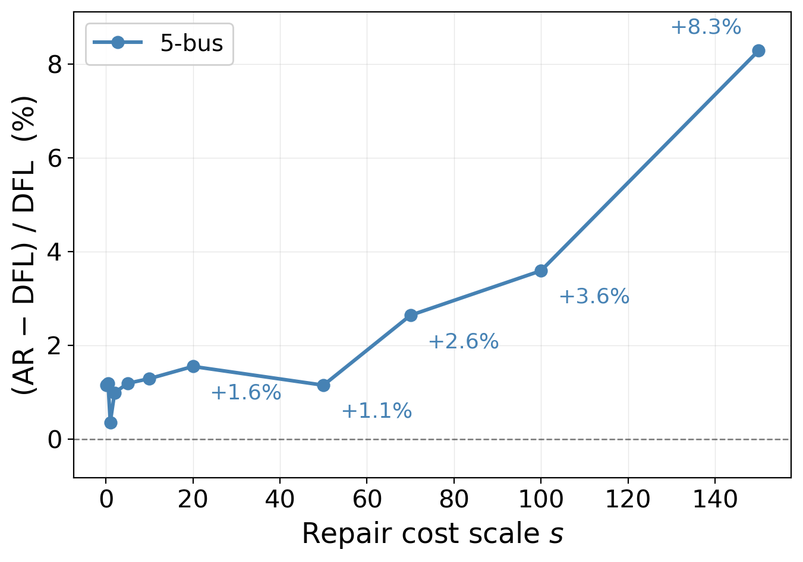
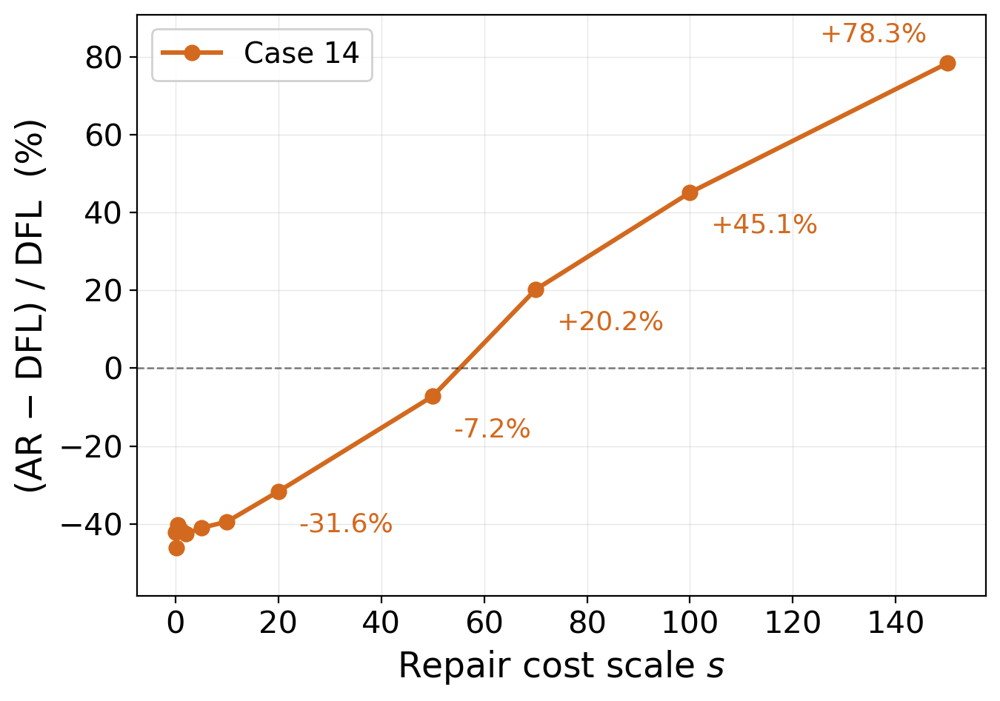
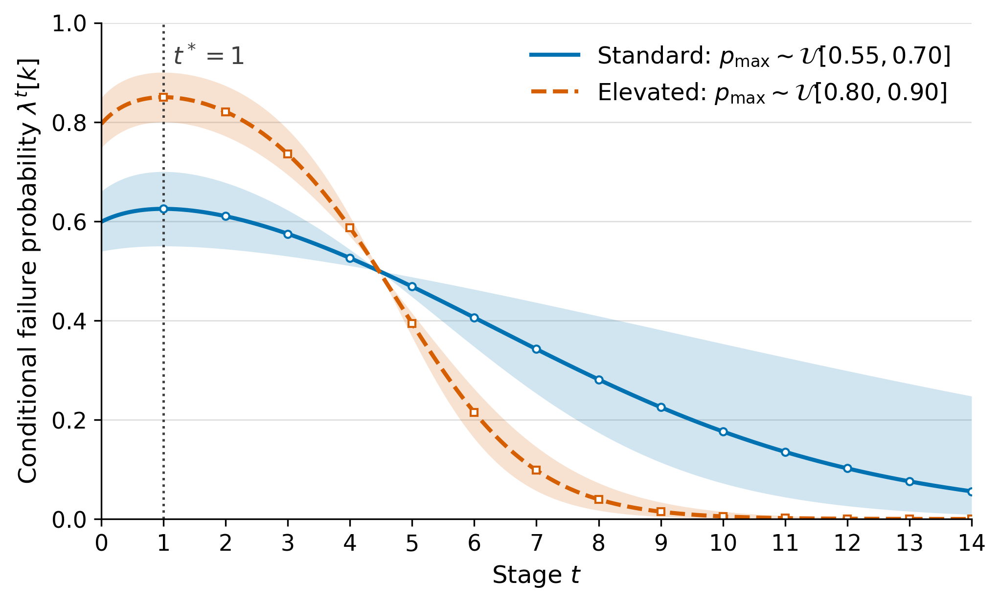
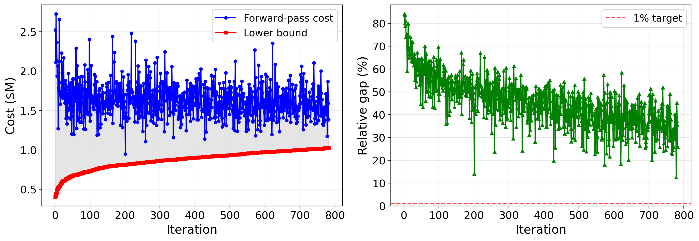

# Reported numbers and figures

The two scripts in this folder rebuild the numbers and figures reported in the paper from the result files stored in [`experiments/`](../experiments/README.md). They read only stored files, listed under [Inputs](#inputs), and do not train, solve or simulate anything.

| Script | What it does | Writes | Run time |
|---|---|---|---|
| [`reproduce_paper_numbers.py`](reproduce_paper_numbers.py) | Recomputes the reported numbers and compares each one with the value stated in the paper (112 checks) | nothing, apart from caching the case14 file on first use ([below](#the-case14-network-file)) | about 3 s |
| [`make_paper_figures.py`](make_paper_figures.py) | Redraws the 10 figures in [`figures/`](../figures) | `figures/`, or the folder given with `--out` | about 3 s |

The run times were measured on a laptop (Apple Silicon, Python 3.11 with `requirements-lock.txt`). Both scripts import repository modules, so Python may add `__pycache__/` folders, which git ignores and `PYTHONDONTWRITEBYTECODE=1` avoids.

**Contents**

1. [Quick start](#quick-start)
2. [`reproduce_paper_numbers.py`](#reproduce_paper_numberspy)
3. [`make_paper_figures.py`](#make_paper_figurespy)
4. [Inputs](#inputs)
5. [The case14 network file](#the-case14-network-file)

## Quick start

Run from the repository root, with the Python environment of the [top-level README](../README.md#python-environment) active:

```bash
python paper/reproduce_paper_numbers.py                       # ends with "All checks agree with the paper."
python paper/make_paper_figures.py --out /tmp/paper_figures   # redraws the figures, leaves figures/ unchanged
```

- Both scripts find the repository from their own location, so they also work from another working directory.
- `reproduce_paper_numbers.py` needs an internet connection the first time it runs, to download the IEEE 14-bus case file (see [below](#the-case14-network-file)). `make_paper_figures.py` reads no network data.
- Neither script needs a MIP solver, a solver license, Julia or a GPU.
- [`scripts/quick_check.sh`](../scripts/quick_check.sh) runs both scripts as part of its end-to-end check of a checkout, and compares the redrawn figures with `figures/` (see [`scripts/README.md`](../scripts/README.md)).

## `reproduce_paper_numbers.py`

### What it checks

The values stated in the paper are written into the script, with the exceptions noted under [Reading the output](#reading-the-output). For each of them, the script recomputes the value from the files in `experiments/` and prints both.

In the output and in the result files, `paper_unbudgeted` and `paper_budget0.3` are the runs without and with the per-stage repair budget (budget fraction $`\varphi = 0.3`$). `toy` is the 5-bus network at repair-cost scale $`s = 100`$, and `case14` and `case14_scale55` are the IEEE 14-bus network at $`s = 45`$ and $`s = 55`$.

| Output section | What is recomputed | Checks |
|---|---|---:|
| Failure model constants | $`K^* \approx 0.763`$, the lower limit on $`K`$ for which the failure model is defined (with $`t^* = 1`$, the root of $`(1 + K)\ln(1 + K) = 1`$), and $`\delta = (1 + K)\ln(1 + K) - 1 \approx 1.29`$ at $`K = 1.5`$, which follows from the same formula. The paper states only $`K^*`$ | 2 |
| Mean out-of-sample cost by method | For each of the six configurations, the mean cost of NoRepair, AlwaysRepair, Near-sighted MPC, SAA and DFL over the 500 test scenarios, the saving of DFL relative to AlwaysRepair (DFL vs AR), and whether the reported training size has the lowest five-seed mean of its sweep. For the budgeted runs, also the across-seed standard deviation of DFL | 45 |
| Cost decompositions quoted in the text | Mean repair spend (USD) and load shed (MWh) of DFL and AlwaysRepair in five configurations | 20 |
| Across-scenario standard deviation | Standard deviation of the cost over the 500 test scenarios for DFL (averaged over the five seeds), AlwaysRepair and Near-sighted MPC. Checked for DFL and AlwaysRepair in the budgeted runs. The other values are printed | 6 |
| Deployment time per 14-stage test scenario | Wall time per test scenario of each policy, as measured on the cluster. Checks the DFL time and the MPC-to-DFL ratio on toy and case14 without budget | 4 |
| SAA solver statistics | Solver, final MIP gap, tree objective, solve time and termination status of the six SAA runs | printed only |
| SDDiP | Lower bound, number of iterations, mean cost of the final policy over its 500 post-training simulations, and the estimated gap $`(\bar c_{\mathrm{SDDiP}} - \mathrm{LB})/\bar c_{\mathrm{SDDiP}}`$. On toy, also how far the policy mean and the bound lie from the exact optimum | 28 |
| Exact dynamic programming on the 5-bus network | The two exact optima, and how far the DFL mean lies above them | 4 |
| Sample-complexity statements | For toy without budget, the first training size at which DFL beats AlwaysRepair, and the largest across-seed standard deviation for $`n_{\text{train}} \ge 15{,}000`$ (printed only). For case14 at $`s = 55`$ without budget, the lowest DFL mean and its training size | 3 |
| Repair-cost sensitivity | The table of $`(\bar c_{\mathrm{AR}} - \bar c_{\mathrm{DFL}})/\bar c_{\mathrm{DFL}}`$ by scale and network, and the case14 zero crossing interpolated between $`s = 50`$ and $`s = 70`$ $`(s = 55.2)`$ | printed only |

The ratios in these checks compare mean costs $`\bar c`$, each the mean total cost over the 500 test scenarios. For SDDiP the mean runs over its 500 simulations instead. For DFL it is the five-seed mean, except in the sensitivity table, which uses the single model with initialization seed 42. AR stands for AlwaysRepair and $`\mathrm{LB}`$ for the SDDiP lower bound. [From files to reported numbers](../experiments/README.md#from-files-to-reported-numbers) in `experiments/README.md` gives the formulas of the five ratios, all reported in percent: DFL vs AR, sensitivity, above and below the exact optimum, and the estimated gap.

Notes on the quantities:

- DFL vs AR and sensitivity differ only in the denominator: the AlwaysRepair cost in the cost tables, the DFL cost in the sensitivity table.
- `std_cost` has two meanings. In an aggregated `dfl_train<N>/evaluation.json`, the DFL entry holds the standard deviation across the five seed means. Everywhere else it is the standard deviation across the 500 test scenarios. The across-scenario value for DFL is therefore averaged over the five `seed_<seed>/evaluation.json` files of the reported size.
- The SAA cost is the mean of the nearest-child rollout over the 500 test scenarios (`out_of_sample_evaluation.mean_cost`). The tree objective printed in the SAA statistics is the in-sample objective of the MILP incumbent over the 16,384 sampled tree paths, not the cost of a deployable policy. The termination status `optimal` of the toy runs means that the 10% target gap was reached.
- The SDDiP policy mean is not stored as such. For each stage, the SDDiP result file keeps the average generation, load served and repair decisions over the 500 simulations. The stage cost is affine in these quantities, so pricing the averages with the network's generation costs and the run's repair costs (bases $`550\,s`$ and $`350\,s`$) gives the exact mean cost of the simulations. `reconstruct_saved_sddip_mean` in [`exact_dp/exact_dp_toy.py`](../exact_dp/exact_dp_toy.py) does this, and the script builds the case14 network for that purpose. The simulations draw from SDDiP's own stagewise distribution, not from the common test set. This distribution enumerates all 128 outcomes per stage on toy and uses a sample of 256 outcomes per stage on case14. The individual simulation costs were not kept, so there is no standard deviation.
- The `upper_bound` and `gap` fields of `sddip_solution.json` come from the single forward pass of the last training iteration, not from a statistical upper bound. The script uses neither.
- The deployment times are the `mean_time_per_scenario_s` values of the cluster runs. The SAA rollouts solved their stage LPs with gurobipy, the other policies with SciPy's HiGHS.

### Reading the output

Each checked number prints one line:

```text
  [ok] DFL (five-seed mean)                                     paper=    1,406,419  recomputed=    1,406,419
```

- `paper=` is the value as stated in the paper, `recomputed=` the value computed from the stored files. Two kinds of `paper=` values are not printed in the paper in this form: $`\delta = 1.29`$, which follows from the formula behind $`K^*`$, and the DFL deployment times. The script checks these times at the precision of the result files (30.0 and 35.2 ms), while the paper rounds them to about 30 ms and 35 ms.
- A check passes when the two differ by no more than the rounding of the stated value: 0.5 for dollars, MWh, counts, training sizes and the MPC-to-DFL time ratio, 0.05 for percentages and milliseconds, 0.0005 for $`K^*`$ and 0.005 for $`\delta`$. The line `paper= 0.7630  recomputed= 0.7632` therefore passes. A failed check shows `[MISMATCH]` in place of `[ok]`.
- Lines starting with `--` name the configuration of the checks that follow. In the cost section they also give the DFL training size, and in the SDDiP section the SDDiP run time in hours and the number of cuts.
- Lines without `[ok]` or `[MISMATCH]` are printed for reference and are not checked.
- The last line is `All checks agree with the paper.` with exit status 0, or `<N> check(s) disagree with the paper.` with exit status 1, so the script can serve as a test.

Each time the case14 network is built (four times), pandapower writes `There are 3 branches which are considered as trafos - due to ratio unequal 0 or 1 - but connect same voltage levels.` to standard error. The message can be ignored. On the first run, `network_data.py` also prints the download of the case file.

<details>
<summary>Excerpt of the output</summary>

```text
====================================================================================================
Failure model constants
  [ok] K* solving (1+K) ln(1+K) = 1                             paper=       0.7630  recomputed=       0.7632
  [ok] delta at K = 1.5                                         paper=       1.2900  recomputed=       1.2907
====================================================================================================
Mean out-of-sample cost by method (unbudgeted and budgeted tables)
  -- paper_unbudgeted / toy (n_train = 15,000)
  [ok] NoRepair                                                 paper=    2,511,488  recomputed=    2,511,488
  [ok] AlwaysRepair                                             paper=    1,509,596  recomputed=    1,509,596
  [ok] Near-sighted MPC                                         paper=    1,445,096  recomputed=    1,445,096
  [ok] SAA (nearest-child rollout)                              paper=    2,028,014  recomputed=    2,028,014
  [ok] DFL (five-seed mean)                                     paper=    1,406,419  recomputed=    1,406,419
  [ok] Savings vs AlwaysRepair, % of AR cost                    paper=         +6.8  recomputed=         +6.8
  [ok] reported n_train is the best size of the sweep           paper=       15,000  recomputed=       15,000
...
====================================================================================================
SAA solver statistics
  paper_unbudgeted toy             solver gurobi, gap   9.7%, incumbent   1,405,197,    0.9 h (optimal)
  paper_unbudgeted case14          solver gurobi, gap  60.1%, incumbent   2,757,664,  116.7 h (maxTimeLimit)
...
====================================================================================================
SDDiP: lower bound, iterations and 500-simulation policy mean (SDDiP table)
  -- paper_unbudgeted / toy (116.8 h, 10166 cuts)
  [ok] lower bound                                              paper=    1,024,482  recomputed=    1,024,482
  [ok] iterations                                               paper=          782  recomputed=          782
  [ok] policy mean                                              paper=    1,584,476  recomputed=    1,584,476
  [ok] estimated gap (mean - LB) / mean, %                      paper=         35.3  recomputed=         35.3
  [ok] policy mean above the exact optimum, %                   paper=         14.6  recomputed=         14.6
  [ok] lower bound below the exact optimum, %                   paper=         25.9  recomputed=         25.9
...
====================================================================================================
Exact dynamic programming on the 5-bus network
  [ok] unbudgeted exact optimum ($)                             paper=    1,382,625  recomputed=    1,382,625
  [ok] budgeted exact optimum ($)                               paper=    1,493,319  recomputed=    1,493,319
  [ok] paper_unbudgeted: DFL mean above the exact optimum, %    paper=          1.7  recomputed=          1.7
  [ok] paper_budget0.3: DFL mean above the exact optimum, %     paper=          1.8  recomputed=          1.8
...
  case14 zero crossing by linear interpolation between s = 50 and s = 70: s = 55.2
====================================================================================================
All checks agree with the paper.
```

</details>

### When a check fails

With the files as stored, all 112 checks pass. A `MISMATCH` means that a result file differs from the one the paper was written from, for example because experiments were rerun into `experiments/`, or because `aggregate_multiseed.py` was run over a tree that contains new runs.

Some results change when they are rerun, even with identical settings:

- budgeted DFL training, whose Monte Carlo perturbations draw from NumPy's unseeded global random state;
- the SAA and SDDiP runs that stopped at their time limit, whose results depend on the limit and on the speed of the machine;
- all timings.

To check new runs, compare them with the stored files rather than expecting `[ok]` on each line.

## `make_paper_figures.py`

### The figures

Each entry names a file in `figures/`, what it shows and the data it is drawn from.

- `failure_probability_profiles.png`: failure probability $`\lambda^t[k]`$ of an operational component over the 14 stages for the two vulnerability classes, Standard $`(p_{\max} \sim \mathcal{U}[0.55, 0.70])`$ and Elevated $`(p_{\max} \sim \mathcal{U}[0.80, 0.90])`$. Each class is drawn at its midpoint $`p_{\max}`$, with a band over its $`p_{\max}`$ range and markers at the stages. The peak is at $`t^* = 1`$. Data: the failure-model constants in `config.py`.
- `sensitivity/cost_vs_scale_toy.png`: repair-cost sensitivity on the 5-bus network without budget, $`(\bar c_{\mathrm{AR}} - \bar c_{\mathrm{DFL}})/\bar c_{\mathrm{DFL}}`$ in % against the repair-cost scale $`s`$ from 0.1 to 150. Values are written next to the points from $`s = 20`$ on. Data: the `toy` column of `experiments/sensitivity/sensitivity_curve.txt`.
- `sensitivity/cost_vs_scale_case14.png`: the same for case14. The curve crosses zero between $`s = 50`$ and $`s = 70`$. Data: the `case14` column of the same file.
- `paper/toy/convergence_multiseed.png`: sample complexity on the 5-bus network $`(s = 100)`$ without budget. The DFL mean cost on the 500 test scenarios is plotted against the training size $`n_{\text{train}}`$ (25 to 120,000), with a band of ± one standard deviation across the five initialization seeds. AlwaysRepair, NoRepair and Near-sighted MPC are horizontal lines, with their mean cost in the legend. Data: the aggregated `evaluation.json` of every `experiments/paper_unbudgeted/dfl_scaling_multiseed/toy/dfl_train*/` folder.
- `paper/toy/convergence_multiseed_budget.png`: the same with the per-stage budget $`\varphi = 0.3`$. Data: `experiments/paper_budget0.3/dfl_scaling_multiseed/toy/`.
- `paper/case14_scale55/convergence_multiseed.png`: sample complexity on case14 at $`s = 55`$ without budget. Data: `experiments/paper_unbudgeted/dfl_scaling_multiseed/case14_scale55/`.
- `paper/case14_scale55/convergence_multiseed_budget.png`: the same with $`\varphi = 0.3`$. The curve ends at $`n_{\text{train}} = 80{,}000`$ because the sizes 100,000 and 120,000 did not finish within the wall-clock limit. Data: `experiments/paper_budget0.3/dfl_scaling_multiseed/case14_scale55/`.
- `paper/case14/convergence_multiseed.png`: sample complexity on case14 at $`s = 45`$ without budget. The paper reports this configuration in its tables only. Data: `experiments/paper_unbudgeted/dfl_scaling_multiseed/case14/`.
- `paper/case14/convergence_multiseed_budget.png`: the same with $`\varphi = 0.3`$, also reported in the tables only. Data: `experiments/paper_budget0.3/dfl_scaling_multiseed/case14/`.
- `paper/toy/sddip_convergence.png`: SDDiP training trace on the 5-bus network without budget, 782 iterations. Left: the lower bound and the cost of the forward pass of each iteration. Right: their relative difference in %, with a dashed reference line at 1%, labeled "1% target" in the legend. A forward-pass cost is the cost of one sampled trajectory, not a statistical upper bound, so the right panel is a diagnostic trace. SDDiP stops on its iteration and time limits, not on this gap. Data: the `convergence` entry of `experiments/paper_unbudgeted/toy/SDDiP/sddip_solution.json`.

In the sample-complexity plots, each point is the DFL mean cost averaged over the five initialization seeds, and the band is the population standard deviation of the five seed means (the `std_cost` of the aggregated files). The baselines do not depend on the training size.

In the sensitivity plots, each point is a single DFL model (initialization seed 42) trained on 120,000 scenarios without budget and evaluated on the 500 test scenarios.

<details>
<summary>Preview of the figures</summary>

Sample complexity without budget (5-bus, case14 at $`s = 55`$):

 

Sample complexity with the budget $`\varphi = 0.3`$ (5-bus, case14 at $`s = 55`$):

 

Repair-cost sensitivity (5-bus, case14):

 

Failure-probability profiles and SDDiP training trace:





</details>

### Output folder

```bash
python paper/make_paper_figures.py                            # overwrites the PNGs in figures/
python paper/make_paper_figures.py --out /tmp/paper_figures   # the same files and subfolders in another folder
```

`--out DIR` writes the 10 files, with the subfolders shown above, into `DIR`. The folder is created if needed, and a relative `DIR` is resolved against the working directory. Without `--out`, the script overwrites the PNGs in `figures/`. It prints the path of each file it saves.

### Pixel differences

In the environment that produced the stored figures (Anaconda Python 3.13 with matplotlib 3.10.6), the script reproduces `figures/` pixel for pixel. Matplotlib wheels installed with pip rasterize text slightly differently, so with `requirements-lock.txt` the redrawn figures differ from the stored ones by a few pixels, mostly in canvas size. The plotted data are the same. `scripts/quick_check.sh` reports these differences figure by figure and fails only when a figure is missing.

### Other plots in `experiments/`

The cluster jobs also wrote diagnostic plots next to the results:

- `convergence_multiseed.png` in `experiments/<variant>/dfl_scaling_multiseed/` and in each network folder below it, written by `aggregate_multiseed.py --plot`;
- `experiments/sensitivity/sensitivity_curve*.png`, written by `scripts/sensitivity_plot.py`;
- `sddip_convergence.png` in each `SDDiP/` folder, written by the SDDiP run, which labels the forward-pass cost "Upper Bound".

They show the same data in another style. The paper uses only the figures in `figures/`.

## Inputs

The two scripts read the following files. `<variant>` is `paper_unbudgeted` or `paper_budget0.3`, and `<net>` is `toy`, `case14` or `case14_scale55`.

- `experiments/<variant>/dfl_scaling_multiseed/<net>/dfl_train<N>/evaluation.json`, aggregated over the seeds, read by both scripts for the mean costs, cost decompositions, standard deviations and deployment times of DFL and the baselines, and for the sample-complexity sweeps and plots.
- `experiments/<variant>/dfl_scaling_multiseed/<net>/dfl_train<N>/seed_<seed>/evaluation.json` at the reported size, read by `reproduce_paper_numbers.py` for the across-scenario standard deviation of DFL.
- `experiments/<variant>/<net>/SAA/solution.json`, read by `reproduce_paper_numbers.py` for the SAA mean cost and time per scenario (`out_of_sample_evaluation`) and the solver statistics (`solver_metadata`, `objective_value`).
- `experiments/<variant>/<net>/SDDiP/sddip_solution.json`, read by `reproduce_paper_numbers.py` for the lower bound, iterations, cuts, run time and the stagewise averages for the policy mean, and by `make_paper_figures.py` for the training trace (`convergence`) of toy without budget.
- `experiments/exact_dp_toy/{unbudgeted,budgeted}/exact_dp_solution.json`, read by `reproduce_paper_numbers.py` for the exact optima (`solution.exact_optimal_value`).
- `experiments/sensitivity/sensitivity_curve.txt`, read by both scripts for the $`(\bar c_{\mathrm{AR}} - \bar c_{\mathrm{DFL}})/\bar c_{\mathrm{DFL}}`$ table.
- `config.py`, read by `make_paper_figures.py` for the failure-model constants and the horizon $`T`$.
- `~/.cache/pglib_opf/pglib_opf_case14_ieee.m`, read by `reproduce_paper_numbers.py` for the case14 network, to price the SDDiP decisions.

The aggregated `evaluation.json` files are written by `aggregate_multiseed.py` from the per-seed files, `sensitivity_curve.txt` by `scripts/sensitivity_plot.py`, and the exact-DP files by `exact_dp/exact_dp_toy.py` (see [`exact_dp/README.md`](../exact_dp/README.md)). [`experiments/README.md`](../experiments/README.md) describes the layout and the fields of all result files.

Besides NumPy, `reproduce_paper_numbers.py` imports SciPy and pandapower (through the repository modules it uses), and pandapower reads the case14 file with matpowercaseframes. `make_paper_figures.py` imports matplotlib. All are in `requirements-lock.txt`.

## The case14 network file

`reproduce_paper_numbers.py` builds the IEEE 14-bus network to price the saved SDDiP decisions on case14. The first time this happens, `network_data.py` downloads `pglib_opf_case14_ieee.m` from the master branch of the PGLib-OPF repository on GitHub and caches it in `~/.cache/pglib_opf/`. Later runs read the cached file and need no internet connection. If the file is missing and there is no connection, the script stops in its SDDiP section with an error that names the expected location of the file.

The experiments used `pglib_opf_case14_ieee.m` of PGLib-OPF v23.07, with SHA-256 `bd5c568621de65e4b0922317010868bc7fa94173807faa10ea8fdbbe77c28106`. At the time of writing, the master-branch file is identical to it. To pin this version, or to prepare a machine without internet access, place the file in the cache manually:

```bash
mkdir -p ~/.cache/pglib_opf
curl -L -o ~/.cache/pglib_opf/pglib_opf_case14_ieee.m \
    https://raw.githubusercontent.com/power-grid-lib/pglib-opf/v23.07/pglib_opf_case14_ieee.m
shasum -a 256 ~/.cache/pglib_opf/pglib_opf_case14_ieee.m    # on Linux: sha256sum
```

The download is not checked against a checksum. If a download was interrupted, delete the cached file and run the script again.
