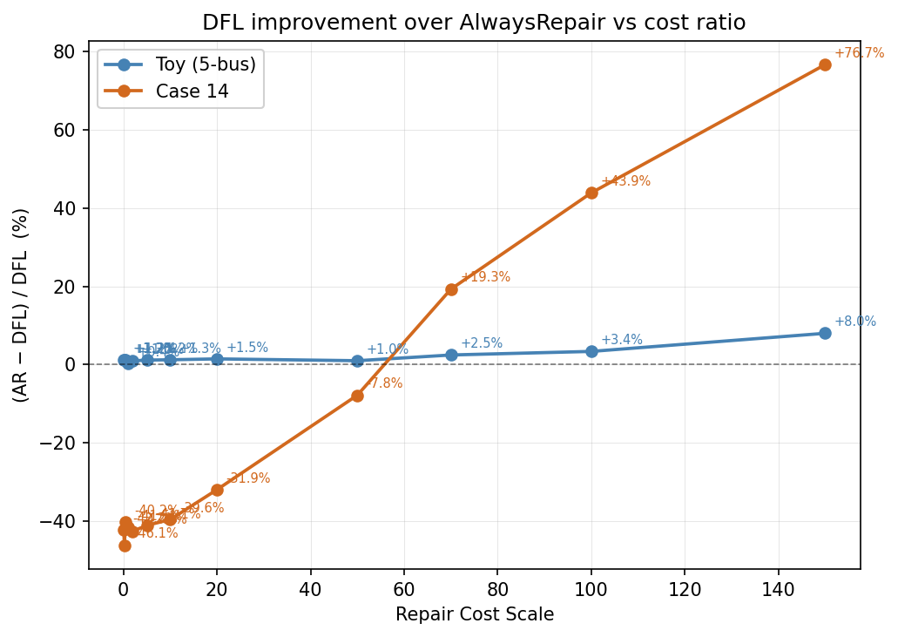
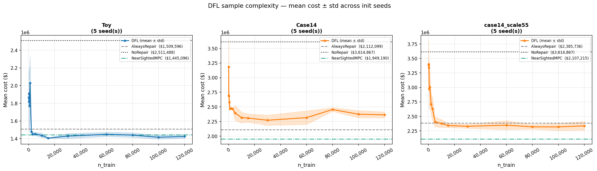
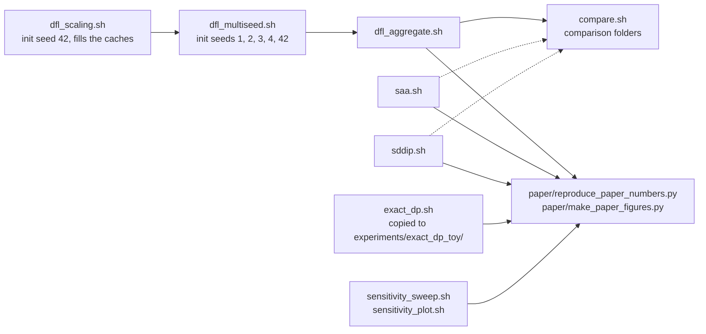

# Scripts

Helper scripts of the repository. Run all of them from the repository root.

- [`quick_check.sh`](quick_check.sh) checks a checkout end to end on a laptop in about a minute.
- [`sensitivity_plot.py`](sensitivity_plot.py) builds the table and plots of the repair-cost sensitivity sweep.
- [`make_readme_figures.py`](make_readme_figures.py) draws the two figures of the top-level README that the paper does not have: `docs/images/toy_network.png`, the 5-bus network from the data in `network_data.py`, and `docs/images/budget_cost_bars.png`, the budgeted mean cost of every method on the 5-bus network and on case14 at $`s = 55`$, with the exact 5-bus optimum as a reference line, read from `experiments/`. The script prints every plotted value.
- [`slurm/`](slurm) holds the SLURM job scripts that produced the results stored in [`experiments/`](../experiments/README.md), the environment setup, and a suite of [smoke tests](slurm/smoke/README.md). The experiments ran on the Snellius cluster, partition `rome` (AMD EPYC 7H12 nodes).

Installation and the Python entry points are described in the [top-level README](../README.md), the stored results in [`experiments/README.md`](../experiments/README.md), and the scripts that recompute the reported numbers and figures in [`paper/README.md`](../paper/README.md).

Names used in the code, the scripts and the result files:

| Name | Meaning |
|---|---|
| `toy` | the synthetic 5-bus network of the paper (2 generators, 5 lines, 7 failure-prone components), run at repair-cost scale $`s = 100`$ |
| `case14` | the IEEE 14-bus network from PGLib-OPF (5 generators, 20 branches), run at $`s = 45`$ |
| `case14_scale55` | result folder of case14 at $`s = 55`$ |
| `Pseudo_DFL` | the DFL policy |
| `NearSightedMPC` | the Near-sighted MPC baseline (window $`W = 3`$) |
| `AlwaysRepair`, `NoRepair` | the two trivial heuristics |
| `paper_unbudgeted`, `paper_budget0.3` | runs without a repair budget, and runs with per-stage budget fraction $`\varphi = 0.3`$ |

**Contents**

1. [Overview](#overview)
2. [Laptop check](#laptop-check)
3. [Sensitivity plot](#sensitivity-plot)
4. [Cluster pipelines](#cluster-pipelines)
   - [Common conventions](#common-conventions)
   - [Solver selection](#solver-selection)
   - [Lanes](#lanes)
   - [Adding a lane](#adding-a-lane)
   - [Resources and logs](#resources-and-logs)
   - [DFL training sweep](#dfl-training-sweep)
   - [Comparison folders](#comparison-folders)
   - [SAA](#saa)
   - [SDDiP](#sddip)
   - [Submission order](#submission-order)
   - [Skip guards, failures and resubmission](#skip-guards-failures-and-resubmission)
   - [Recorded run times](#recorded-run-times)
5. [Sensitivity sweep](#sensitivity-sweep)
6. [Exact DP job](#exact-dp-job)
7. [Environment setup](#environment-setup)
8. [Smoke tests](#smoke-tests)
9. [Running on another cluster](#running-on-another-cluster)

## Overview

| Script | Start with | Purpose |
|---|---|---|
| `quick_check.sh` | `bash scripts/quick_check.sh` | installation check, unit tests, short runs, and a check of the reported numbers and figures (laptop) |
| `sensitivity_plot.py` | `python scripts/sensitivity_plot.py` | $`(\bar c_{\mathrm{AR}} - \bar c_{\mathrm{DFL}})/\bar c_{\mathrm{DFL}}`$ against the repair-cost scale $`s`$, from the sensitivity sweep |
| `make_readme_figures.py` | `python scripts/make_readme_figures.py` | redraws `docs/images/toy_network.png` and `docs/images/budget_cost_bars.png`, the two figures of the top-level README that the paper does not have, or writes them to the folder given with `--out` |
| `slurm/install_env.sh` | `sbatch` | creates `.venv` with the Python packages, gurobipy, Julia, SDDP.jl and Gurobi.jl |
| `slurm/install_deps.sh` | `bash`, on a login node | adds missing packages to an existing `.venv` |
| `slurm/smoke/` | `bash scripts/slurm/smoke/submit_all.sh`, or `sbatch` per job | nine short jobs that check the setup and both solvers |
| `slurm/unbudgeted/dfl_scaling.sh` | `sbatch` | DFL at 15 training sizes with init seed 42; fills the label and MPC caches |
| `slurm/unbudgeted/dfl_multiseed.sh` | `sbatch` | the same sweep for init seeds 1, 2, 3, 4 and 42 |
| `slurm/unbudgeted/dfl_aggregate.sh` | `sbatch` | aggregates the five seeds of every training size |
| `slurm/unbudgeted/compare.sh`, `run_comparison_folders.py` | `sbatch` | diagnostic comparison folders |
| `slurm/unbudgeted/saa.sh` | `sbatch` | tree SAA |
| `slurm/unbudgeted/sddip.sh` | `sbatch` | SDDiP through SDDP.jl |
| `slurm/budgeted/` | `sbatch` | the same six jobs with $`\varphi = 0.3`$ |
| `slurm/sensitivity/submit_sensitivity.sh` | `bash` | submits `sensitivity_sweep.sh` (12 repair-cost scales) and then `sensitivity_plot.sh` |
| `slurm/exact_dp.sh` | `sbatch` | exact dynamic program on toy, both variants |

## Laptop check

`quick_check.sh` runs the steps below from a new temporary folder and prints `ok` or `FAILED` for each, with the elapsed time. The times were measured on a laptop (Apple Silicon, Python 3.11 with `requirements-lock.txt`).

| Step | Command | What it checks | Time |
|---|---|---|---|
| installation check | `verify_installation.py` | imports, toy network, model parameters, a MIP build, available solvers | about 1 s |
| unit tests | `pytest tests/` | 118 tests; 117 pass and 1 is skipped when GLPK's `glpsol` is not on the PATH | about 15 s |
| DFL quick run | `Pseudo_DFL_main.py --test` | toy, 10 training scenarios, 10 epochs, 5 test scenarios, $`s = 1`$ | 30 to 40 s |
| SAA wait-and-see | `main.py --mode ws --n-scenarios 4 --evaluate --n-test 4 --no-plots` | a 4-scenario wait-and-see MIP and its evaluation | about 8 s |
| exact DP | `exact_dp/exact_dp_toy.py --variant both ...` | both variants, with the settings of the stored results | about 2 s |
| exact DP check | inline Python | the recomputed optima equal those in `experiments/exact_dp_toy/` (relative tolerance 1e-6) | under 1 s |
| reported numbers | `paper/reproduce_paper_numbers.py` | 112 checks against the stored results | about 3 s |
| figures | `paper/make_paper_figures.py --out <tmp>` | the 10 figures of `figures/`, redrawn | a few seconds |
| figure comparison | inline Python | redrawn figures against `figures/` | under 1 s |
| SDDiP quick run, only with `--with-sddip` | `SDDiP_main.py --test --no-plots` | toy SDDiP: 5 iterations, 100 policy simulations, 120 s training limit | several minutes on the first call |

With the environment of the [top-level README](../README.md#python-environment) active:

```bash
bash scripts/quick_check.sh                                   # steps 1 to 9
bash scripts/quick_check.sh --with-sddip                      # adds the SDDiP run
PYTHON=.venv/bin/python bash scripts/quick_check.sh           # a specific interpreter
```

- The interpreter is `PYTHON`, by default `python3` from the PATH. Activate the environment or set `PYTHON`. Otherwise, the first `python3` on the PATH is used. `PYTHON` can be a command name or a relative or absolute path. A relative path is resolved against the current directory before the steps start.
- Outputs go to a new folder created with `mktemp -d ${TMPDIR:-/tmp}/quick_check.XXXXXX`, whose path is printed at the start and at the end. It also receives the `data_cache/` of the DFL run and one log per step. Outside that folder, the script itself writes only the PGLib case14 file in `~/.cache/pglib_opf/`. The reported-numbers step downloads this file on first use, so internet is needed once. The packages may add caches of their own: matplotlib builds its font cache on first use, and PyTorch can leave an empty `torchinductor_<user>/` folder in the system temporary directory. With `--with-sddip`, the first `juliacall` import also installs Julia and SDDP.jl into `<venv>/julia_env` and the Julia depot `~/.julia`, which needs internet and takes several minutes.
- The run ends with `Passed: N   Failed: M` and exits with status 0 only when every step passed. A failed step prints the last 25 lines of its log and the log's path. `-h` prints the usage, and an unknown argument makes the script exit with status 2.
- The figure comparison fails only when a figure is missing. In the environment that drew `figures/` (Anaconda Python 3.13 with matplotlib 3.10.6), the redrawn figures are pixel-identical. Pip-installed matplotlib wheels, including the version in `requirements-lock.txt`, rasterize text slightly differently. With them, the step typically reports that none of the 10 figures is pixel-identical and that the canvas sizes are a few pixels off. The plotted data are the same.

## Sensitivity plot

`sensitivity_plot.py` reads `<base>/scale_<s>/<net>/evaluation.json` for `toy` and `case14`. For each network and scale, it computes the ratio $`(\bar c_{\mathrm{AR}} - \bar c_{\mathrm{DFL}})/\bar c_{\mathrm{DFL}}`$ in percent, where $`\bar c_{\mathrm{AR}}`$ and $`\bar c_{\mathrm{DFL}}`$ are the means of the per-scenario `costs` of `AlwaysRepair` and `Pseudo_DFL`.

```bash
python scripts/sensitivity_plot.py                                    # defaults below
python scripts/sensitivity_plot.py --out my_plots/sensitivity_curve.png
```

| Flag | Default, relative to the working directory |
|---|---|
| `--base` | `experiments/sensitivity` |
| `--out` | `experiments/sensitivity/sensitivity_curve.png` |

It writes four files named after `--out`: the combined figure, one figure per network (`sensitivity_curve_toy.png` and `sensitivity_curve_case14.png`) and the table `sensitivity_curve.txt`. The table has a header row, a separator row and one row per scale, with `---` where a result is missing. `paper/make_paper_figures.py` and `paper/reproduce_paper_numbers.py` parse it.

- Run from the repository root with the defaults, the script overwrites the stored files. On the stored results, the regenerated table is byte-identical to `experiments/sensitivity/sensitivity_curve.txt`, and the run takes about a second.
- Only folders named `scale_<float>` are read, e.g. `scale_10.0`, which is how `sensitivity_sweep.sh` names them. A folder named `scale_10` is listed but not read, so its row shows `---`.
- This ratio divides by the DFL cost. DFL vs AR in the cost tables divides by the AlwaysRepair cost instead: $`(\bar c_{\mathrm{AR}} - \bar c_{\mathrm{DFL}})/\bar c_{\mathrm{AR}}`$.
- The figures written here are diagnostics. The reported figures `figures/sensitivity/cost_vs_scale_toy.png` and `cost_vs_scale_case14.png` are drawn from the same table by `paper/make_paper_figures.py`.
- The script exits with status 1 when `--base` has no `scale_*` folder.

<details>
<summary>Combined figure drawn from the stored results</summary>



</details>

## Cluster pipelines

### Common conventions

Every job script

- is submitted from the repository root. It sets `PROJECT_DIR="${SLURM_SUBMIT_DIR:-$(pwd)}"`, activates `$PROJECT_DIR/.venv`, changes to `PROJECT_DIR`, and resolves `experiments/`, `logs/` and the `data_cache*/` folders there;
- writes its SLURM output to `logs/` in that directory. SLURM opens these files before the script starts, so `logs/` must exist at submission. The repository keeps `logs/.gitkeep` for this reason;
- runs `module purge`, then loads the Snellius modules `2023` and `Python/3.11.3-GCCcore-12.3.0`, plus `Gurobi/10.0.1-GCCcore-12.3.0` when the solver is a Gurobi variant;
- requests partition `rome`, 1 node and 1 task.

The scripts in `unbudgeted/` and `budgeted/` use `set -uo pipefail` without `-e`: a failing run is logged and the job continues (see [Skip guards, failures and resubmission](#skip-guards-failures-and-resubmission)). The other scripts use `set -euo pipefail` and stop at the first error. Each array task renames itself with `scontrol update`, so `squeue` shows its lane and seed, e.g. `unb_paper_dfl_ms_case14_s3`.

The job scripts rely on SLURM variables (`SLURM_ARRAY_TASK_ID`, `SLURM_JOB_ID`) and on environment modules, so submit them with `sbatch`. `sensitivity_sweep.sh` also runs under plain `bash` (see [Sensitivity sweep](#sensitivity-sweep)). To run one configuration on another machine, use the Python command shown for each job below. These commands are quoted from the scripts, which call the interpreter of `.venv` as `python3`. With the environment active, `python` is the same interpreter.

### Solver selection

`solver_config.py` chooses a solver for three layers of the code, from environment variables that it reads once at import:

| Layer | Used for | With no variable set | `ED_OPF_SOLVER=gurobi` |
|---|---|---|---|
| A | Pyomo MIPs: DFL training labels and SAA | `appsi_highs` | `gurobi` |
| B | SDDiP subproblems in SDDP.jl | HiGHS | Gurobi (needs Gurobi.jl) |
| C | stage DC-OPF LPs in every policy rollout | SciPy `linprog(method="highs")` | gurobipy |

`ED_OPF_SOLVER` is the master setting, and `ED_OPF_MIP_SOLVER`, `ED_OPF_LP_SOLVER` and `ED_OPF_SDDIP_SOLVER` override one layer each. A master value that contains `gurobi` also moves layers B and C to Gurobi. Any other value keeps them on HiGHS.

Two command-line flags override these variables for a single run: `--solver` sets layer A in `main.py` and `Pseudo_DFL_main.py` and layer B in `SDDiP_main.py`, and `--lp-method` sets layer C in `Pseudo_DFL_main.py`, `compare_methods.py` and `inject_mpc_baseline.py`. The layer C backend must be a SciPy `linprog` method name or exactly `gurobi`. Any other name, such as `gurobi_direct`, silently falls back to SciPy's deprecated `revised simplex` method.

Every script in `unbudgeted/` and `budgeted/` contains this block:

```bash
SOLVER="${SOLVER:-gurobi}"
if [[ "$SOLVER" == *gurobi* ]]; then
    module load Gurobi/10.0.1-GCCcore-12.3.0
    [[ -f "$HOME/gurobi.lic" ]] && export GRB_LICENSE_FILE="$HOME/gurobi.lic"
fi
export ED_OPF_SOLVER="$SOLVER"
```

These jobs therefore run on Gurobi by default. Set the solver at submission with `--export`:

```bash
sbatch --export=ALL,SOLVER=appsi_highs scripts/slurm/unbudgeted/dfl_scaling.sh
sbatch --export=ALL,SOLVER=gurobi,ED_OPF_LP_SOLVER=highs scripts/slurm/unbudgeted/saa.sh   # one layer changed
```

- On Snellius, the prefix form `SOLVER=appsi_highs sbatch ...` did not reach the job, which then ran with the default `gurobi`. Use `--export` instead.
- `--export=ALL` also forwards the environment of your login shell. An `ED_OPF_*` variable set there overrides the corresponding layer, so unset these variables before submitting unless they are intended.
- A license file at `~/gurobi.lic` is used when it exists. Otherwise, the cluster's default Gurobi license applies.
- With `SOLVER=gurobi`, the label generation of the DFL jobs runs up to 64 Gurobi MIP solves at a time per job, which can be more than a Gurobi license allows. The reported runs did not use this setup either.
- SDDiP on Gurobi needs Gurobi.jl in the Julia environment. `install_env.sh` and `install_deps.sh` add it, and the [smoke-test README](slurm/smoke/README.md#adding-gurobijl) shows the command.

Settings of the reported runs:

| Script | Default `SOLVER` | Reported runs |
|---|---|---|
| `dfl_scaling.sh`, `dfl_multiseed.sh` (both variants) | `gurobi` | submitted with `--export=ALL,SOLVER=appsi_highs`. Label MIPs on HiGHS through Pyomo appsi: 64 worker processes with 1 thread each, `maxtasksperchild=64`, forkserver start method, relative MIP gap 1e-6. Stage LPs of DFL, AlwaysRepair, NoRepair and Near-sighted MPC on SciPy's HiGHS |
| `sddip.sh` (both variants) | `gurobi` | submitted with `--export=ALL,SOLVER=appsi_highs`. SDDP.jl subproblems on HiGHS |
| `saa.sh` (both variants) | `gurobi` | the default: Gurobi 10.0.1 with MIPGap 0.10 and TimeLimit 419,760 s. Gurobi reported "using up to 32 threads" (its default cap) on the 64-CPU allocation. The out-of-sample rollout LPs also ran through gurobipy. LP optimal values do not depend on the solver |
| `sensitivity_sweep.sh` | `appsi_highs` | the default |
| `dfl_aggregate.sh`, `sensitivity_plot.sh` | `gurobi` | no effect: these jobs solve nothing |
| `compare.sh` | `gurobi` | sets only the LP backend of the plot rollouts. No comparison folders are part of the stored results |
| `exact_dp.sh` | none | always SciPy's HiGHS (`--lp-solver highs`) |

To see what a job used:

- DFL: `config_snapshot.json` in each run folder records `DATA_SOLVER_NAME` and `LP_METHOD` (`appsi_highs` and `highs` in every stored DFL and sensitivity run). When labels are solved, the log shows `Generating training data: ... solver=<name>, seed=42, workers=<n>, ...`.
- SAA: `solver_metadata.solver_name` in `solution.json`.
- SDDiP: the line `Optimizer:` in the header of the run log. `sddip_solution.json` does not record the solver.

### Lanes

The array index of `dfl_scaling.sh`, `saa.sh`, `sddip.sh` and `compare.sh` selects a lane, i.e. a network with its repair-cost scale $`s`$. `--repair-base-scale s` sets the mean repair cost to $`550\,s`$ per generator and $`350\,s`$ per line.

| Index | `--network` | s | Folder | SAA `--n-scenarios` | SDDiP `--n-samples` | Budget per stage (`budgeted/`) |
|---|---|---|---|---|---|---|
| 0 | `toy` (5-bus) | 100 | `toy/` | 2000 | 1024 | 85,500 USD |
| 1 | `case14` (IEEE 14-bus) | 45 | `case14/` | 300 | 256 | 131,625 USD |
| 2 | `case14` | 55 | `case14_scale55/` | 300 | 256 | 160,875 USD |

- The default array, `0-2`, runs all three lanes. To run a single lane, pass its index, e.g. `sbatch --array=1 scripts/slurm/unbudgeted/saa.sh` for case14 at $`s = 45`$. Another network can be added as a further lane ([Adding a lane](#adding-a-lane)).
- SAA `--n-scenarios` has no effect in tree mode, where the tree has $`2^{14} = 16{,}384`$ sample paths on every lane. The value appears only in the log and in `solver_metadata.n_scenarios`.
- SDDiP `--n-samples` is the number of failure outcomes sampled per stage. Networks with fewer than 10 components enumerate all outcomes instead (toy: $`2^7 = 128`$ per stage), so the toy value is ignored.
- The budget is $`B = \varphi \sum_k \beta[k]`$, $`\varphi = 0.3`$ times the summed repair costs $`\beta[k]`$ of all components, the same at every stage.

`dfl_multiseed.sh` has 15 tasks: `task // 5` is the lane index above and `task % 5` picks the init seed from (1, 2, 3, 4, 42).

| Tasks | Lane | Init seeds |
|---|---|---|
| 0–4 | toy, $`s = 100`$ | 1, 2, 3, 4, 42 |
| 5–9 | case14, $`s = 45`$ | 1, 2, 3, 4, 42 |
| 10–14 | case14, $`s = 55`$ | 1, 2, 3, 4, 42 |

For example, task 7 is case14 at $`s = 45`$ with init seed 3.

The two variants differ only in these points, so they can run at the same time:

| | `unbudgeted/` | `budgeted/` |
|---|---|---|
| Output root | `experiments/paper_unbudgeted/` | `experiments/paper_budget0.3/` |
| Extra flag on every run | none | `--repair-budget-fraction 0.3` |
| Cache file names | `training_data.pkl`, `mpc_W3.json` | `training_data_budgetfrac0.3.pkl`, `mpc_W3_budgetfrac0.3.json` |
| Log and job-name prefix | `unb_` | `bud0.3_` |

All scripts use the data seed `--seed 42` (failure model, training scenarios, train/validation split, batch order). They also use the same 500 test scenarios (`--eval-seed 1000` with `--n-eval 500` for DFL and `--n-test 500` for SAA), so every method is scored on the same test set.

### Adding a lane

Another network runs as a further lane once it is appended to the lane arrays of the job scripts. The example below is the IEEE 30-bus case with the settings we tried. It is not part of the study, and no script runs it by default.

| Index | `--network` | s | Folder | SAA `--n-scenarios` | SDDiP `--n-samples` | Budget per stage (`budgeted/`) |
|---|---|---|---|---|---|---|
| 3 | `case30` (IEEE 30-bus) | 25 | `case30_scale25/` | 150 | 64 | 132,375 USD |

Append the lane in `unbudgeted/` and `budgeted/` alike, for example `NETWORKS=(toy case14 case14 case30)` in `dfl_scaling.sh`:

| Script | Arrays | Values for case30 |
|---|---|---|
| `dfl_scaling.sh`, `dfl_multiseed.sh` | `NETWORKS`, `SCALES`, `NET_DIRS` | `case30`, `25`, `case30_scale25` |
| `saa.sh` | the same three, and `N_SCEN` | the same, and `150` |
| `sddip.sh` | the same three, and `N_SAMPLES` | the same, and `64` |
| `compare.sh` | `NETWORKS` (folder names) | `case30_scale25` |

Compute nodes may have no internet access, so load the network once on a login node first, for example with step 1 of [Applying the code to another network](../README.md#step-by-step-with-case30-as-the-example), which puts its PGLib file into `~/.cache/pglib_opf/`.

The default arrays (`0-2`, and `0-14` for `dfl_multiseed.sh`) leave the new lane out, so it runs only when its index is passed. As lane 3, it is tasks 15 to 19 of `dfl_multiseed.sh`. The chain below submits the whole lane at once, with the dependencies used for the cluster runs of the study: SAA (on Gurobi, as in the stored runs) and SDDiP start at once, the five seed tasks wait for the single-seed sweep that fills the label and MPC caches, the aggregation waits for the seed tasks, and the optional comparison waits for all of them.

```bash
V=unbudgeted; R=experiments/paper_unbudgeted     # or: V=budgeted; R=experiments/paper_budget0.3
SD=$(sbatch --parsable --array=3 --export=ALL,SOLVER=appsi_highs scripts/slurm/$V/sddip.sh)
SA=$(sbatch --parsable --array=3 --export=ALL,SOLVER=gurobi scripts/slurm/$V/saa.sh)
SC=$(sbatch --parsable --array=3 --export=ALL,SOLVER=appsi_highs scripts/slurm/$V/dfl_scaling.sh)
MS=$(sbatch --parsable --array=15-19 --dependency=afterok:$SC \
    --export=ALL,SOLVER=appsi_highs scripts/slurm/$V/dfl_multiseed.sh)
AGG=$(sbatch --parsable --dependency=afterok:$MS scripts/slurm/$V/dfl_aggregate.sh)
sbatch --array=3 --dependency=afterok:$AGG,afterany:$SD:$SA \
    --export=ALL,SOLVER=appsi_highs,SAA_ROOT=$R,SDDIP_ROOT=$R scripts/slurm/$V/compare.sh
echo "SD=$SD SA=$SA SC=$SC MS=$MS AGG=$AGG"     # five job IDs; a blank one means that submission failed
```

- A job that ends in TIMEOUT never satisfies `afterok`, and the jobs that wait for it stay pending. Cancel them with `scancel`, resubmit the timed-out job and run the lines after it again. For a job that is still running or has finished, set its variable to its job ID instead of submitting it again, for example `SD=<job ID>`. If the single-seed sweep stopped while generating labels, first delete the label cache of the lane, `data_cache_scale25/case30/seed42/training_data.pkl` (`training_data_budgetfrac0.3.pkl` in the budgeted variant): the cache already has its full size, so the resubmitted job would train on the labels solved so far and never solve the rest ([Skip guards, failures and resubmission](#skip-guards-failures-and-resubmission)).
- `afterok` also starts the seed tasks when a size of `dfl_scaling.sh` failed, because the DFL scripts end with status 0. Check the line `Completed : ... | Skipped : ... | Failed : ...` at the end of its log, and cancel the seed tasks if a size failed: they would otherwise solve the missing labels in parallel and write to the same cache file.
- The comparison is optional, and the 8 h of `compare.sh` are too short for most lanes ([Comparison folders](#comparison-folders)). Add a `--time` to its `sbatch` line, or leave the line out.
- The comparison runner reads $`s`$ from a folder name of the form `<network>_scale<s>`. A plain folder name such as `case30/` needs an entry in `PAPER_SCALES` of both `run_comparison_folders.py` instead, or the comparison plots use $`s = 1`$.
- `dfl_aggregate.sh` aggregates every folder under its root and needs no change. `paper/reproduce_paper_numbers.py` and `paper/make_paper_figures.py` read only the three lanes of the study.
- For the sensitivity sweep, add `run_net "$SCALE" case30 120000 "$GEN_BASE" "$LINE_BASE" "$OUTBASE"` to `run_scale` in `sensitivity_sweep.sh`, and `("case30", "Case 30", "#2ecc71")` to `NETWORKS` in `scripts/sensitivity_plot.py`. Each task then runs three networks within the 72:00:00 of `sensitivity_sweep.sh`, so raise its `--time` if needed.
- Label MIPs are the main cost of a new lane. On case14, 120,000 labels took 5.8 to 18.6 h on 64 cores, and each job reserves 117:36:00, about 4.9 days. Time a few labels of the new network first ([step 3 of Applying the code to another network](../README.md#step-by-step-with-case30-as-the-example)). If 120,000 labels do not fit into one job, shorten `N_TRAIN_SIZES`, which all lanes share and which has to be the same in `dfl_scaling.sh` and `dfl_multiseed.sh`.

### Resources and logs

Each job writes a `.out` file (stdout) and an `.err` file (stderr) to `logs/` in the submission directory, under the names below. In these names, `%A` is the array job ID, `%a` the task index and `%j` the job ID.

| Script | CPUs | Memory | Time | Array | Log files |
|---|---|---|---|---|---|
| `dfl_scaling.sh` | 64 | 112G | 117:36:00 | 0-2 | `logs/unb_paper_dfl_scaling_%A_%a` |
| `dfl_multiseed.sh` | 64 | 112G | 117:36:00 | 0-14 | `logs/unb_paper_dfl_scaling_ms_%A_%a` |
| `dfl_aggregate.sh` | 1 | 8G | 00:30:00 | none | `logs/unb_paper_dfl_scaling_agg_%j` |
| `compare.sh` | 16 | 28G | 08:00:00 | 0-2 | `logs/unb_paper_dfl_compare_%A_%a` |
| `saa.sh` | 64 | 112G | 117:36:00 | 0-2 | `logs/unb_paper_saa_%A_%a` |
| `sddip.sh` | 64 | 112G | 117:36:00 | 0-2 | `logs/unb_paper_sddip_%A_%a` |
| `sensitivity/sensitivity_sweep.sh` | 64 | 112G | 72:00:00 | 0-11 | `logs/dfl_sensitivity_%A_%a` |
| `sensitivity/sensitivity_plot.sh` | 1 | 4G | 00:10:00 | none | `logs/dfl_sensitivity_plot_%j` |
| `exact_dp.sh` | 1 | 4G | 00:30:00 | none | `logs/exact_dp_toy_%j` |
| `install_env.sh` | 32 | partition default | 01:00:00 | none | `logs/install_%j` |
| `smoke/smoke_<n>_*.sh` | 8 or 16 | 16G or 32G | 00:15:00 to 00:45:00 | none | see the [smoke-test README](slurm/smoke/README.md) |

The scripts in `budgeted/` request the same resources, and their log files start with `bud0.3_` instead of `unb_`. Inside a job, the number of label-generation workers, the HiGHS threads of the SAA MIP and the solver threads of SDDP.jl all follow `SLURM_CPUS_PER_TASK`. Gurobi gets no thread setting and chooses its own.

### DFL training sweep

The DFL results come from three jobs per variant. In their Python commands below, `<variant>` stands for `paper_unbudgeted` or `paper_budget0.3`, and `[--repair-budget-fraction 0.3]` appears only in the budgeted scripts.

**`dfl_scaling.sh`** (array 0-2, one task per lane) runs the training sizes

```text
25 100 250 500 1000 2000 3000 5000 10000 15000 30000 60000 80000 100000 120000
```

in this order, with init seed 42 (the `config.py` default):

```bash
python3 Pseudo_DFL_main.py --network <net> --n-train <N> --n-eval 500 --eval-seed 1000 \
    --seed 42 --repair-base-scale <s> [--repair-budget-fraction 0.3] \
    --output-dir experiments/<variant>/dfl_scaling/<folder>/dfl_train<N> --with-mpc
```

Each run solves the training labels it is missing, trains the network, evaluates DFL, AlwaysRepair, NoRepair and Near-sighted MPC on the 500 test scenarios, and draws its plots. The plots include one repair heatmap per method. For these heatmaps, the methods are simulated again on the first 50 test scenarios, Near-sighted MPC included. The main purpose of this job is to fill two caches in the repository root that every later run reads:

- `data_cache_scale<s>/<net>/seed42/training_data[_budgetfrac0.3].pkl`, the training labels: one single-scenario MIP per training scenario. Each size solves only the scenarios that the cache does not have yet, which is why the sizes run in increasing order within one task.
- `data_cache_scale<s>/<net>/seed42/mpc_W3[_budgetfrac0.3].json`, the Near-sighted MPC result on the test set. The first run of a lane computes it. The result depends neither on the training size nor on the init seed.

A whole-number scale is written without decimals: `data_cache_scale100`, `data_cache_scale45` and `data_cache_scale55`. The caches are large and gitignored, so they are not in the repository. The output tree `experiments/<variant>/dfl_scaling/` is not included either, because the reported results use only the multi-seed tree below.

Only `Pseudo_DFL_main.py` writes the label cache. Its general path is `data_cache[_scale<s>]/<net>/seed<seed>/training_data[_budgetfrac<phi>].pkl`, relative to the working directory, with the bracketed parts left out at $`s = 1`$ and without a budget. `<net>` is the `--network` value as typed, so `case14` and `case14_ieee` get separate caches. `--load-data` is read only when no cache path is in use, which by default never happens: only a non-default `--load-shedding-cost` without `--cache-path` disables the cache. The label cache is checked only against the data seed, so delete it after changing the horizon, $`\tau`$, the failure model, the label MIP gap or the solver. Delete it also after a job was killed while generating labels: the file then already has its full size, and later runs train on the solved scenarios only (see [Skip guards, failures and resubmission](#skip-guards-failures-and-resubmission)).

The MPC cache `mpc_W<W>[_budgetfrac<phi>].json` lies in the same folder. Its key covers the network, the repair costs, the budget, the data and evaluation seeds, the test-set size, $`W`$, $`T`$, $`\tau`$ and the schedule-cap settings in `config.py`, but not the load-shedding cost or the failure-model parameters, so delete the file after changing either.

**`dfl_multiseed.sh`** (array 0-14, task mapping in [Lanes](#lanes)) repeats the sweep for init seeds 1, 2, 3, 4 and 42:

```bash
python3 Pseudo_DFL_main.py --network <net> --n-train <N> --n-eval 500 --eval-seed 1000 \
    --seed 42 --repair-base-scale <s> --init-seeds <seed> [--repair-budget-fraction 0.3] \
    --output-dir experiments/<variant>/dfl_scaling_multiseed/<folder>/dfl_train<N>/seed_<seed> --with-mpc
```

- The init seed sets only the initial network weights. The data seed stays 42, so all five seeds train on the same labels, which they read from the cache. In the stored results, `timing.data_generation_s` is at most 4.4 s in all 440 seed folders.
- Each run writes `config_snapshot.json`, `evaluation.json`, `model.pt` and its plots into `seed_<seed>/`. The stored tree keeps `config_snapshot.json` and `evaluation.json` everywhere and `model.pt` only at the reported sizes (unbudgeted 15,000 / 30,000 / 100,000 and budgeted 60,000 / 15,000 / 80,000 for toy / case14 / case14_scale55).
- Every `config_snapshot.json` records `DEFAULT_INIT_SEED` 42, because the snapshot is written before the seed is applied. The init seed of a run is the number in its folder name.
- Without a budget, training is reproducible from the seeds. Under the budget, the Monte Carlo perturbations of the Fenchel-Young loss come from NumPy's global random state, which is never seeded. A budgeted rerun therefore gives slightly different models and numbers.
- Run `dfl_scaling.sh` to completion first. With an incomplete cache, the five seed tasks of a lane solve the same MIPs in parallel and write the same cache file, which is not written atomically.

**`dfl_aggregate.sh`** (one job, 1 CPU) runs

```bash
python3 aggregate_multiseed.py --root experiments/<variant>/dfl_scaling_multiseed --plot
```

For every `dfl_train<N>/` with at least one `seed_<seed>/evaluation.json`, the command writes the aggregated `dfl_train<N>/evaluation.json`. Its DFL entry holds the mean and the population standard deviation of the per-seed mean costs, which `seed_means` lists. In this entry, `std_cost` is therefore the spread across seeds, not across test scenarios. The baseline entries are copied from the lowest seed's file. `--plot` adds `<folder>/convergence_multiseed.png` and a combined `convergence_multiseed.png` in the root. The job overwrites these files on every run. On the stored seed files, it reproduces the stored aggregated files byte for byte. The plots are diagnostics. The reported figures in `figures/paper/` are drawn by [`paper/make_paper_figures.py`](../paper/make_paper_figures.py).

<details>
<summary>Combined convergence plot of the unbudgeted runs</summary>



</details>

### Comparison folders

**`compare.sh`** (array 0-2, one task per lane folder) runs

```bash
python3 scripts/slurm/<unbudgeted|budgeted>/run_comparison_folders.py \
    --root experiments/<variant>/dfl_scaling_multiseed --network <folder> \
    [--repair-budget-fraction 0.3] [--saa-root $SAA_ROOT] [--sddip-root $SDDIP_ROOT]
```

and the runner calls `compare_methods.py` on every aggregated `dfl_train<N>/` and every `seed_<seed>/` folder that has an `evaluation.json`:

```bash
python compare_methods.py --network <net> --dfl-dir D --output-dir D --eval-seed 1000 --n-eval 500 \
    --repair-base-scale <s> [--saa-dir <SAA_ROOT>/<folder>/SAA] [--sddip-dir <SDDIP_ROOT>/<folder>/SDDiP] \
    [--repair-budget-fraction 0.3]
```

- Each call writes `D/comparison/` with cost bars that mark the SDDiP bounds, cost shares, computation time, repair heatmaps, repair rates and cost profiles by stage, and `comparison_summary.json`. It also writes a `repair_heatmap_<method>.png` into each method's own folder: `D` for DFL and the baselines, and `SDDiP/`. `SAA/` gets one only when its `solution.json` holds the repair decisions, which the stored files do not.
- SAA and SDDiP are included only when `SAA_ROOT` and `SDDIP_ROOT` are passed with `--export`, e.g. `--export=ALL,SAA_ROOT=$R,SDDIP_ROOT=$R` with `R=experiments/paper_unbudgeted`.
- The runner takes the network and $`s`$ from the folder name: `case14_scale55` is case14 at $`s = 55`$, and the plain names `toy` and `case14` stand for $`s = 100`$ and $`s = 45`$ (`PAPER_SCALES` in the runner). The test set (seed 1000, 500 scenarios) is fixed in the runner. The budgeted runner forwards `--repair-budget-fraction`. `compare.sh` passes 0.3, and without the flag the plot rollouts run without a budget.
- The runner must be started from the repository root, since it calls `compare_methods.py` by a relative path. When it is started anywhere else, every call fails, but the runner still exits with status 0. Check the line `Done.  OK=...  Failed=...  Skipped=...` at the end of each log.
- The comparison folders are diagnostics. They are not part of the stored results, and no reported number or figure uses them.
- Each call simulates the methods again on the first 50 test scenarios for its heatmaps, Near-sighted MPC included, and MPC takes most of the time: about 5 minutes per call on unbudgeted toy and 74 to 79 minutes on the unbudgeted case14 lanes, from the MPC times per scenario stored in the results. A lane makes 90 calls (15 sizes and 75 seed folders, 78 calls on budgeted case14 at $`s = 55`$), so its MPC simulations alone take about 7 h on unbudgeted toy, 16 h on budgeted toy, 31 to 61 h on the budgeted case14 lanes and 111 to 119 h on the unbudgeted case14 lanes. The 8 h that `compare.sh` requests is therefore too short for most lanes.
- The runner does not skip comparison folders that already exist, so resubmitting a task that ended in TIMEOUT redoes its whole lane. Submit each lane on its own, with `--array=<lane>` and a `--time` that covers it. The unbudgeted case14 lanes need about as long as the 117:36:00 of the other jobs, or longer. For them, add `--aggregated-only` to `CMD` in a copy of `compare.sh`, which leaves the 15 aggregated calls, about 18 to 20 h.

When pointed at the stored results, the job adds `comparison/` folders and heatmaps inside `experiments/`. To leave the stored results unchanged, start the runner on a copy, from the repository root:

```bash
rm -rf /tmp/paper_unbudgeted && cp -r experiments/paper_unbudgeted /tmp/paper_unbudgeted
python scripts/slurm/unbudgeted/run_comparison_folders.py \
    --root /tmp/paper_unbudgeted/dfl_scaling_multiseed --network toy --aggregated-only \
    --saa-root /tmp/paper_unbudgeted --sddip-root /tmp/paper_unbudgeted
```

This makes 15 calls of about 5 to 7 minutes each. Most of this time goes to the Near-sighted MPC heatmap. `--aggregated-only` skips the seed folders and `--seeds-only` the aggregated ones. For the budgeted tree, use `scripts/slurm/budgeted/run_comparison_folders.py` and add `--repair-budget-fraction 0.3`.

For one run folder, `compare_methods.py` can also be called directly, again on a copy. The call below writes `comparison/` into the seed folder given as `--output-dir`, and on toy its heatmaps take about 5 minutes. For a budgeted run folder, add `--repair-budget-fraction 0.3`.

```bash
rm -rf /tmp/unb_compare && cp -r experiments/paper_unbudgeted /tmp/unb_compare
python compare_methods.py --network toy --repair-base-scale 100 --eval-seed 1000 --n-eval 500 \
    --dfl-dir /tmp/unb_compare/dfl_scaling_multiseed/toy/dfl_train15000/seed_42 \
    --saa-dir /tmp/unb_compare/toy/SAA --sddip-dir /tmp/unb_compare/toy/SDDiP \
    --output-dir /tmp/unb_compare/dfl_scaling_multiseed/toy/dfl_train15000/seed_42
```

### SAA

**`saa.sh`** (array 0-2) runs for each lane:

```bash
python3 main.py --network <net> --mode tree --branching 2 --n-scenarios <2000|300|300> --seed 42 \
    --time-limit 419760 --mip-gap 0.10 --checkpoint-interval 0 --repair-base-scale <s> \
    [--repair-budget-fraction 0.3] --output-dir experiments/<variant>/<folder>/SAA \
    --evaluate --eval-seed 1000 --n-test 500
```

- The SAA is one extensive-form MILP on a sampled scenario tree with 2 children per node: $`2^{14} = 16{,}384`$ sample paths at $`T = 14`$ and $`2 + 2^2 + \dots + 2^{14} = 32{,}766`$ decision nodes. On toy, the MILP has 1.6 million variables and 2.7 million constraints, and building the tree and the model takes about half a minute on a laptop. On case14, everything outside the solver (tree, model and reading back the solution) took 528 to 545 s of the recorded `solve_time`.
- `--time-limit 419760` is the 117:36:00 wall clock minus 1 h (`TIME_LIMIT=$(( SLURM_LIMIT - 3600 ))`), which leaves time for building, saving, evaluating and plotting. The solver stops at a relative gap of 10% or at the time limit and returns its incumbent. Without an incumbent, the code falls back to the NoRepair solution and records `norepair_fallback: true` (false in all six stored runs).
- `--checkpoint-interval 0` gives one uninterrupted solve. The `main.py` default (600 s) solves in chunks that restart the solver and repeat presolve, which on this MILP leaves no time for branch and bound. In the uninterrupted solve, `main.py` passes the NoRepair solution to Gurobi as a MIP start. HiGHS takes no MIP start, neither this one nor one between the restarts of a chunked solve.
- After the solve, the tree policy is rolled out on the 500 test scenarios. At each stage, the realized failures select the child node nearest in Hamming distance, and that node's repairs are applied.
- Without `--eval-seed` and `--n-test`, `main.py` would test on seed 1042 (`--seed` + 1000) with `max(5, n_scenarios // 3)` scenarios, so the script passes `--eval-seed 1000 --n-test 500` explicitly.
- Outputs: `config_snapshot.json`, `solution.json` and, since `--no-plots` is not passed, the plots of `main.py`. `solution.json` is written right after the solve and rewritten with `out_of_sample_evaluation` once the 500 rollouts finish. The stored `SAA/` folders keep only a reduced `solution.json`.
- The settings of a run are recorded in `solution.json`, under `solver_metadata` (`solver_name`, `mip_gap_target`, `time_limit`, `solve_time`, `mip_gap_achieved`, `termination_condition`). `config_snapshot.json` does not record command-line overrides such as `--mip-gap` or `--time-limit`, so it shows the `config.py` defaults (gap 0.05, 172,800 s).
- If `main.py` fails, the task ends with its exit status.
- The tree solve belongs on the cluster. On a workstation, the wait-and-see form of the [laptop check](#laptop-check) solves in seconds: `python main.py --mode ws --n-scenarios 4 --evaluate --n-test 4 --no-plots --output-dir /tmp/saa_ws`.

In the stored runs, toy reached the 10% gap after 0.9 h (unbudgeted) and 2.3 h (budgeted). The four case14 runs ($`s = 45`$ and $`s = 55`$, both variants) stopped at the time limit with gaps between 42.5% and 60.1%.

### SDDiP

**`sddip.sh`** (array 0-2) runs for each lane:

```bash
python3 -u SDDiP_main.py --network <net> --iterations 10000 --n-samples <1024|256|256> \
    --hard-time-limit 394560 --seed 42 --repair-base-scale <s> [--repair-budget-fraction 0.3] \
    --output-dir experiments/<variant>/<folder>/SDDiP --no-plots
```

- The model is an `SDDP.LinearPolicyGraph` over the 14 stages with lower bound 0. Its stage problem is the big-M stage DC-OPF of the other methods, in per-unit of a capacity base, with binary states for the availability and the repair pipeline.
- On case14, the 256 outcomes per stage (`--n-samples 256`) are drawn once, when the model is built, from Julia's random number generator seeded with `--seed`. Each has probability 1/256, and the same outcomes serve training and simulation.
- Training uses Lagrangian cuts (the default `--duality-handler`). The 10,000 iterations are never reached, so the time limit ends training. The trained policy is then simulated 500 times (the default `--n-simulations`).
- `--hard-time-limit 394560` is the wall clock minus 8 h (`HARD_LIMIT=$(( SLURM_LIMIT - 8 * 3600 ))`). It limits training only. The remaining 8 h leave time for the 500 post-training simulations and the result files. SDDP.jl checks the limit after each iteration, so training ends up to one iteration after it. A case14 iteration took about 40 to 45 minutes (median of `convergence.times`), and the case14 runs stopped training up to an hour after the limit.
- The SDDP.jl solver gets `SLURM_CPUS_PER_TASK` threads.
- Outputs: `config_snapshot.json`, `cuts.json` (gitignored), `sddip_solution.json`, `sddip_checkpoint.json` and `sddip_*.png`, which are written even with `--no-plots`. `sddip_solution.json` is first written right after training, with the bounds, the gap, the convergence history and a `note` key. It is overwritten with the full solution when the simulations finish. On SIGTERM (which SLURM sends at the time limit) or SIGINT, `SDDiP_main.py` saves the iterations completed so far, if any, to `sddip_solution_interrupted.json`. SDDP.jl appends its training log to `SDDP.log` in the repository root, which all SDDiP tasks share.
- The stored `SDDiP/` folders keep `sddip_solution.json` and `sddip_convergence.png`.
- The script does not check the exit status of `SDDiP_main.py` and prints `DONE` in any case, so read the log.
- `upper_bound` and `gap` in `sddip_solution.json` come from the forward pass of the last training iteration, not from the post-training simulations. The mean cost over the 500 simulations is not stored. `reconstruct_saved_sddip_mean` in `exact_dp/exact_dp_toy.py` rebuilds it from the saved averages, and `paper/reproduce_paper_numbers.py` uses it.
- The defaults of `SDDiP_main.py` (50 iterations, no time limit) are not the settings of the stored runs. As a quick check, `python SDDiP_main.py --test --output-dir /tmp/sddip_test` runs 5 iterations with a 120 s training limit and 100 simulations. On first use, it also installs Julia and SDDP.jl.

The stored toy runs of both variants were trained with `--hard-time-limit 419760` (wall clock minus 1 h), and the stored case14 runs ($`s = 45`$ and $`s = 55`$, both variants) with 394,560 s. The script uses 394,560 s on every lane. To repeat the toy runs exactly, set `HARD_LIMIT=$(( SLURM_LIMIT - 3600 ))` in a copy of `sddip.sh` and submit the copy with `--array=0 --export=ALL,SOLVER=appsi_highs`. In that case, add `--array=1-2` to the submission of `sddip.sh` itself, because its default array also runs toy and would write to the same `SDDiP/` folder. The task of the copy runs

```bash
python3 -u SDDiP_main.py --network toy --iterations 10000 --n-samples 1024 \
    --hard-time-limit 419760 --seed 42 --repair-base-scale 100 \
    --output-dir experiments/paper_unbudgeted/toy/SDDiP --no-plots
# budgeted copy: adds --repair-budget-fraction 0.3 and writes to experiments/paper_budget0.3/toy/SDDiP
```

To run this command directly instead, start it inside an allocation of 64 CPUs, 112 GB and 117:36:00, the resources that `sddip.sh` requests.

The stored toy runs completed 782 (unbudgeted) and 755 (budgeted) iterations, and the case14 runs between 147 and 158.

### Submission order

The skip guards (next section) treat an existing result file as done. In a checkout that contains the stored results, every stored lane, size and seed is therefore skipped. Move or delete the stored files that are to be regenerated. The tree `dfl_scaling/` is not stored, so `dfl_scaling.sh` always runs.



*Cluster jobs and what they feed. Dotted arrows mark optional inputs of `compare.sh`. No reported number uses its comparison folders.*

1. Set up the environment once (see [Environment setup](#environment-setup)) and pin case14 to the PGLib-OPF v23.07 file used for the stored results. Optionally, run the smoke tests. Without the pinned file, case14 is downloaded from the master branch on first use. This download fails on compute nodes without internet, and three of the smoke jobs load case14.

   ```bash
   sbatch scripts/slurm/install_env.sh
   mkdir -p ~/.cache/pglib_opf
   curl -L -o ~/.cache/pglib_opf/pglib_opf_case14_ieee.m \
       https://raw.githubusercontent.com/power-grid-lib/pglib-opf/v23.07/pglib_opf_case14_ieee.m
   bash scripts/slurm/smoke/submit_all.sh
   ```

2. Choose the variant. Steps 3 to 6 are the same for both.

   ```bash
   V=unbudgeted; R=experiments/paper_unbudgeted       # or: V=budgeted; R=experiments/paper_budget0.3
   ```

3. Fill the label and MPC caches:

   ```bash
   sbatch --export=ALL,SOLVER=appsi_highs scripts/slurm/$V/dfl_scaling.sh
   ```

   Wait until every lane has all 15 sizes. Resubmit the same command if a task ended in TIMEOUT.

   ```bash
   ls $R/dfl_scaling/*/dfl_train*/evaluation.json | wc -l     # 45 when the three lanes are done
   ```

4. Train the five init seeds, then aggregate:

   ```bash
   MS=$(sbatch --parsable --export=ALL,SOLVER=appsi_highs scripts/slurm/$V/dfl_multiseed.sh)
   AGG=$(sbatch --parsable --dependency=afterok:$MS scripts/slurm/$V/dfl_aggregate.sh)
   ```

5. Run SAA on Gurobi (the script default) and SDDiP on HiGHS. These jobs do not depend on steps 3 and 4 and can be submitted at any time. For the toy SDDiP lane with the training limit of the stored runs, use the copy described in [SDDiP](#sddip) and add `--array=1-2` to the `sddip.sh` command below.

   ```bash
   SAA=$(sbatch --parsable scripts/slurm/$V/saa.sh)
   SDDIP=$(sbatch --parsable --export=ALL,SOLVER=appsi_highs scripts/slurm/$V/sddip.sh)
   ```

6. Optionally, build the diagnostic comparison folders once steps 4 and 5 are done. The 8 h limit of `compare.sh` is too short for most lanes, so submit the command below once per lane, with `--array=<lane>` and a `--time` that covers the lane (see [Comparison folders](#comparison-folders)).

   ```bash
   sbatch --dependency=afterok:$AGG,afterany:$SAA:$SDDIP \
       --export=ALL,SOLVER=appsi_highs,SAA_ROOT=$R,SDDIP_ROOT=$R scripts/slurm/$V/compare.sh
   ```

7. Run the [sensitivity sweep](#sensitivity-sweep) and the [exact DP](#exact-dp-job). Both are independent of the steps above, with one exception. The sweep's toy cell at $`s = 100`$ (array index 10) uses the same label cache as unbudgeted lane 0, `data_cache_scale100/toy/seed42/training_data.pkl`. Do not run the two while either one is still generating labels.

   ```bash
   bash scripts/slurm/sensitivity/submit_sensitivity.sh
   sbatch scripts/slurm/exact_dp.sh
   ```

8. Recompute the reported numbers and redraw the figures (see [`paper/README.md`](../paper/README.md)):

   ```bash
   python paper/reproduce_paper_numbers.py
   python paper/make_paper_figures.py --out <folder>     # without --out it overwrites figures/
   ```

   These scripts read the aggregated and per-seed `evaluation.json` files, `SAA/solution.json`, `SDDiP/sddip_solution.json`, `experiments/exact_dp_toy/<variant>/` and `experiments/sensitivity/sensitivity_curve.txt`. They read neither the `dfl_scaling/` tree nor any `comparison/` folder.

Step 4 is not chained to step 3 with `--dependency`, because a task that ends in TIMEOUT never satisfies `afterok`. [Adding a lane](#adding-a-lane) shows the chained form for a single lane. It also works for a lane of the study with that lane's index and tasks, for example `--array=1` and `--array=5-9` for case14 at $`s = 45`$.

### Skip guards, failures and resubmission

Every long job skips work whose result file already exists, so a resubmitted job continues where the previous one stopped:

| Script | Skips a unit when this file exists | Unit |
|---|---|---|
| `dfl_scaling.sh` | `<root>/dfl_scaling/<folder>/dfl_train<N>/evaluation.json` | one size |
| `dfl_multiseed.sh` | `<root>/dfl_scaling_multiseed/<folder>/dfl_train<N>/seed_<seed>/evaluation.json` | one size of one seed |
| `saa.sh` | `<root>/<folder>/SAA/solution.json` | one lane |
| `sddip.sh` | `<root>/<folder>/SDDiP/sddip_solution.json` | one lane |
| `sensitivity_sweep.sh` | `experiments/sensitivity/scale_<s>/<net>/evaluation.json` | one network at one scale |

`dfl_aggregate.sh`, `compare.sh` and `sensitivity_plot.sh` have no guard and rewrite their outputs on every run. `exact_dp.sh` writes a new `run_<jobid>/` folder each time.

The guards check only that the file exists:

- `saa.sh` writes `solution.json` right after the solve and adds the out-of-sample costs when the evaluation finishes. A file without the key `out_of_sample_evaluation` belongs to a job that stopped in between. Delete it before resubmitting, or the lane is skipped.
- `sddip.sh` writes `sddip_solution.json` right after training, with a `note` key, and overwrites it after the policy simulation. If the file still has the `note` key, the simulation did not finish. Delete the file before resubmitting.
- A job killed while generating labels leaves a cache file that already has its full size, with the scenarios not yet solved marked as such. Later runs train on the solved scenarios only and never solve the rest. Delete that `.pkl` file before resubmitting.

Failures:

- `dfl_scaling.sh` and `dfl_multiseed.sh` log a failing size as `FAIL ... (exit code <rc>)`, continue with the next size, and still end with exit status 0. Check the summary line `Completed : <n>  |  Skipped : <m>  |  Failed : <k>` at the end of each log. Because the tasks end with status 0, `afterok` can also fire on partial results.
- `saa.sh` ends with the exit status of `main.py`.
- `sddip.sh` does not check the exit status of `SDDiP_main.py`.
- `sensitivity_sweep.sh` stops at the first error, so a failed network ends the task of its scale.
- `run_comparison_folders.py` exits with status 0 even when individual comparisons fail. It reports `OK=`, `Failed=` and `Skipped=`.

Timeouts: SLURM stops a task at its wall clock with the state TIMEOUT. Resubmit the same command, with the same `--array` if one was given. Finished units are skipped, and the interrupted size starts again from the beginning. A task that ends in TIMEOUT never satisfies `--dependency=afterok`, so after the last resubmission of `dfl_multiseed.sh`, submit `dfl_aggregate.sh` by hand (or run `python aggregate_multiseed.py --root <root>/dfl_scaling_multiseed --plot`).

The stored run times show which tasks need more than one 117:36:00 window. For `dfl_multiseed.sh`, the recorded times of all sizes of one task, excluding the plots, add up to 119.6 to 121.6 h for the budgeted toy tasks of init seeds 1, 2 and 3, and to 146.0 to 205.3 h for every budgeted case14 task. The budgeted case14 lane of `dfl_scaling.sh` does the same training for init seed 42 (181.9 h) plus the label MIPs and the MPC, so it needs more than one window as well. In the budgeted case14_scale55 lane, the sizes 100,000 and 120,000 did not finish within the wall-clock limit, so the stored lane has 13 of the 15 sizes. Resubmitting tasks 10 to 14 starts these two sizes. Every other stored lane has all 15 sizes for all 5 init seeds.

### Recorded run times

From the stored results (Snellius, 64 CPUs per job):

| Job or step | Recorded time | Source in the stored files |
|---|---|---|
| `dfl_multiseed.sh`, one task (one lane and init seed, all sizes) | unbudgeted: toy 36.9–46.0 h, case14 26.8–31.8 h, case14_scale55 39.6–48.3 h; budgeted: toy 101.2–121.6 h, case14 146.0–205.3 h, case14_scale55 78.9–93.2 h (13 sizes) | sum of `timing` over the `seed_<seed>/evaluation.json` files |
| `dfl_multiseed.sh`, DFL training summed over a lane (75 models, 65 in budgeted case14_scale55) | unbudgeted: toy 196.4 h, case14 145.7 h, case14_scale55 216.2 h; budgeted: toy 568.3 h, case14 877.0 h, case14_scale55 430.6 h | `timing.training_s` |
| Training of one DFL model in `dfl_multiseed.sh` | up to 17.0 h without the budget (case14_scale55, init seed 42) and 62.8 h with it (case14, init seed 4), both at n_train = 120,000 | `timing.training_s` |
| Label MIPs for 120,000 training scenarios (64 workers) | toy 1.5–1.8 h, case14 5.8–18.6 h | `timing.data_generation_s` in `experiments/sensitivity/` |
| Training of one DFL model in the sensitivity sweep (120,000 training scenarios) | toy 7.6–17.6 h, case14 6.9–15.1 h | `timing.training_s` in `experiments/sensitivity/` |
| Near-sighted MPC on the 500 test scenarios, computed once per lane | unbudgeted: toy 0.8 h, case14 13.2 h, case14_scale55 12.3 h; budgeted: 1.8 h, 6.8 h, 4.0 h | `NearSightedMPC.eval_time_s` |
| `saa.sh` | toy 0.9 h (unbudgeted) and 2.3 h (budgeted) to the 10% gap; the case14 lanes stop at the time limit (about 116.7 h including the model build) | `solver_metadata.solve_time` |
| `sddip.sh` | 109.9–116.8 h; training ends at the time limit | `solve_time` in `sddip_solution.json` |
| `sensitivity_sweep.sh`, one task (toy and case14 at one scale) | 23.1–44.5 h | `timing` in `experiments/sensitivity/` |
| `dfl_aggregate.sh`, `sensitivity_plot.sh`, `exact_dp.sh` | seconds | |

Summed over the stored files, the recorded times come to more than 4,000 hours of 64-core jobs (4,018 h): 2,434 h of DFL training over the 440 models of `dfl_multiseed.sh`, 470 h of SAA, 674 h of SDDiP, 401 h for the sensitivity sweep (145 h of label generation and 256 h of training) and 39 h for computing Near-sighted MPC. The label generation and training of the `dfl_scaling.sh` runs come on top.

The `timing` fields cover loading the labels, training and evaluation. The plots of each run take additional time. Their heatmaps simulate Near-sighted MPC again on 50 test scenarios. At the stored MPC speed, this takes about 5 minutes on unbudgeted toy and more than an hour on unbudgeted case14, per training size. The run times of `dfl_scaling.sh` are not stored, since its output tree is not included. Each of its tasks does the work of one `dfl_multiseed.sh` task plus the label MIPs and the Near-sighted MPC of its lane.

## Sensitivity sweep

The sweep evaluates DFL and AlwaysRepair at 12 repair-cost scales on toy and case14. Submit it with

```bash
bash scripts/slurm/sensitivity/submit_sensitivity.sh
```

which submits `sensitivity_sweep.sh` (array 0-11) and then `sensitivity_plot.sh` with `--dependency=afterany`, so the plot job runs once all 12 tasks have ended, whether they succeeded or not.

| Array index | 0 | 1 | 2 | 3 | 4 | 5 | 6 | 7 | 8 | 9 | 10 | 11 |
|---|---|---|---|---|---|---|---|---|---|---|---|---|
| s | 0.1 | 0.2 | 0.5 | 1.0 | 2.0 | 5.0 | 10.0 | 20.0 | 50.0 | 70.0 | 100.0 | 150.0 |

Each task runs toy and then case14 at its scale:

```bash
python3 Pseudo_DFL_main.py --network <net> --n-train 120000 --seed 42 --init-seeds 42 --n-eval 500 \
    --eval-seed 1000 --output-dir experiments/sensitivity/scale_<s>/<net> --repair-base-scale <s>
```

- The sweep runs without a budget and without Near-sighted MPC. Each point is a single run with init seed 42.
- Each scale has its own label cache, `data_cache_scale<s>/<net>/seed42/` (`data_cache/` for $`s = 1`$), because the labels depend on the repair costs. Separate caches also keep the parallel tasks from writing the same file.
- Skip guard: a network whose `evaluation.json` exists at that scale is skipped. The script uses `set -euo pipefail`, so a failed network ends the task of its scale.
- `SOLVER` defaults to `appsi_highs` here, which is the setting of the stored runs. A comment in the script gives the reason: label generation runs one MIP worker per CPU, which can be more simultaneous solves than a Gurobi license allows. Override the default with `sbatch --export=ALL,SOLVER=gurobi scripts/slurm/sensitivity/sensitivity_sweep.sh`. `submit_sensitivity.sh` passes no `--export`.
- The wall clock is 72:00:00, not the 117:36:00 of the other experiment jobs.
- The plot job runs `python3 scripts/sensitivity_plot.py --base experiments/sensitivity --out experiments/sensitivity/sensitivity_curve.png` (see [Sensitivity plot](#sensitivity-plot)). It loads the Gurobi module by default, although it solves nothing. On a cluster without that module, run `sensitivity_plot.py` directly.
- The values `gen_repair_base`, `line_repair_base` and `x_ratio` in the log are computed from the literal bases 550 and 350 and are only printed. `x_ratio` is the mean of the two bases $`550\,s`$ and $`350\,s`$ divided by the load-shedding cost of 1,000 USD per MWh, that is $`0.45\,s`$ MWh. The repair costs of the runs come from `--repair-base-scale`.

The stored results cover both networks at all 12 scales, so in a checkout that contains them every cell is skipped.

`bash scripts/slurm/sensitivity/sensitivity_sweep.sh` runs all 12 scales one after another without SLURM, in the active Python environment and with the solver from the caller's `ED_OPF_SOLVER` (HiGHS if unset). This amounts to 24 runs with 120,000 training scenarios each, so it remains a cluster-scale job even without SLURM.

## Exact DP job

```bash
sbatch scripts/slurm/exact_dp.sh [extra exact_dp_toy.py arguments]
```

runs both variants of the exact dynamic program on toy (1 CPU, 4 GB and 30 min requested, although it finishes in seconds):

```bash
python3 -u exact_dp/exact_dp_toy.py --variant both --seed 42 --horizon 14 --repair-base-scale 100 \
    --budget-fraction 0.3 --lp-solver highs --output-dir experiments/exact_dp_toy/run_<jobid> [extra arguments]
```

- Extra arguments are appended, so a repeated option overrides the value above, e.g. `--variant unbudgeted`.
- Results go to `experiments/exact_dp_toy/run_<jobid>/{unbudgeted,budgeted}/exact_dp_solution.json`. When the toy SDDiP solutions exist, the log also compares the DP with them.
- `paper/reproduce_paper_numbers.py` reads the stored files in `experiments/exact_dp_toy/{unbudgeted,budgeted}/` instead. They were computed on a laptop with the same settings, and a rerun reproduces their optima exactly (1,382,625.16 USD unbudgeted, 1,493,318.65 USD budgeted). To replace them, copy a run's files there, or append `--output-dir experiments/exact_dp_toy`.
- The job has no `SOLVER` switch and loads no Gurobi module. The 128 stage LPs per variant run on SciPy's HiGHS.
- Under plain `bash` the script stops, because `SLURM_JOB_ID` is not set. Run `bash exact_dp/run_local.sh` locally instead (it writes `exact_dp/results/local/`). See [`exact_dp/README.md`](../exact_dp/README.md).

## Environment setup

**`install_env.sh`** is an `sbatch` job (32 CPUs, 1 h, log `logs/install_<jobid>.out`) that builds the environment of all job scripts:

1. loads the modules `2023`, `Python/3.11.3-GCCcore-12.3.0` and `Gurobi/10.0.1-GCCcore-12.3.0`;
2. creates `.venv` in the submission directory and installs `requirements.txt`;
3. installs `gurobipy==10.0.1`, the version of the Gurobi module, for layers A and C;
4. imports `juliacall`, which installs Julia and the packages listed in `juliapkg.json` (SDDP.jl, JuMP, HiGHS.jl, JSON.jl) and precompiles them;
5. adds Gurobi.jl to the Julia environment for layer B and precompiles it.

```bash
sbatch scripts/slurm/install_env.sh       # from the repository root; logs/ must exist
```

When the job is done, the last line of the log starts with `Installation complete`. The pip and Julia downloads run on the compute node, which therefore needs internet. `requirements.txt` sets mostly lower bounds, so a new environment can differ from `requirements-lock.txt`. The lock file lists the exact versions of the validated Python 3.11 environment (see the [top-level README](../README.md#python-environment)).

**`install_deps.sh`** adds what is missing to an existing `.venv`: the packages of `requirements.txt`, `gurobipy==10.0.1` and Gurobi.jl. It then prints the versions of PyTorch, Pyomo, NumPy and gurobipy. Run it with `bash` on a login node, not with `sbatch`. The script locates the repository from its own path, and under `sbatch` that path points to SLURM's copy of the script.

```bash
bash scripts/slurm/install_deps.sh
```

Both scripts load the Gurobi module unconditionally and use `set -euo pipefail`, so they stop on a cluster without that module. Remove the Gurobi lines there.

## Smoke tests

Before the first long job, submit the nine smoke jobs (time limits of 15 to 45 minutes each):

```bash
bash scripts/slurm/smoke/submit_all.sh
```

| Jobs | What they check |
|---|---|
| `smoke_0` | the environment, the solver selection, the Gurobi license and loading case14 |
| `smoke_1`, `smoke_2` | toy SAA (wait-and-see) and the DFL pipeline, on HiGHS and on Gurobi |
| `smoke_3`, `smoke_4` | toy SDDiP on HiGHS and on Gurobi (Gurobi.jl) |
| `smoke_5`, `smoke_6` | the SAA solve settings of `saa.sh` on case14 and the exit status of a failed run, on HiGHS and on Gurobi |
| `smoke_7`, `smoke_8` | the SDDiP bounds written before the policy simulation, on HiGHS and on Gurobi |

The [smoke-test README](slurm/smoke/README.md) describes each job, how to read the results, and how to add Gurobi.jl.

## Running on another cluster

The scripts are written for Snellius. Elsewhere, change the following:

| What | Where | Change |
|---|---|---|
| Partition | `#SBATCH --partition=rome` in every job script | your partition |
| Account, QoS | not set | add `#SBATCH --account=...` or `--qos=...` if your cluster requires them |
| Modules | `module load 2023`, `module load Python/3.11.3-GCCcore-12.3.0`, and `module load Gurobi/10.0.1-GCCcore-12.3.0` (when `SOLVER` contains `gurobi`; always in `install_env.sh`, `install_deps.sh` and smoke jobs 0, 4, 6 and 8) | your Python 3.11 and Gurobi modules, or remove the lines |
| Node size | 64 CPUs and 112 GB for the experiment jobs | worker count, HiGHS threads and SDDP.jl threads follow `SLURM_CPUS_PER_TASK`. The 112 GB suit 64 label-generation workers, so scale the memory with the CPU count |
| Wall clock | `#SBATCH --time=117:36:00`, and `SLURM_LIMIT` in `saa.sh` and `sddip.sh` | change both: the SAA `TIME_LIMIT` and the SDDiP `HARD_LIMIT` are computed from the constant `SLURM_LIMIT`, not from `--time` |
| Gurobi | `gurobipy==10.0.1` and Gurobi.jl in the install scripts; `~/gurobi.lic` | match your Gurobi version and license. Without Gurobi, submit every job with `--export=ALL,SOLVER=appsi_highs`. SAA on HiGHS is not the setup of the reported runs |
| Internet on compute nodes | PGLib-OPF download on first use, Julia packages on the first `juliacall` import, pip in `install_env.sh` | download on a login node first: the case14 command in [Submission order](#submission-order), and the install commands |
| Python environment | `.venv` in the submission directory, built from `requirements.txt` | optionally install `requirements-lock.txt`. The code runs on the CPU only. On Linux, installing the CPU build of torch first avoids several GB of CUDA packages (see the [top-level README](../README.md#python-environment)) |

SAA on case14 and every SDDiP run stop at their time limits, so their results depend on these limits and on the speed of the hardware.
